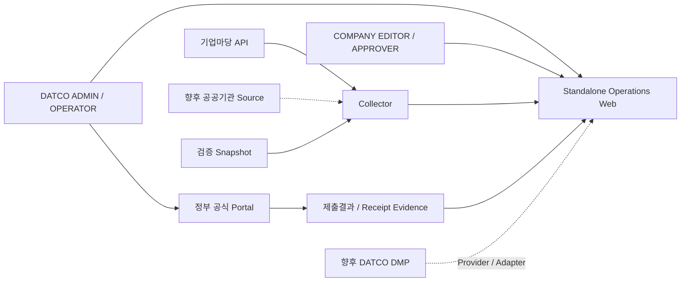
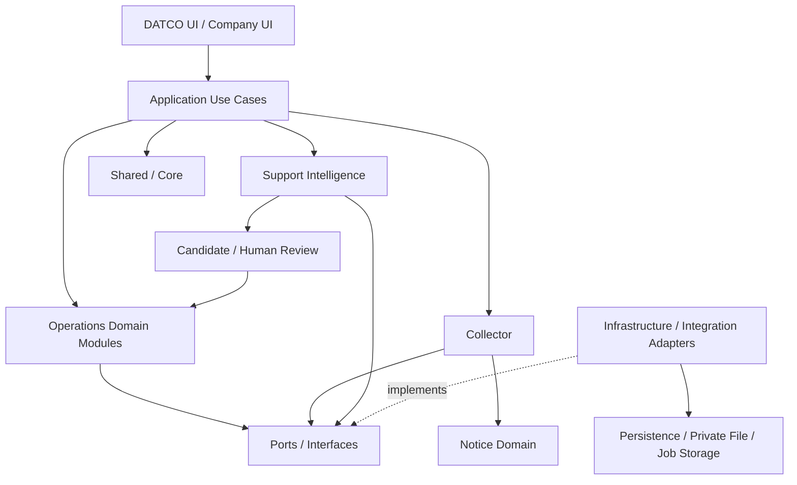
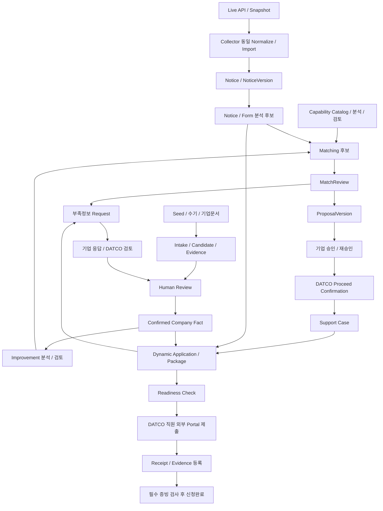
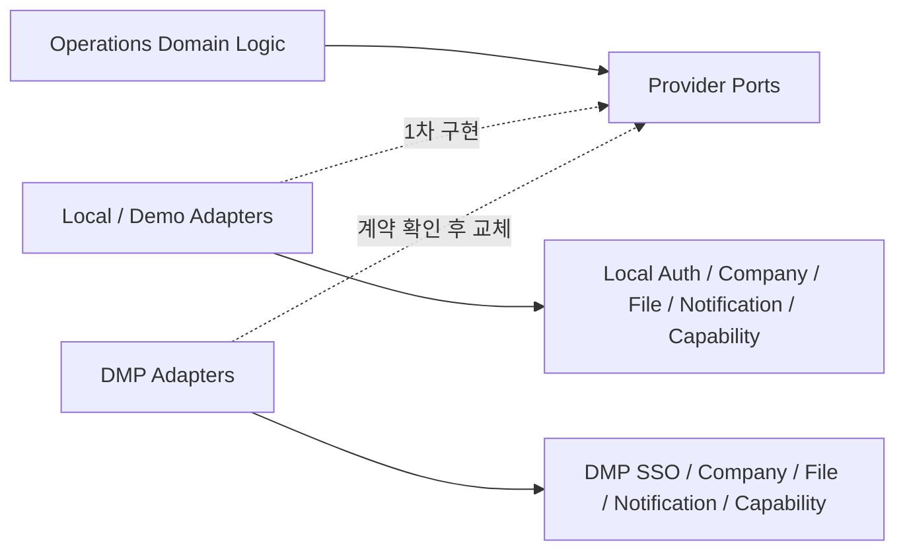

# DATCO 정부지원사업 운영체계 - System Architecture

## 1. 문서 역할과 적용 범위

이 문서는 Project Baseline을 실제 시스템 구조로 구체화하는 Architecture 기준서다. AGENTS.md와 00_PROJECT_BASELINE.md에 따라 사용자, 시스템 경계, Module 책임, 데이터 전달, 공통 Core, 외부 Integration, 1차 Demo 및 향후 DMP 전환 구조를 정의한다.
Project Root는 `C:\Users\PC\Desktop\정부지원사업운영체제 구축\dongalab`이다. Git Root는 작업 전 실제 상태로 확인한다.
이 문서는 논리적 구조와 물리적 배치의 기본방향을 정하며 Framework, DB 제품, API Schema, 상세 Permission, 실제 디렉터리 구조를 확정하지 않는다. 이후 Data Model, State/Action, Permission, Collector, Intelligence, 화면 및 Demo/Test 문서가 세부 계약을 구체화한다.

## 2. 최상위 Architecture 원칙

1차 구현은 Browser 기반 Standalone Web Application이며 초기 구조는 Modular Monolith를 우선한다. 불필요한 Microservice 분리 없이 Collector, Intelligence, Operations, Integration, Shared/Core의 논리적 경계를 유지한다.
기업마당 API Collector는 본 프로젝트 필수 개발범위다. Intelligence는 분석 후보를 제공하고 Operations는 사람 검토와 업무 확정을 담당한다.
Domain Logic과 외부 Integration을 분리한다. Backend Authorization, Company Scope, Version, Audit, Retry를 공통 기반으로 사용한다.
Live API와 Snapshot은 동일 Normalization 및 후속 Domain Logic을 통과한다. DMP 실제 Contract 확인 전에 가짜 API 계약을 확정하지 않는다.

## 3. Actor와 외부 시스템

| Actor/System | 수행 책임 | 경계 |
| --- | --- | --- |
| DATCO_ADMIN | 기준정보, Capability, 사용자/권한, 시스템 관리 | 상세 권한은 후속 Matrix로 결정. 관리자도 상태/감사 규칙 적용 |
| DATCO_OPERATOR | 기업자료/분석/Match 검토, Request, Proposal, 추진확정, Case/Package, 제출증빙 관리 | 분석 후보를 검토하며 기업 승인이나 외부 제출 사실을 임의 대체하지 않음 |
| COMPANY_EDITOR | 자기 기업 정보/문서/현장자료, Request 응답과 보완 | 다른 기업 및 비공개 DATCO 정보 접근 불가 |
| COMPANY_APPROVER | 자기 기업 Proposal Version·책임범위 확인, 승인/재승인 | 다른 Version의 승인으로 현재 Version을 자동 승인하지 않음 |
| 기업마당 API | 공고 원천 제공 | 업무 승인/기업 Fact 확정은 내부 시스템 책임 |
| 기타 공공기관 Source | 향후 공고 원천 확장 | Connector를 통해 연결 |
| 정부 공식 신청 Portal | 실제 제출/접수 사실의 공식 원천 | 우리 Web에서 재구현하거나 1차 자동제출하지 않음 |
| DATCO DMP | 향후 SSO/Company/User/File/Notification/Service Master 제공 | 현재 API 계약 미확정. Domain에 직접 종속시키지 않음 |

## 4. System Context Diagram



DATCO와 기업 사용자는 같은 Backend Domain을 사용하는 Web에 접근한다. 공고는 Collector를 통해 공급하고, 실제 제출은 DATCO 직원이 외부 Portal에서 수행한다. 결과/증빙은 Web에서 연결 관리한다. DMP는 향후 Adapter로 연결되는 별도 플랫폼이다.

## 5. Logical Layer와 Module Architecture Diagram



Presentation는 Use Case를 호출한다. Application은 Domain Module과 공통 정책을 조합하고, Infrastructure는 Domain이 필요로 하는 Port를 구현한다. 이 도식의 Module은 별도 서비스 배포 단위가 아니다.
DATCO UI와 Company UI는 같은 Backend를 사용하지만 Role, State, Data Scope에 따라 정보와 Action을 달리한다.
주요 화면은 Dashboard, Company, Fact/Intake, Improvement Workspace, Notice, Analysis Review, Capability, Match Review, Information Request, Proposal/Approval, Dynamic Application, Package, Case, Task/Schedule/Evidence, Operations Dashboard/Audit이다. UI가 Domain 저장소에 직접 쓰지 않는다.

## 6. Application / Domain Module 책임

다음 데이터 소유권은 논리적 책임이며 테이블/물리 Schema 확정은 아니다. Module 간 조회·명령은 Application Service/Port를 사용하고 다른 Module 저장소에 직접 쓰지 않는다.

| Module | 책임 | 입력 → 출력 | 소유 핵심 데이터 | 의존/연결 |
| --- | --- | --- | --- | --- |
| Company | 기업/Site/연락처와 기업 식별 기준 | Provider/검토된 입력 → 기업 식별/조회 | 내부 Company/Site 관계와 Provider ID 매핑 | CompanyProvider, Authorization. 추출 Candidate로 Master 자동 덮어쓰기 금지 |
| Enterprise Intake | 기업자료 수신·입력 세션·추출 검토 준비 | Seed/수기/업로드 → Intake/Extraction Candidate | Intake, 입력 출처, Candidate 연결 | Company, File Port, Analysis Job, Evidence |
| Company Fact | 검증된 기업 Fact와 충돌 관리 | Candidate/검토 → Confirmed Fact Version | Fact, Verification, Conflict, Source/기간/단위 | Intake, Company, Evidence; Matching/Application에 조회 제공 |
| Notice | 내부 정규화 공고와 버전·원천 연결 | Collector 정규화 결과 → Notice/NoticeVersion | 내부 Notice ID, Version, 원천/첨부 참조 | Collector import Port, Versioning; 분석/Matching에 제공 |
| Improvement | 기업 문제·개선목표·지원과제 | Fact/현장자료/분석 후보 → 검토된 Improvement | Improvement, Task 요구, 근거/Version | Company Fact, Intake/Evidence, Intelligence |
| DATCO Capability | 서비스 기능·조건·근거 Catalog | Local/Provider 입력·후보 → 검토된 Capability | Capability Catalog/Version/조건 | CapabilityProvider, Intelligence; Matching에 제공 |
| Matching | 3-way 분석 및 MatchReview | Fact/Improvement/Capability/Notice → 후보/검토결과 | Match Candidate, Review, 사유, 입력 Version 참조 | Intelligence, 각 조회 Port, Request/Proposal |
| Information Request | 부족정보 요청·응답·보완·검증 | Missing Information/기업 응답 → Verified/Revision Requested | Request, Response, 응답 의미/이력 | Company Scope, File/Evidence, Fact 확인 Use Case |
| Proposal | 제안 범위·사업비·기업부담 버전 | 검토된 Match/확인정보 → ProposalVersion | Proposal 및 Version/Snapshot | Matching, Fact, Capability, Approval |
| Approval | 특정 Version 대상 승인/재승인 | ApprovalRequest/기업 판단 → Approval 기록 | 요청/결정/승인 Version/행위자/시각 | Proposal, Authorization, Audit |
| Dynamic Application | 공고별 Template와 매핑·입력 | NoticeVersion/Form 분석/Fact → Template/입력 후보 | Template Version, Field/Section/문서/평가기준/매핑 규칙 | Intelligence, Fact, Request, Case |
| Application Package | 제출준비와 준비조건 검사 | Application/문서/승인 → 준비상태/제출 Snapshot | Package Version, 체크리스트, Readiness | Case, Dynamic Application, Evidence, Approval |
| Support Case | 추진확정 이후 업무 Life Cycle | 검토/기업확인/추진확정 → Case/단계 | Case, Proceed Decision, 결과/단계 참조 | Matching, Approval, Package, Task/Evidence |
| Task / Schedule | Case 업무·담당·일정 관리 | Case 단계/요구 → Task/일정/진행 | Task, Schedule, 담당/상태 | Case, Evidence, Notification |
| Evidence | 근거/파일/접수증과 대상 연결 | File 참조/원천/검증 → Evidence 연결 | Evidence 메타데이터, 대상/Version/검증 | File Port, Authorization; Domain과 연결 |
| Audit / Workflow | 업무 감사 연결과 전이 정책 적용 | Domain Action/정책 → 감사기록/검증된 전이 | Audit 기록 및 전이 실행 이력 | Shared Audit/Workflow 사용. 객체 상태/Guard 정의는 해당 Domain 소유 |

## 7. Collector 구성과 Notice 소유권

필수 Subcomponent는 Source Connector Interface, Bizinfo API Connector, Collection Job, Pagination Handler, Raw Source Capture, Normalizer, Duplicate Detector, Notice Version Manager, Change Detector, Attachment/Original Source Handler, Retry/Error Log, Manual Sync, Future Scheduler, Snapshot Import Adapter이다.
Collector는 외부 수집과 Raw Source/수집 이력을 소유한다. Notice Version Manager는 Notice Domain의 import/Version 정책을 호출하며 별도의 경쟁 Notice 저장모델을 만들지 않는다.
Connector는 실제 외부 응답을 Raw Source로 전달하고 Normalizer는 내부 import 모델로 변환한다. Source별 Field는 후속 Collector 설계에서 실제 응답 확인 후 정한다.
Web의 수동 Sync는 Collection Job을 요청한다. Web/Intelligence가 기업마당 API를 별도로 직접 호출하지 않는다.

## 8. 기업마당 API Data Flow와 장애격리

기업마당 API → BizinfoApiConnector → Raw Source Record → Normalization → Duplicate/Idempotency Check → Notice → NoticeVersion → Attachment/Original Source Link → Notice Analysis → Match Candidate → MatchReview → Operations Web.

External ID는 외부 Source의 식별자이며 Internal ID는 내부 Notice 식별자다. Source 식별과 External ID를 연결해 반복수집을 판별하며 실제 키 형식/중복판정 기준은 후속 설계에서 검증한다.
동일 내용 재수집은 기존 Notice를 재사용하고 수집이력은 추적한다. 수정공고는 변경검사에 따라 새 NoticeVersion을 보존하고 후속 Change Impact 검토를 요청한다. 동시 import도 중복 Notice를 만들지 않도록 원자적 idempotency 검증을 수행한다.
수집 실행은 일반 Web 조회와 분리된 Job으로 처리한다. 수집 실패는 Job 상태/로그/Retry에 남기고 기존 저장 Notice의 조회를 유지한다. 동일 프로세스 내 논리적 격리이며 완전한 프로세스 장애격리는 아니다. 시간제한과 실행량 통제, 필요 시 Worker 분리를 후속 설계한다.
Snapshot Import Adapter도 Raw Source/provenance를 남긴 뒤 동일 Normalizer, idempotency, Notice Version 정책을 사용한다. 수집 모드/출처를 구분하고 분석·Matching·업무 로직을 우회하지 않는다.
실제 기업마당 Field 이름, Pagination/응답/첨부 구조는 `06_BIZINFO_COLLECTOR.md`에서 실제 API 문서/응답 확인 후 확정한다.

## 9. Support Intelligence

| Component | 입력 | 출력 및 경계 |
| --- | --- | --- |
| Notice/Form Analyzer | NoticeVersion, 원문/서식 | Requirement/Form/평가기준 후보 |
| Enterprise Document Analyzer | 기업문서/Source Location | 기업정보 Extraction Candidate |
| Company Improvement Analyzer | Fact, 문제/현장자료 | 개선과제/Required Function 후보 |
| DATCO Capability Analyzer | 서비스 Catalog/근거 | Capability 적합성 분석 후보 |
| Matching Engine | Fact, Improvement, Capability, Notice Requirement | Match Candidate와 부족정보/반대근거 |
| Application Template/Field Mapping Engine | 검토된 서식/Fact/분석 | Template/자동채움 후보 |
| Change Impact Analyzer | 이전/새 Version, 연결관계 | 영향 객체/재검토 필요 후보 |

모든 결과는 Candidate + Reason + Evidence + Version 형태로 Operations에 반환한다. 입력 Source/Version, 분석 Version, Job 결과를 연결한다. Intelligence가 Fact, Approval, Proposal, Proceed 또는 선정결과를 자동 확정하지 않는다.
Human Review/Confirmation은 해당 Operations Domain의 권한·상태 검사를 거친다. Provider/OCR/LLM 구현은 Port 뒤로 분리하며 제품은 미확정이다.

## 10. Shared / Core

| 공통 기능 | 역할과 Domain 경계 |
| --- | --- |
| Authentication / Authorization | 인증 주체 및 Permission/Role/Company Scope 정책 검사. 업무별 권한 정의는 후속 Matrix |
| Workflow / State Transition | 공통 전이 검증/실행 기반. 각 Domain이 상태와 Guard를 소유 |
| File Abstraction / Notification Abstraction | Private File와 알림 Port, 접근검사 및 Provider 연결 |
| Audit / Versioning | 행위·Version 참조 및 변경이력 보존 기반. Domain이 업무 Snapshot 의미 정의 |
| Analysis Job / Error Handling / Retry | 비동기 실행, 오류/시도/결과 추적과 재시도 기반 |
| Idempotency / Validation | 중복 실행 방지와 입력검증 기반. 업무 키/조건은 Domain 정의 |
| Configuration / Secret Management | Backend 구성과 Secret 접근. Secret 값의 Browser/Git/로그 노출 방지 |

각 Domain이 별도 권한/감사/파일 구현을 중복하지 않는다. Shared는 안정적인 공통 정책과 작은 Port만 포함하며 업무 데이터와 모든 기능을 모으는 공통코드 저장소가 되지 않는다.

## 11. 기업 데이터 Flow

Demo/Seed, Manual Input, Document Upload → Enterprise Intake → Extraction/Input Candidate → Evidence → Human Review → Confirmed Company Fact.
문서는 File Port를 통한 Private 보관 후 분석하고, 수기/Seed도 출처와 검증 상태를 구분한다. 확인되지 않은 Demo 값은 DEMO/SEED로 표시한다.
확정 Fact는 Improvement Analysis, Matching, Dynamic Application Field Mapping에서 같은 Version 참조로 재사용한다. 추출값이 Company Master 또는 기존 Confirmed Fact를 자동 덮어쓰지 않으며 충돌은 검토 대상으로 보존한다.

## 12. 개선과제 / Capability / Matching Flow

Company Fact + Improvement Task + DATCO Capability + Notice Requirement → Matching Engine → Match Analysis Candidate → MatchReview → Missing Information / Hold / Exclude / Proposable → Proposal.
업무상 3-way 관계는 기업 개선/지원과제 × Capability × Notice이며 Company Fact는 자격과 과제 판단의 근거다.
FIT/PARTIAL_FIT/NEED_MORE_INFO/MISMATCH와 Review 후 업무 판단을 구분한다. 정확한 상태명/Transition은 후속 문서에서 확정한다.
Matching Engine은 Proposal이나 Proceed를 자동 확정하지 않는다. DATCO 검토와 필요한 기업 확인/승인을 거친다.

## 13. Information Request Loop

Analysis/Matching/Application → Missing Information → Information Request → Company User → Response/File → DATCO Review → Fact/Request Confirm → Reanalysis/Rematch/Application Update.
Match 단계와 Package 준비 단계에서 동일 Request Module을 재사용한다. Request는 원 요청의 대상/Version/부족항목을 참조하며 값/0/없음/모름/추후 제출/해당 없음을 구분한다.
응답 제출만으로 Fact를 확정하지 않는다. DATCO 검토 후 관련 Fact 확인 Use Case와 Request 상태를 갱신하고 영향받는 분석/입력의 재검토를 요청한다.

## 14. Proposal / Approval Architecture

MatchReview → ProposalVersion → ApprovalRequest → Company Approval을 연결한다. 승인 대상은 특정 Version/Snapshot이며 행위자/시각/결과를 보존한다.
Approved Proposal → 중요변경 → New Proposal Version → Reapproval Required. 기존 Approval은 유지하며 이전 승인이 새 Version을 자동 승인하지 않는다.
Proposal, Approval, Case 생성 Use Case는 현재 승인 대상과 적용 Version의 일치 여부 및 권한/상태/Scope를 검사한다. 상세 중요변경 기준은 State/Action과 Data Model에서 정의한다.

## 15. Support Case Architecture

Match Candidate와 Support Case는 별개다. Match Review 완료 + 필요한 Company Confirmation/Approval + DATCO Proceed Confirmation을 충족해야 Case 생성이 가능하다.
생성조건 검사와 생성은 한 업무 경계에서 일관되게 처리하며 반복 요청이 중복 Case를 생성하지 않게 한다. 실제 트랜잭션/식별 제약은 Data Model에서 확정한다.
Case 흐름은 Baseline의 APPLICATION_PREP → SUBMISSION → EVALUATION → RESULT_CONFIRMED를 유지한다. 결과 단계의 상태명은 Baseline을 기준으로 하며 별도의 중복 상태를 추가하지 않는다.
선정은 SELECTED → AGREEMENT → EXECUTION → INSPECTION → SETTLEMENT → CLOSED, 미선정은 NOT_SELECTED → CLOSED 또는 RECONSIDERATION이다. 미선정 상태에서 AGREEMENT로 자동 진행하지 않는다.
Case는 Package/Task/Schedule/Evidence 및 평가·협약·수행·정산·사후관리와 연결한다. 세부 Guard는 후속 State/Action 문서에서 확정한다.

## 16. Dynamic Application / Package Architecture

NoticeVersion → Notice/Form Analysis → 사람 검토 → ApplicationTemplate을 연결한다. Template은 Form Fields, Plan Sections, Required Documents, Evaluation Criteria, Field Mapping Rules를 포함하며 공고/서식 Version을 참조한다.
Confirmed Company Fact / Improvement Analysis / Capability Analysis → Auto-fill Candidate → 사람 확인 → Application 입력.
Missing Data는 Information Request Loop로 연결한다. 분석 후보를 자동으로 공식 신청값으로 확정하지 않는다.
Application Package → Readiness Check → READY_TO_SUBMIT 흐름은 필수 입력/문서/기업확인/승인 등의 충족을 검사한다. 준비완료는 외부 제출완료와 구분하며 제출할 Version/Snapshot을 보존한다.

## 17. 공식 정부포털 경계

Operations Web은 신청준비를 담당하고 DATCO 직원이 정부 공식포털에서 실제 제출한다. 직원은 제출일시, 제출자, 제출 Version, 접수번호, 접수증/공식 Evidence를 Web에 등록한다.
1차 단계에서 Portal 자체를 복제하거나 자동제출하지 않는다. 접수증 또는 승인된 필수 공식증빙이 없으면 최종 제출/신청완료를 차단한다.
공식 사실의 원천은 외부 Portal이며 내부 입력은 증빙과 연결하여 검토한다. Demo 제출결과/증빙은 실제 제출 사실과 구분한다.

## 18. Main Data Flow Diagram



Collector와 Intake의 데이터는 각각 분석과 사람 검토를 통해 Matching에 모인다. 부족정보는 재사용 가능한 Request Loop로 되돌아가며, 제안/승인/추진확정 이후에만 Case와 신청준비로 진행한다. 외부 제출과 내부 준비완료는 분리한다.

## 19. Background Job / Async Architecture

Notice Analysis, PDF/Document Extraction, Financial Document Analysis, Image/Layout Analysis, Matching, Change Impact Analysis는 장시간 작업으로 취급할 수 있다.
Application은 입력 객체/Version을 참조하는 Job을 등록하고 실행기는 Intelligence/Collector Port를 호출해 결과와 오류를 저장한다. Browser는 상태/결과를 조회하며 장시간 외부 처리를 요청 응답에 묶지 않는다.
초기 DB-backed Job Queue가 가능한 구조를 둔다. 구체 Queue 제품과 프로세스 배치는 미확정이다.
대표 Analysis Job 상태는 QUEUED, PROCESSING, REVIEW_REQUIRED, CONFIRMED, FAILED이다. 성공한 분석 결과도 REVIEW_REQUIRED를 거쳐 사람 확인하며 Collector Job 상태와 동일 enum이라고 가정하지 않는다.
입력 Version, 분석 Version, 시도횟수, Error Reason, 결과를 추적하고 Retry를 지원한다. 재시도 중복 실행과 오래된 입력 결과의 확정은 idempotency/Version 검사를 거친다.
실행량, timeout, 재시도 한계, 재시작 후 실행 복구는 후속 설계에서 정한다. Worker 분리 시에도 동일 Use Case와 Port를 유지한다.

## 20. Source of Truth

| 데이터 | 논리적 소유/기준 원천 | 소비 및 경계 |
| --- | --- | --- |
| 공고 Raw/수집정보 | Collector | 원천/수집 provenance. Secret은 Raw/로그에 저장하지 않음 |
| 정규화 Notice/Version | Notice Domain | 분석/Matching/Web이 동일 내부 모델 사용 |
| Confirmed Company Fact | Company Fact Domain, Operations | 출처·검증·기간·Version 보존 |
| Improvement | Improvement Domain | 분석 후보와 검토된 과제 구분 |
| Capability | Capability Domain | Local Catalog 기준, 향후 Provider 소유권 확인 |
| MatchReview | Matching/Operations | Intelligence 후보를 검토한 업무 판단 |
| Proposal/Approval | Operations의 해당 Domain | 특정 Version 승인/재승인 이력 |
| Application Package | Operations | 준비상태와 제출 Snapshot |
| Support Case/Task/Evidence | Operations의 해당 Domain | 업무 단계/일정/근거 연결 |
| 공식 제출 사실 | 외부 정부 공식포털 | 내부는 Receipt/Evidence 연결 관리 |
| Company Master/Auth/File | 초기 Local Provider, 향후 DMP로 변경 가능 | 실제 계약 확인 후 ID 매핑/소유권/동기화 확정 |

같은 정보를 여러 Module에서 독립 확정하지 않는다. 분석 후보는 확정 Fact나 외부 공식원천을 대체하지 않는다. 물리 테이블 소유권은 Data Model에서 구체화한다.

## 21. Security Boundary

Browser와 Browser가 보낸 Role/Company ID/상태는 신뢰하지 않는다. 신뢰경계는 Backend 검증이며 모든 중요 API는 인증 주체로 Authorization/Company Scope와 필요한 Case Scope를 검사한다.
Internal DATCO Data와 Company-visible Data를 응답/조회 정책에서 분리한다. UI 숨김만으로 보호하지 않는다.
Secret은 Backend 환경변수로 관리하며 기업마당 Key를 Frontend, Git, 로그, 분석 결과에 노출하지 않는다.
실제 기업문서는 Private Storage/File Port로 접근하고 다운로드도 소유 기업/권한을 검증한다. 다운로드, 승인, 중요한 상태변경을 Audit한다.
업로드 형식/크기/내용 검증과 운영 보안·파일 격리 정책은 후속 설계대상이다. 상세 보안정책 및 권한 Matrix는 후속 문서에서 확장한다.

## 22. Integration / Adapter와 DMP 전환 Diagram

| Port 개념 | 1차 구현 방향 | 향후 구현 대상 |
| --- | --- | --- |
| AuthProvider | Local/Demo Auth | DMP SSO |
| CompanyProvider | Local Company | DMP Company/Site/Contact |
| FileProvider | Local Private File | DMP File |
| NotificationProvider | In-App Notification | DMP Notification |
| CapabilityProvider | Local Capability | DMP Capability/Service Master |
| Notice Source Connector | Bizinfo Connector / Snapshot Adapter | 추가 기관 Connector |



Domain은 Port에 의존하고 Local/DMP Adapter가 이를 구현한다. 이는 내부 책임 개념이며 외부 DMP API Schema나 endpoint 확정이 아니다.
DMP 전환 때 사용자/기업/파일 식별 매핑, 데이터 소유권, 인증/권한 의미, 이관/동기화와 기존 Evidence/Version 참조를 검증한다. Provider 교체만으로 모든 통합 문제가 해결된다고 가정하지 않는다.

## 23. Physical Deployment Mode

| 구분 | 1차 Demo Mode | 향후 DMP Mode |
| --- | --- | --- |
| 사용자 접근 | Standalone Browser Web | DMP SSO와 연결된 Web |
| Application | Modular Monolith Backend | Operations Domain을 가능한 유지 |
| Provider | Local/Demo Auth/Company/File/알림/Capability | 검증된 DMP Adapter로 교체 |
| 영속성 | 실제 DB와 실제 Private File 처리 | 업무 DB 및 DMP 소유 데이터 역할 재확인 |
| 공고 수집 | 기업마당 Live API + Snapshot fallback | 동일 Collector/Notice 경계 유지 |
| 장시간 작업 | 논리 Job 실행기, DB-backed Queue 가능 | 필요 시 Collector/Analysis Worker 독립 |

기본 물리 구성은 Browser, Application Backend, 영속 저장소, Private File 보관, Job 실행기의 역할로 설명한다. 별도 호스트/컨테이너 개수, SSR/SPA, Worker 프로세스 분리, DB/파일/Queue 제품과 Cloud는 아직 결정하지 않는다. 초기 논리 실행기는 Monolith 내부로 구현할 수 있으며 운영 규모에 따라 분리한다.
Demo는 DMP 없이 동작하고 실제 DB/File을 사용한다. 저장된 데이터 조회와 Job 실행의 자원 경계를 고려하며 운영 배포 방식은 후속 결정한다.

## 24. Repository Logical Skeleton

아래는 향후 가능한 개념 예시이며 기술 Stack 결정 후 조정한다. 현재 실제 폴더를 생성하거나 확정된 구조로 취급하지 않는다.

```text
apps/
  web/
modules/
  collector/
  company/
  intake/
  fact/
  notice/
  improvement/
  capability/
  matching/
  request/
  proposal/
  approval/
  application/
  package/
  case/
  task/
  evidence/
intelligence/
integrations/
  bizinfo/
  dmp/
shared/
tests/
docs/
```

## 25. Module Dependency와 일관성 원칙

Presentation → Application/Domain → Ports/Interfaces로 의존한다. Infrastructure/Integration은 Port를 구현하며 Domain이 Bizinfo API, DMP API, 특정 DB Library에 직접 의존하지 않는다.
Module 간 조정은 Application Use Case로 수행한다. 서로의 저장소를 직접 갱신하거나 Circular Dependency를 만들지 않는다. ID/Version 참조와 필요한 조회 Port로 연결한다.
상태변경과 관련 Version/Audit 기록은 일관된 업무 경계로 보존한다. 승인 확인/Case 생성/Readiness 검사 시 오래된 Version과 동시 변경을 검출한다. 실제 transaction, 잠금, 이벤트 전달/재처리 방식은 Data Model 및 State/Action에서 확정한다.
같은 DB를 사용해도 논리 데이터 소유권은 유지한다. Background Job이나 외부 호출 실패가 확정 업무 이력을 임의 삭제하지 않도록 한다.

## 26. Architecture Decision Point

이번 기준으로 정한 사항은 Browser Web, Modular Monolith 우선, Collector 필수범위, Logical Module Boundary, Provider/Adapter, Human Review, Version/Audit, Async Job 개념, Standalone → DMP 전환, Live API + Snapshot Strategy이다.
Frontend/Backend Framework, ORM, Database Product, AI/LLM Provider, OCR Product, Queue Product, Cloud Provider, Deployment Platform, File Storage 제품, DMP 실제 API Schema, 기업마당 세부 Field Mapping과 상세 Permission은 미확정이다.
후속 확인으로 기준 변경이 필요하면 영향범위를 보고하고 승인된 범위에서 Baseline/Decision Log와 동기화한다.

## 27. Architecture Risk와 후속 확인

| Risk | 현재 Architecture 대응 | 후속 확인 문서/단계 |
| --- | --- | --- |
| 기업마당 실제 Response/Attachment 구조 | Connector/Normalizer 경계, Raw provenance, Field 추정 금지 | 06 Collector: 실제 문서/응답/첨부 확인 |
| Rate Limit / 외부 장애 | Collection Job, 오류/Retry, 기존 Notice 조회, Snapshot | 06 Collector 및 10 Test: 제한/timeout/재시도 검증 |
| HWP/HWPX 등 포맷 | 추출 Port와 실패/사람 검토 경로 | 07 Intelligence: 포맷 지원과 대체 처리 확인 |
| OCR/문서추출 정확도 | Candidate/Evidence/Conflict/Human Review | 07 Intelligence 및 10 Test: 검증 자료와 정확도 기준 |
| AI 비용/속도 | Async Job, Provider 분리, 실행량 관리 개념 | 07 Intelligence: 비용/지연 측정 및 정책 결정 |
| 대용량 File | Private File Port, 장시간 처리 분리 | 운영 보안/저장소 설계 및 10 Test: 크기/성능/검증 |
| DMP Contract 미확정 | Local Provider, Port/Adapter 경계 | Integration 검증 및 Decision Log: 실제 계약/이관 |
| Company Scope 보안 | Backend Authorization, 비공개 데이터 분리 | 05 Permission 및 10 Test: 직접 URL/API/다운로드 검증 |
| 연구원 간 Schema 변경 충돌 | Domain 소유권, 공통 변경 영향보고 | 03 Data Model, Git Review: 변경 조정/일관성 확인 |
| Demo Live API 의존 | Sanitized Snapshot 동일 Normalize/Domain 흐름 | 09 Demo 및 10 Test: 네트워크 장애 시 E2E |
| Background Analysis 실패 | Job 상태/오류/시도, Retry/Version 검사 | 07 Intelligence 및 10 Test: 실패/복구/중복실행 |
| Monolith 자원/프로세스 장애 | Job 실행량 통제, Worker 분리 가능한 Port | 배포 설계: 부하/장애격리 수준 결정 |

## 28. Architecture Validation

다음 검증은 문서상 경로 추적이며 실행 테스트나 실제 API/DMP 검증 결과가 아니다.

| Scenario | Architecture 경로와 검사 | 검토 결과 |
| --- | --- | --- |
| A: API → Web | Connector → Raw/Normalize → NoticeVersion → 분석 후보 → MatchReview → 권한별 Web | 연결됨. API Field는 후속 확인 |
| B: 사업자등록증 → Fact → Match | Private Upload → Intake/Extraction Candidate/Evidence → Human Review → Confirmed Fact → Matching | 연결됨. 자동 Master 덮어쓰기 없음 |
| C: Missing Info → Re-Match | Request → 기업 응답/File → DATCO 검토 → Fact/Request 확인 → 새 입력 Version으로 Rematch | 연결됨. 미확인 응답 확정 방지 |
| D: 승인 → 중요변경 → 재승인 | 승인된 ProposalVersion → 새 Version → Reapproval Request → 기업 판단 | 연결됨. 이전 승인 보존 |
| E: Proceed → Receipt | 검토/기업확인/승인/추진확정 Guard → Case → Application/Package → Readiness → 직원 Portal 제출 → Receipt/Evidence 검사 | 연결됨. 증빙 없는 신청완료 차단 |
| F: Notice v2 → Re-review | 변경검사/새 Version → Change Impact Candidate → Operations 검토 → 영향 Match/Proposal/Package 재검토 | 연결됨. 과거 Version 보존 |
| G: Live 장애 → Snapshot | Collection 실패기록 → Snapshot Adapter → 동일 Raw/Normalize/Notice import → 분석/업무 Demo | 연결됨. 화면 결과 주입 우회 없음 |
| H: DMP 교체 | 실제 계약 확인 → ID/소유권 검증 → Auth/Company/File Adapter 교체 → 기존 Use Case/Domain 사용 | 개념상 연결됨. 실제 계약과 이관 검증 필요 |
| I: 여러 Company | 인증 주체 → Backend Company Scope → 기업별 조회/Action/File 검증 | 격리 경로 정의. 실제 교차기업 접근 Test 필요 |
| J: 한 Company의 여러 Site | Company의 Site 관계 → Fact/자료의 Site 참조 → 분석/업무 연결 | 다중 Site 수용 원칙 유지. 관계/Scope 상세는 Data Model에서 확정 |
| K: 여러 Notice/Case | Company → 복수 Match 후보 → 각각의 추진확정/Case/Package/Task | 단일 Case로 고정하지 않음. 중복 생성 방지와 정당한 복수 Case를 구분해 검증 |
| L: 담당자 변경/이관 | 권한 검사 → Case/Task 담당 변경 → Audit → 새 담당자 업무 조회 | 업무 ID/과거 행위자 이력 유지. 상세 이관 권한은 Permission에서 확정 |
| M: Deadline 임박/초과 | 공고/업무 due date → Schedule 판별 → Dashboard/Notification | 식별 경로 정의. 시간 기준/임박 기준은 후속 확정 |
| N: Application/Job 재시작 | 영속 업무/Job 조회 → 실패·중단 실행 확인 → Version/idempotency 검사 → Retry | 확정 결과 보존. 중단 Job 복구정책은 후속 설계/실행 Test 필요 |
| O: Backup/Restore | 일관된 DB/파일 복구 → Version/Audit/Evidence 참조 및 파일 존재 검증 | 검증 경계 정의. 실제 복구 Test와 수용기준 필요 |

상세 실행 Test와 수용기준은 향후 `10_TEST_ACCEPTANCE.md`에서 정의한다. 문서상 경로 정의는 실제 운영 복구나 보안 검증의 완료를 의미하지 않는다.
후속 구현의 완료 판단은 정상/예외 E2E, Company Scope, Version/승인, Evidence, 중복수집, 변경감지, Retry, Audit 및 새로고침 후 영속성 테스트로 검증한다.

## 29. Operational Reliability / 운영 안정성

기존 Modular Monolith와 Domain/Shared/Adapter 경계 안에서 다음 운영 Capability를 수용한다. 별도 Microservice를 추가하지 않으며 Backup, Scheduler, Message Broker, Queue, Notification SaaS, DB, Cloud, Monitoring 제품을 확정하지 않는다.

### Deadline / Dependency

Task/Schedule은 due date, prerequisite/dependency, overdue, blocked/waiting 개념을 지원한다. Notice 마감일과 내부 업무기한을 구분하고 Case/Task와 연결한다. Dashboard는 마감임박·초과·선행업무 대기 대상을 식별한다. 담당자 변경 시에도 Case/Task 식별과 기존 Audit History를 유지하며 새 담당자의 권한을 검사한다.
정확한 State/Schema, 시간 기준, 마감임박 기준, 의존조건과 이관 정책은 Data Model, State/Action, Permission에서 확정한다.

### Notification / Alert

Information Request sent, Approval requested, Revision requested, Deadline approaching, Task overdue, Notice changed/impact review required를 Notification Abstraction의 논리 Event로 수용한다.
관련 Domain/Use Case가 대상 객체와 기업 Scope를 제공하고 공통 알림 Port가 수신자의 권한과 공개범위를 적용한다. 1차 In-App, 향후 DMP Notification Provider 구조를 유지한다. 알림 수신 자체는 업무 승인이나 상태전이가 아니다.
Event 형식, 전달/중복처리, 임박 판별 실행방식은 후속 설계에서 정한다.

### Backup / Restore 경계

복구대상은 업무 DB, File/Evidence metadata, 실제 파일 저장소, Version/Audit이다. DB와 파일 복구시점의 일관성을 고려하고 복구 후 Domain ID/Version/Approval/Evidence 참조 및 실제 파일 존재를 검증해야 한다.
누락·불일치를 정상 업무로 간주하지 않고 식별·검토한다. 파일 Provider가 DMP로 교체되면 복구 책임과 참조 복원 가능성을 실제 계약으로 확인한다.
Backup/Restore 제품, 운영주기, 보존기간, 복구목표와 실행절차는 후속 결정한다. Backup 존재만으로 복구 검증을 완료했다고 판단하지 않는다.

### Import / Export 경계

Collector Snapshot Import는 동일 공고 Normalize/import 경로를 사용한다. 업무데이터 Import는 관리자 Use Case로 각 Domain의 Validation/Scope/Version/idempotency/상태 정책을 거친다. Report/Data Export는 권한과 공개범위에 맞춘 조회/내보내기 Use Case다.
세 기능을 구분하고 필요한 Demo/Test 데이터 이동을 지원할 확장 경계를 둔다. 실제 기업자료/Secret을 Demo 자산으로 옮기지 않는다. 형식·대상·권한·이동 정책은 후속 설계/Test에서 확정한다.

### Operational Recovery

Application/Job 재시작 후 저장된 업무상태와 확정 결과는 유지한다. 영속 Job 상태/오류/시도이력을 조회하여 실패 및 중단 실행을 확인하고, 현재 입력 Version과 idempotency를 검사한 뒤 정책에 따라 Retry한다.
재시작을 이유로 확정 업무결과·승인·Audit을 삭제하거나 PROCESSING Job을 성공으로 간주하지 않는다. 중단 실행의 재판별/재시도 정책은 후속 설계에서 정한다. 복구와 Retry의 실제 수용기준은 10 Test에서 검증한다.
