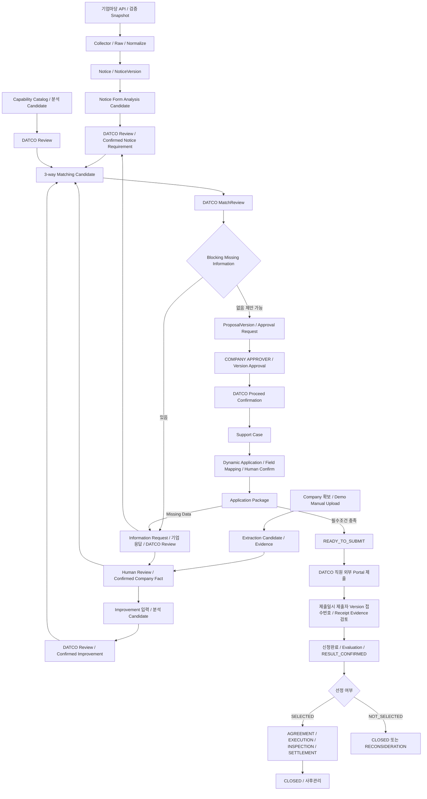
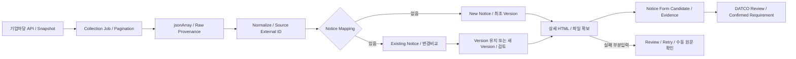
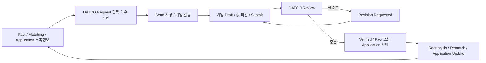
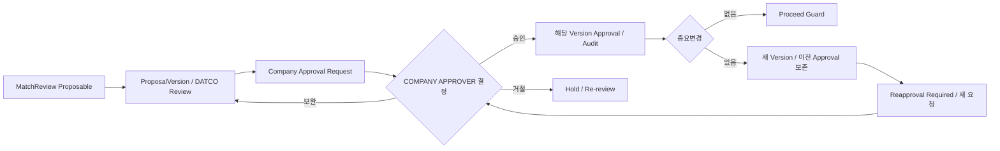
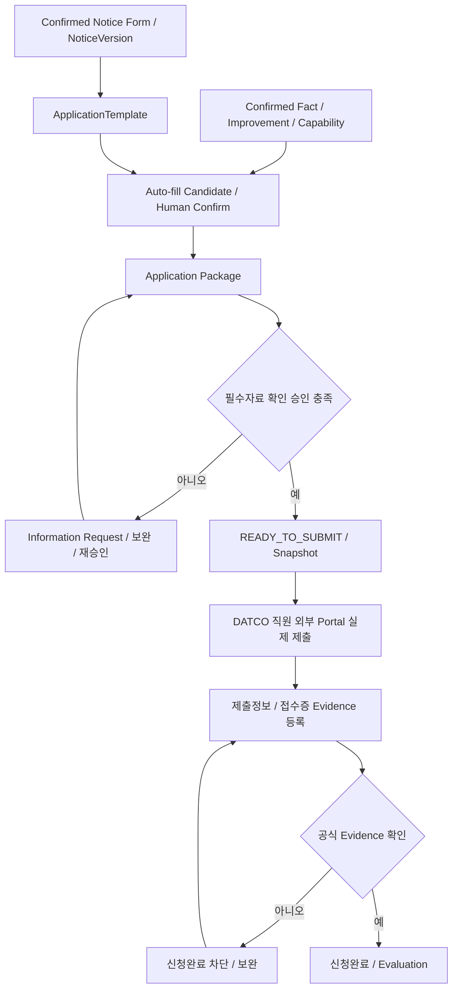
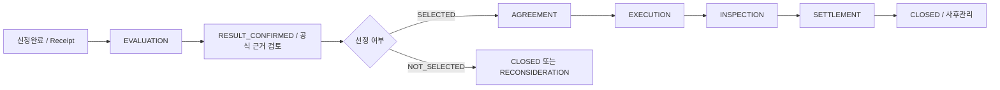
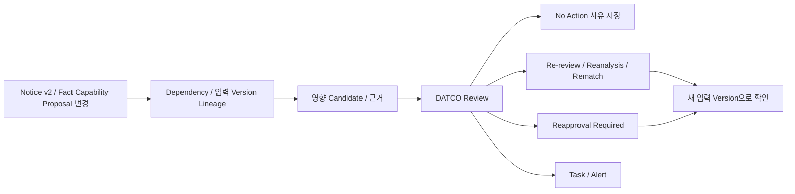
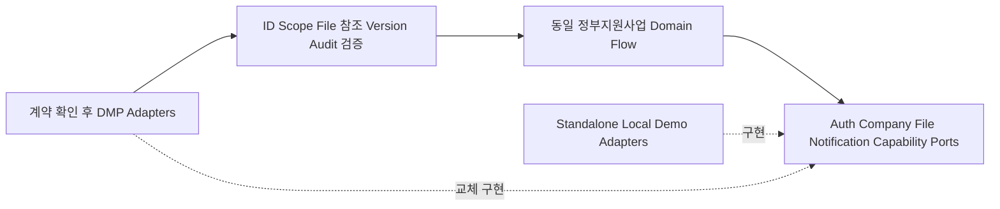

# DATCO 정부지원사업 운영체계 - End-to-End System Flow

## 1. 역할, 기준과 확정 범위

이 문서는 Architecture의 Module을 실제 사용자·시스템·데이터의 순서로 연결하는 업무흐름 기준서다. 업무 순서, Actor/System/Data handoff, Human Review, Blocking Condition, 완료조건, 정상/예외 복귀경로를 정의한다. 화면을 여는 순서만을 정의하지 않는다.
기준 우선순위는 [AGENTS](../AGENTS.md) → [Project Baseline](00_PROJECT_BASELINE.md) → [System Architecture](01_SYSTEM_ARCHITECTURE.md) → 실제 [1차 Probe](../tools/bizinfo-probe/ANALYSIS.md)/[2차 Probe](../tools/bizinfo-probe/PHASE2_ANALYSIS.md) → 이 문서다. Probe는 외부 API 가정을 보완하는 관찰근거이며 제품목표 변경 권한이 아니다.
DB 물리 Schema, 내부 API Endpoint 설계, 버튼 디자인/색상/위치, 모든 State enum, 상세 Permission Matrix, Framework/DB/ORM, Queue/Cloud, AI/OCR Provider는 여기서 확정하지 않는다. Flow의 Object/상태 표현은 업무 의미와 관계 요구이며 후속 세부설계 대상이다.
Project Root는 `dongalab`이다. 기존 Modular Monolith와 Provider/Adapter 경계를 유지한다. 모든 중요한 저장/조회/전이는 Backend Permission + State + Company/Case Scope 검사를 거치며 Version/Audit를 보존한다.

## 2. Actor / System과 공통 handoff

| 구분 | Actor/System | Flow 책임 |
| --- | --- | --- |
| Human | DATCO_ADMIN | 기준정보, Capability Catalog, 사용자/권한 및 승인된 운영관리 |
| Human | DATCO_OPERATOR | 자료/분석/Match 검토, Request/Proposal, 추진확정, Case/Package/Task, 외부 제출결과·Evidence 검토 |
| Human | COMPANY_EDITOR | 자기 기업 입력/파일/개선요구, Request 응답·보완 |
| Human | COMPANY_APPROVER | 자기 기업의 특정 ProposalVersion 확인·승인·재승인 |
| System | Government Support Collector / Notice Domain | 외부 수집·Raw provenance와 내부 공고/Version 저장을 각각 담당 |
| System | Support Intelligence / Background Job | 입력 Version 기반 분석 Candidate와 오류/시도/결과 관리. 최종 업무판정 자동확정 금지 |
| System | Operations Web | 사용자 Action을 해당 Domain Use Case로 전달하고 저장된 상태/결과 표시 |
| System | File / Evidence | Private 파일·원천/근거 위치와 업무 Object/Version 연결 |
| System | Audit / Notification | 변경/승인 이력과 Scope에 맞는 알림 전달 |
| External | 기업마당 API / 향후 기타 공공기관 Source | 공고 원천. Connector 확장 대상 |
| External | 정부지원사업 공식 Portal | 실제 신청/접수의 공식원천. DATCO 직원이 외부 제출 |
| Future | DATCO DMP | Auth/Company/File/Notification/Capability Provider 전환 대상 |

공통 완료조건은 저장된 Object/State/Version/Evidence 변화다. 정보요청 화면 열기 ≠ Request Sent, Proposal 조회 ≠ Approved, Portal 열기 ≠ Submitted, 접수번호 입력 ≠ Evidence Verified, 분석결과 생성 ≠ Confirmed Fact다.
UI는 저장 성공과 검증 결과를 확인하여 다음 Actor에게 전달한다. Draft/실패/부분 입력을 완료로 표현하지 않는다. Module 간에는 ID/Version/Source 참조를 전달하며 다른 Module 저장소를 직접 갱신하지 않는다.
각 Flow의 권한은 역할 책임 수준이며 상세 Action 권한은 05 문서에서 확정한다. 변경과 승인 대상 Version을 확인한 후 저장하고 동시 변경/반복 실행은 내부 일관성 정책으로 처리한다.

## 3. Master E2E Happy Path

공고, 기업 Fact/Improvement, Capability는 병렬로 준비되고 검토된 입력들이 Matching에서 합쳐진다. 부족정보는 기업 응답과 DATCO 검토를 거쳐 원래 분석/입력으로 돌아간다. 승인과 추진확정 뒤에만 Case를 만들고, 준비완료와 외부 제출/공식증빙 확인을 구분한다. 미선정은 선정 후 협약 흐름으로 자동 연결하지 않는다.
기업응답이 Notice Requirement 검토로 이어지는 경우에도 공식 공고조건의 확정은 공식 Source 근거를 다시 확인한다. 기업응답 자체가 공식조건의 원천을 대체하지 않는다.

## 4. 실제 API 근거와 미확정 경계

| 근거 구분 | 관찰/책임 | 이 문서에서의 적용 |
| --- | --- | --- |
| CONFIRMED | GET /uss/rss/bizinfoApi.do, query crtfcKey, dataType=json, 실제 jsonArray 배열 | Backend Collector 입력 경로. Secret 값/인증 URL을 로그·문서·Frontend에 남기지 않음 |
| CONFIRMED | pageIndex/pageUnit, 2차 Probe 당시 totCnt=1423; searchCnt=0/pageUnit=2에서 712페이지 1건, 713페이지 200/빈 배열 | 해당 조건의 종료 경로 근거. 1423을 고정 상수로 사용하지 않음 |
| CONFIRMED | pblancId, pblancNm, jrsdInsttNm/excInsttNm, reqstBeginEndDe, creatPnttm/updtPnttm, bsnsSumryCn | Source ID/제목/기관/기간 원문/시각/개요의 내부 입력 후보 |
| CONFIRMED | pblancUrl 상세 HTML 200, API 제공 flpthNm 및 printFlpthNm URL에서 PDF 헤더 확인 | 현실적인 Source Acquisition 경로. 전체문서 다운로드·추출 성공 증명 아님 |
| PARTIALLY_CONFIRMED | 전체본문 추출규칙, 첨부 역할/다중구조, HWP/HWPX 등 포맷, 수정시각의 변경보장, Snapshot 의미분석 충분성 | 확보/분류/추출 후보와 검토·실패/부분입력 복귀 경로를 정의, 세부 정책은 미확정 |
| INTERNAL_POLICY | Internal ID, Duplicate/Version/Hash/동시성/Job 정책 | 내부 책임을 명시하되 Schema·알고리즘 확정 안 함 |
| UNCONFIRMED | 인증오류, 429/5xx, Rate Limit, Retry-After, 전체 오류정책 | 오류/재시도 경계만 정의. 응답 형식·횟수·대기값을 추정하지 않음 |

`fileNm/printFileNm`은 파일명 참조이며 print 파일의 정확한 역할은 아직 미확정이다. API 기간에는 `2026-10-01 ~ 2026-10-23`와 `2020.01.01 ~ 2026.12.31`이 관찰됐고 첨부 결측도 있었다. 문자열 원문과 결측을 보존하며 존재하지 않는 필드를 가정하지 않는다.
이 근거는 기존 Probe 시점의 사실이다. 이 문서 작성 중 추가 네트워크 호출은 하지 않는다. 1차 마스킹 샘플은 구조 확인용이며 대표 의미분석 Demo의 충분한 Fixture로 간주하지 않는다.

## 5. 공고 확보와 분석

### FLOW-01: 기업마당 공고 수집

- 목적/Primary Actor: DATCO_OPERATOR의 수동 동기화 요청 또는 향후 승인된 Scheduler 실행으로 원천 공고 확보.
- Supporting System: Government Support Collector, Background Job, 기업마당 API, Audit.
- 시작조건/입력: 허용된 수집 요청과 Backend Secret 구성, Source·비밀 제외 요청조건. 검증 Snapshot Import도 동일 처리 경로로 진입.
- 생성/변경 Object: Collection Job, Raw Source/Provenance, 페이지/항목 처리 결과.
- 정상 Flow: 요청 저장 → Job 실행 → pageIndex/pageUnit 요청 → HTTP/JSON 검증 → jsonArray 읽기 → 인증정보 제외 Raw와 Source/수집시각/요청조건 연결 → Normalize 입력 전달.
- Human Review/Blocking: 수집 자체는 Fact/Requirement 확정 아님. 인증구성 부족, 응답 오류/구조 불일치는 정상 import 차단. Raw에 개인정보가 있으면 비공개 보관/공유 Sanitization 구분.
- 완료조건/예외: 저장된 수집 결과와 항목 처리상태. 실패·중단은 오류를 Secret 없이 기록하고 FLOW-26으로, Live 장애 시 검증 Snapshot을 사용하되 모드/출처를 구분.
- 다음 Flow: FLOW-02/03. Web와 Intelligence가 같은 공고를 별도로 다시 수집하지 않는다.

### FLOW-02: Pagination과 종료

- Primary/System: Collector / Collection Job. 입력은 첫 페이지의 배열과 totCnt, pageUnit, 검색조건.
- 정상 Flow: 첫 페이지 → totCnt 확인 → 예상 마지막 페이지 계산 → 필요한 페이지 수집 → 배열길이/빈 배열/중복과 건수 일관성 확인 → 실행결과 저장.
- 실제 근거: 1423/2의 마지막 후보 712는 1건, 다음 713은 200의 빈 jsonArray였다. 빈 항목 배열에는 totCnt가 없었다.
- Object/완료조건: 페이지 처리이력과 수집완료 또는 부분/실패 결과. 빈 배열을 오류 Response로 취급하지 않는다.
- Blocking/복귀: 실행 중 추가/삭제/정렬 변동, 건수 불일치, 오류는 무조건 전체완료로 처리하지 않고 부분결과·검토/재시도로 연결한다.
- Human Review/다음: 불일치/중단 실행은 운영자 검토, 확보 항목은 FLOW-03. searchCnt 의미, 필터별 종료, 변동 데이터, 제한/최대실행건수/재시도는 06에서 확정한다. **종료경로는 실제 검증됐으나 Production 안정성 정책은 Collector 상세설계에서 확정한다.**

### FLOW-03: Normalize / Notice 생성과 중복판정

- Primary/System: Collector → Notice Domain. 시작조건은 검증된 Raw Item, 입력은 관찰된 공고 필드와 Source.
- 정상 Flow: Raw Item → Source+pblancId 확인 → 기존 Notice Mapping 조회 → 없음은 New Notice/Internal ID, 있음은 Existing Notice 재사용 → 정규화 입력/원천/기간 원문/첨부 참조 보존.
- Object: Source ID 매핑, Notice, 최초 NoticeVersion 또는 기존 Version 비교 입력. 실제 필드를 DB Column으로 확정하지 않는다.
- Human Review/Blocking: 결측/파싱불가/ID 충돌은 검증·Review 대상이며 임의 사실값을 채우지 않는다. 재수집마다 새 Notice 생성 금지.
- 완료조건/복귀: Internal Notice ID와 Source/External ID의 저장된 연결. 동시 import/Unique Constraint/중복키 정책은 03/06에서 정하고 오류는 FLOW-26으로.
- 다음: 최초 Version은 FLOW-05/06, 기존 공고는 FLOW-04. 다른 Source와의 장기 External ID 안정성은 후속 확인.

### FLOW-04: NoticeVersion / 변경감지

- Primary/System: Collector·Notice Domain, DATCO_OPERATOR 검토; 입력은 기존 Version과 재수집 입력.
- 정상 Flow: updtPnttm 신호 확인 → 핵심 정규화 내용 비교 → 기간/첨부 metadata 비교 → 변경판정.
- Object/분기: 변경 없음은 기존 Version 유지/수집이력 연결. 의미 있는 변경 후보는 새 NoticeVersion 또는 변경 검토 대상으로 보존하고 검증 후 Notice Reanalysis/Change Impact로 연결.
- Human Review/Blocking: updtPnttm만으로 모든 업무변경을 보장하지 않는다. 의미/파싱이 불명확하면 검토한다. inqireCo/totCnt를 업무 Version 변경으로 취급하지 않는다.
- 완료조건/복귀/다음: 변경판정 근거·대상 Version이 저장돼야 한다. 기존 Version/승인 이력을 삭제하지 않고 FLOW-06/25로 전달한다. Hash 알고리즘/의미변경 기준은 INTERNAL_POLICY로 06에서 확정.

### FLOW-05: 상세/원문/첨부 확보

- Primary/System: Collector Source Content Acquisition, File/Evidence, Background Job; 필요 시 DATCO_OPERATOR.
- 시작조건/입력: NoticeVersion과 pblancUrl, flpthNm/fileNm, printFlpthNm/printFileNm 참조.
- 정상 Flow: 제공 참조 검증 → Source 확보 → 실제 응답/파일형식 확인 → NoticeVersion에 Source/Evidence 연결 → Document Classification → Extraction Candidate 입력.
- 실제 경로: pblancUrl HTML 200, API URL 그대로 파일 접근/PDF 헤더 확인. 다운로드 URL을 추측하여 조합하지 않는다.
- Blocking/Review: Production HTML selector, 전체본문 완전성, 다중첨부/다른 포맷, print 역할 미확정. 부족/실패는 Failed 또는 Partial Input으로 표시하고 DATCO 검토/Retry/수동 원문 확인으로 복귀한다. 확보되지 않은 자료를 확보완료로 표시하지 않는다.
- 완료조건/다음: 실제 확보 Source와 형식/범위/실패 상태의 연결 저장 후 FLOW-06. Probe prefix 확인과 Production 전체파일 확보를 구분한다.

### FLOW-06: Notice/Form Analysis와 Requirement 확정

- 목적/Primary: DATCO_OPERATOR가 공고 조건/서식을 검토·확정한다. Supporting: Support Intelligence, Background Job, File/Evidence, Notice Domain.
- 시작조건/입력: NoticeVersion + API metadata + 확보된 상세/첨부, 입력 확보수준과 Source Location.
- 정상 Flow: Analysis Job → Eligibility/Support Scope/Application Period/Required Document/Form Field/Plan Section/Evaluation Criteria/Conditional Requirement Candidate → Reason/Evidence/Source Location → DATCO Review → Confirmed Notice Requirement.
- Object: 분석 입력/결과 Version, Candidate, Review, 확인된 Requirement와 NoticeVersion 참조.
- Blocking/복귀: Partial Input/근거 부족/충돌/지원불가 포맷은 미확정 항목으로 남기고 FLOW-05/13/26으로. 기업에게 요청 가능한 자료 부족은 FLOW-13, 공고 공식조건 불명확은 운영자의 공식원문 검토로 해결하며 기업응답만으로 공식 공고조건을 바꾸지 않는다.
- 완료조건/다음: 권한 있는 검토자가 근거/확정범위를 저장한 결과. 자동 확정 금지. FLOW-12와 FLOW-19에서 같은 검토 결과/Version 재사용.

Collector가 확보한 동일 Notice/Version이 분석과 Web의 기준이다. 자료 확보와 Requirement 확정은 서로 다른 완료조건을 갖는다.

## 6. 기업 이해와 개선과제 / Capability

### FLOW-07: Company 생성/확보

- Primary: DATCO_OPERATOR 또는 자기 기업의 COMPANY_EDITOR, Supporting: Company Domain/CompanyProvider/Operations Web.
- 시작조건/입력: 권한·기업 식별 검증, Demo/Seed, Manual Input, Document Upload의 세 입력경로.
- 정상 Flow: 기업 식별/중복 검토 → Company 확보 → 필요한 여러 Site/Contact 연결 → 입력 출처와 자료를 Intake에 연결.
- Object/Review: Company, Site/Contact, Intake 참조. 문서 추출은 Master를 자동 덮어쓰지 않고 FLOW-08에서 확인. 미확인 동아테크놀로지 값은 DEMO/SEED.
- Blocking/완료조건: 타기업 Scope/식별 충돌은 차단·검토. 저장된 기업과 Site/Contact 연결로 완료, 기업별 여러 후보/Case를 허용한다.
- 예외/다음: 중복/오류는 기존기업 조회·검토로 돌아가고 입력자료는 FLOW-08/09로.

### FLOW-08: 기업문서 / Company Fact

- Primary: COMPANY_EDITOR 또는 DATCO_OPERATOR 입력, DATCO_OPERATOR 검토. Supporting: Enterprise Intake, File/Evidence, Intelligence/Job, Company Fact.
- 시작조건/입력: Company/필요 Site, 사업자등록증·재무제표·공장/기업증빙 또는 수기/Seed 후보.
- 정상 Flow: Upload → Private File/File Metadata → Classification → Extraction Job → Candidate/Source Location/Evidence → Existing Fact 비교 → 신규값/동일값/Conflict 구분 → Human Review → Confirmed Company Fact Version.
- 수기/Seed 경로는 Upload/Extraction 없이 입력 출처와 Candidate를 만들어 같은 비교·검토·확정 단계에 합류한다. 없는 원본문서나 추출 실행을 있다고 표시하지 않는다.
- Object: Private File, Intake, Candidate, Conflict, 검증기록, Fact Version. 재무값은 기간/연도/단위를 함께 검토하고 Source·검증자/시각·유효성을 추적한다.
- Blocking/복귀: 충돌 자동 덮어쓰기 금지. 근거 부족은 보완자료/FLOW-13, 추출 실패는 FLOW-26, 권한 위반은 FLOW-27.
- 완료조건/다음: 검토된 값과 근거/기간/Version 저장. 동일값은 출처 연결과 확인결과를 보존하고 불필요한 값변경을 만들지 않는 정책을 후속 확정한다. FLOW-10/12/19에서 재사용.

### FLOW-09: Improvement Workspace 입력

- Primary: COMPANY_EDITOR 또는 DATCO_OPERATOR, Supporting: Improvement Domain/Private File.
- 입력/시작: Company/필요 Site 및 현 업무·공정·방식, 문제/목표, 지원사업 수행내용, 설비/시스템, 제약조건, 사진/Layout/도면/Excel/PDF/Data Sample/자유서술.
- 정상 Flow/Object: Draft 저장 → 자료 연결 → Submit → Analysis Request. Improvement Draft/제출 입력 Version/파일 참조 생성.
- Review/Blocking: 기업 입력과 DATCO 검토는 별개다. 저장/필수입력/Scope 미충족 시 제출 차단, 보완은 Draft로 복귀.
- 완료조건/다음: 제출된 입력 Version과 분석 요청 저장 후 FLOW-10. Draft 조회만으로 제출완료하지 않는다.

### FLOW-10: Improvement Analysis

- Primary: DATCO_OPERATOR, Supporting: Intelligence/Job/Improvement Domain.
- 입력: Submitted Improvement + Confirmed Fact/자료 Version.
- 정상 Flow: Job → Current State/Problem/Impact/Improvement Goal/Support Task/Required Function/Missing Information Candidate → 근거 → DATCO Review → Confirmed Improvement.
- Object/Blocking: 분석 Candidate/Review/Improvement Version. 부족정보·근거 충돌은 확정범위를 제한하고 FLOW-13으로, 실패는 FLOW-26으로.
- 완료조건/다음: 검토된 과제·근거와 입력 Version 저장 후 FLOW-11/12. 분석결과만으로 최종 과제 자동확정 금지.

### FLOW-11: DATCO Capability Catalog / 분석

- Primary: DATCO_ADMIN Catalog 관리, DATCO_OPERATOR 적합성 검토. Supporting: Capability Domain/Provider, Intelligence/Job.
- 시작/입력: 검토 가능한 Catalog와 Confirmed Improvement. Catalog는 Service/Function/Solvable Problem/Target/조건/Exclusion/Prerequisite/Scope/Evidence/Version을 참조한다.
- 정상 Flow: Catalog 입력·검토 → 과제 기준 Capability Analysis → Solvable Problem/Function/조건/제외/선행조건/범위 검토 → FIT/PARTIAL_FIT/NEED_MORE_INFO/MISMATCH Candidate + Reason → DATCO Review.
- Object/Blocking: Capability Version/분석/검토기록. 단순 MES/QMS Label만으로 판단하지 않으며 정보부족은 FLOW-13, 실패는 FLOW-26.
- 완료조건/다음: 검토된 Catalog Version과 과제별 서비스 적합성 기록 후 FLOW-12. Proposal/Proceed 자동확정 금지.

## 7. Matching과 기업 협업

### FLOW-12: 3-way Matching / MatchReview

- Primary: DATCO_OPERATOR, Supporting: Matching Domain, Intelligence/Job.
- 시작/입력: Confirmed Company Facts + Confirmed Improvement + Reviewed Capability + Confirmed Notice Requirements의 Source/Version.
- 정상 Flow: Eligibility/Task Fit/Service Fit/Missing Information/Conflict·Opposing Evidence 분석 → Match Candidate → DATCO MatchReview.
- Object/분기: Match/입력 Version/근거/Review. FIT/PARTIAL_FIT/NEED_MORE_INFO/MISMATCH는 분석 의미, 계속검토/추가정보/Proposable/Hold/Exclude는 업무판단이다.
- Blocking/Review: 자동 Match가 Proceed로 직행하지 않는다. Blocking Missing Info는 FLOW-13, 판단근거 불충분은 원 분석으로 돌아간다.
- 완료조건/다음: 저장된 검토결과·근거·입력 Version. Proposable은 FLOW-14, Hold/Exclude는 사유와 이력 보존, 입력 변경은 FLOW-25.

### FLOW-13: Information Request Loop

- Primary: DATCO_OPERATOR 요청/검토, COMPANY_EDITOR 응답. Supporting: Request Domain, Operations Web, File/Evidence, Notification, 관련 Fact/Application Domain.
- 시작/입력: Fact 부족, Match Missing Info, Application Missing Data, 승인 전 확인정보와 대상/Version.
- 정상 Flow: Request Draft(항목/이유/Due Date) → Send 저장 → 기업 알림/확인 → 임시저장 → 값/파일 제출 → DATCO Review.
- 분기/Object: 충분하면 Verified 및 확인된 Fact/Application 갱신 → 필요한 Reanalysis/Rematch. 부족하면 Revision Requested → 기업 재제출. Request/Response Version/검토/근거를 연결하고 Value/0/없음/모름/추후제출/해당없음을 구분한다.
- Human Review/Blocking: 응답 제출만으로 Fact/Application 확정 금지. 미응답/검증실패/Blocking 항목은 다음 단계 차단; 공식 공고조건의 보완은 공식원천 근거 필요.
- 완료조건/복귀/다음: 관련 Domain이 검증 결과를 저장한 뒤 FLOW-06/08/10/11/12/14/19/20의 요청 원점으로 복귀한다. Scope는 요청·첨부·응답 모두 적용한다.

기업 응답과 DATCO 검증을 분리하며, 동일 Loop를 Match와 Package 준비에서 재사용한다.

## 8. 제안 / 승인 / 추진확정

### FLOW-14: Proposal Draft / Version

- Primary: DATCO_OPERATOR, Supporting: Proposal Domain/Matching/Notification.
- 시작/입력: 제안 가능한 MatchReview와 필요한 확인정보/근거 Version.
- 정상 Flow: Draft → 서비스 범위/지원과제/사업비/기업부담/책임범위 작성 → ProposalVersion → DATCO Review → Company Approval Request 저장.
- Object/Blocking: ProposalVersion/Snapshot, Review, ApprovalRequest. Blocking Missing Info·오래된 검토/잘못된 Scope는 요청 전 차단, FLOW-13/12로.
- 완료조건/다음: 전달 대상과 특정 Version을 명시한 저장된 요청으로 FLOW-15. 화면을 보여준 것만으로 요청발송/승인 완료 아님.

### FLOW-15: Company Approval

- Primary: COMPANY_APPROVER, Supporting: Approval/Proposal Domain, Audit/Notification, DATCO_OPERATOR.
- 시작/입력: 자기 기업의 유효 ApprovalRequest와 ProposalVersion/Snapshot.
- 정상 Flow: 대상 Version·책임/범위 확인 → APPROVE 시 특정 Version Approval/행위자/시간 저장.
- 예외/분기: REVISION REQUEST는 DATCO 보완/New Version(FLOW-14), REJECT는 Hold/Re-review(FLOW-12/14). 조회/수신만으로 Approved가 아니다.
- Blocking/완료조건: 승인권한/Scope/현재 대상 Version 불일치 시 차단. 저장된 Version별 결정이 완료조건이며 이력 덮어쓰기 금지.
- 다음: 유효 승인 후 FLOW-17; 승인 후 중요변경은 FLOW-16.

### FLOW-16: Reapproval

- Primary: DATCO_OPERATOR 변경제안, COMPANY_APPROVER 재승인. Supporting: Proposal/Approval/Audit.
- 시작/입력: 승인 v1과 사업비/기업부담/서비스·수행·책임범위 등 중요변경.
- 정상 Flow: Proposal v2 생성 → v1 Approval 보존 → REAPPROVAL_REQUIRED 개념 → 새 대상 Version 요청 → 기업 재승인.
- Object/Blocking: 새 Version/변경사유/ApprovalRequest/결정. 이전 승인을 v2에 전용하지 않는다. 재승인 부족이면 Proceed/Readiness의 관련 조건 차단.
- 완료조건/복귀/다음: v2에 연결된 저장된 결정. 보완/거절은 FLOW-14/12, 유효 재승인은 FLOW-17 또는 이미 진행 중인 Case/Package의 재검토(FLOW-25)로 복귀. 기존 Case를 자동 삭제/재생성하지 않는다.

승인은 특정 Version에 대한 결정이다. 새 Version은 기존 승인을 유지하면서 별도 재승인으로 연결한다.

### FLOW-17: DATCO Proceed Confirmation

- Primary: DATCO_OPERATOR, Supporting: Workflow/Authorization, Proposal/Approval/Matching.
- 시작/입력: 현재 검토·제안·기업확인/승인 상태.
- 개념 Guard: MatchReview 완료, Blocking Missing Info 없음, 필요한 Company Approval 완료, 현재 ProposalVersion 유효, DATCO 권한.
- 정상 Flow/Object: Guard 재확인 → Proceed Decision과 대상 Version/행위자 저장 → Case 생성 요청.
- Blocking/완료/복귀: 미충족이면 Action 차단·이유 표시 후 FLOW-12/13/14/15/16으로. 동시 중요변경은 재검사한다. 정확한 Guard는 04에서 확정하며 저장된 추진확정이 완료조건이다.
- 다음: FLOW-18. 회사 승인 자체와 DATCO 추진확정은 별도다.

### FLOW-18: Support Case 생성

- Primary/System: DATCO_OPERATOR → Support Case Domain.
- 입력/시작: 유효 Proceed Confirmed와 Company, 필요 Site, NoticeVersion, ProposalVersion, Approval, DATCO 담당자 참조/Snapshot.
- 정상 Flow/Object: 생성조건 일관성 검사 → Support Case 생성/연결 → 신청준비 업무 시작. Match Candidate와 별도 객체.
- Blocking/복귀: Proceed 조건 전 Case 생성 차단. 반복 요청의 중복 Case와 동일 기업의 정당한 여러 Case를 구분하는 내부 정책은 03/04에서 확정한다. 담당자 이관은 Case ID/이력 유지.
- 완료조건/다음: 관련 승인/입력 Version을 연결한 저장된 Case로 FLOW-19/20/23. 불일치는 FLOW-17로.

## 9. 신청준비 / 외부 제출 / 결과

### FLOW-19: Dynamic Application / Field Mapping

- Primary: DATCO_OPERATOR, 기업 입력/확인은 Scope 내 COMPANY_EDITOR 및 필요한 기업 확인자. Supporting: Application Domain/Intelligence/Fact/Request.
- 시작/입력: Confirmed Notice/Form Analysis와 NoticeVersion, Case, Confirmed Fact/Improvement/Reviewed Capability.
- 정상 Flow: ApplicationTemplate(Fields/Plan Sections/Required Documents/Evaluation Criteria/Conditional Requirements/Mapping Rules) → 자동채움 Candidate → Human Confirm → 신청입력 저장.
- Object/Blocking: Template/입력 Version/매핑근거. 모든 공고를 고정 Form에 강제하지 않는다. Missing Data는 FLOW-13, 파싱/매핑 충돌은 검토, 미확정 사실 자동채움 확정 금지.
- 완료조건/다음: 확인된 입력과 Template/Source Version 연결 후 FLOW-20. 공고변경은 FLOW-25로.

### FLOW-20: Application Package / Readiness

- Primary: DATCO_OPERATOR, 필요한 기업 입력/확인자. Supporting: Package/Approval/File/Evidence/Workflow.
- 입력: 신청필드, 사업계획서, 필수/조건부서류, Company Confirmation, Approval, Evidence와 Case/Template/입력 Version.
- 정상 개념 Flow: PREPARING → WAITING_INPUT 가능 → READY_FOR_CONFIRMATION → COMPANY_CONFIRMED → Readiness Check → READY_TO_SUBMIT. 정확한 enum/전이/확인 Role는 04/05에서 확정한다.
- Object/Blocking: Package Version/체크리스트/입력확인/제출 Snapshot. 필수자료·확인·현재 Version 승인 부족은 READY_TO_SUBMIT 차단; FLOW-13/19/15/16으로 복귀.
- Human Review/완료: 검토자가 필수조건/승인과 Snapshot 일치를 확인하여 준비완료를 저장. 이전 준비완료가 변경된 Package의 준비완료를 보장하지 않는다.
- 다음: FLOW-21. Readiness는 외부 제출 사실이 아니다.

### FLOW-21: Government Portal 제출 / Receipt 확인

- Primary: DATCO_OPERATOR가 외부 제출하고 권한 있는 DATCO 사용자가 Evidence를 검토. Supporting: 외부 공식 Portal, Package/Case, Private File/Evidence/Audit.
- 시작/입력: 유효 READY_TO_SUBMIT과 제출 Version/Snapshot.
- 정상 Flow: 직원이 공식 Portal에서 실제 제출 → 내부 복귀 → 제출일시/제출자/제출 Version/접수번호/접수증 또는 승인된 공식증빙 등록 → Evidence 검토 → Receipt Confirmed/신청완료 저장.
- Object: Submission 정보, Receipt Evidence/검토, Case 단계/Task 연결. 검토의 정확한 권한/분리조건은 05에서 확정한다.
- Blocking/복귀: Portal 열기/번호 입력만으로 제출·증빙검증 완료 금지. 필수 공식 Evidence 미확인 시 신청완료 차단, 누락/불일치 보완으로 복귀. 실제 외부 제출 후에는 사실/증빙을 보존하고 내부 불일치를 재검토한다.
- 완료조건/다음: 제출대상 Version과 일치하는 공식증빙 검토 저장 후 FLOW-22. 포털 재구현/1차 자동제출하지 않으며 Demo 증빙은 실제 사실과 구분 표시.

신청준비와 제출증빙 확인은 두 개의 독립 Gate다. 누락자료/승인과 접수증 부족을 각각 원 업무로 돌려보낸다.

### FLOW-22: Evaluation / Result / Case Life Cycle

- Primary: DATCO_OPERATOR, 기업은 Scope 내 진행상태/보완요청 확인. Supporting: Case/Task/Schedule/Evidence, 외부 공식 평가결과.
- 시작/입력: 증빙 확인된 신청완료/Case와 외부 평가 일정·보완요구·결과.
- 정상 Flow: APPLICATION_PREP → SUBMISSION → EVALUATION → RESULT_CONFIRMED의 Baseline 개념 유지. 보완요청/발표/현장평가는 Task/일정/Evidence로 연결하고 필요 기업정보는 FLOW-13 재사용.
- Object/Human Review: Case 결과/근거/판정 검토와 단계기록. 선정 여부를 AI/추측으로 확정하지 않는다.
- 분기: SELECTED → AGREEMENT → EXECUTION → INSPECTION → SETTLEMENT → CLOSED. NOT_SELECTED → CLOSED 또는 RECONSIDERATION.
- Blocking/복귀: 미선정에서 AGREEMENT 자동 이동 금지. 증빙/단계조건 부족은 해당 Task/보완 단계로. 재검토 이후 경로는 04에서 확정하며 새로운 공식 결과 없이 선정으로 처리하지 않는다.
- 완료조건/다음: 각 단계의 저장된 상태·필수 Evidence/Task 충족. 종료 후에도 이력과 사후관리 연결을 유지; FLOW-23/24/30으로 이어진다.

미선정은 협약 경로로 연결되지 않는다. 결과 근거와 이력은 종료/재검토 이후에도 보존한다.

## 10. 공통 운영 / 예외 / 전환 Flow

### FLOW-23: Task / Schedule / Dependency / Evidence

- Primary: DATCO_OPERATOR 담당 지정/검토, 지정된 허용 사용자 수행. Supporting: Task/Schedule/Case/File/Evidence.
- 시작/입력: Case 전반의 업무, 담당자, 내부 Due Date, 지원사업 Deadline, 선행업무와 Evidence 요구.
- 정상 Flow/Object: Create → Assign → Due Date/Prerequisite 연결 → Work → Evidence 제출·검토 → Complete 저장. Task/Schedule/담당 변경 이력/근거를 연결한다.
- Blocking/복귀: 선행조건/증빙 미충족은 Waiting/Blocked, 기한초과는 Overdue로 식별. Evidence Reject는 보완/재작업, Resume은 현재 조건 재검사.
- Human Review/완료: 필요한 증빙과 선행업무 충족을 확인한 완료기록. 담당자/기한 변경·이관은 권한 검사와 Audit를 남기고 과거 행위자 기록 유지.
- 다음: Case 해당 단계(FLOW-22)와 Dashboard/Alert(FLOW-24/30). 정확한 상태/임박 기준은 후속 확정.

### FLOW-24: Notification / Alert

- Primary/System: 관련 Domain Event → Audit/Notification Port; 수신자는 Role/Company Scope 내 사용자.
- Trigger: Information Request Sent, Approval Requested, Revision Requested, Deadline Approaching, Task Overdue, Notice Changed, Re-review Required.
- 정상 Flow/Object: 저장된 Event/객체 참조 → 수신권한/공개범위 확인 → In-App 알림 → 사용자 원 Domain 조회/Action. Notification 전달/확인과 업무 State는 별개.
- Blocking/복귀/완료: 다른 기업/비공개 데이터 전달 차단. 전달 실패는 알림 오류/후속 처리로 남기고 원래 확정 업무를 지우지 않는다. 전달/중복정책은 후속 확정.
- 다음: 해당 Domain Flow 또는 FLOW-30; 향후 DMP NotificationProvider 교체.

### FLOW-25: Change Impact / Re-review

- Primary: DATCO_OPERATOR 판단, Supporting: Change Impact Analyzer, 각 Domain, Audit/Task/Notification.
- 입력/Trigger: NoticeVersion, Company/Financial Fact, CapabilityVersion, ProposalVersion 등 중요 입력 변경.
- 정상 Flow: Dependency/Lineage로 사용된 Version과 영향 Match/Proposal/Approval/Package/Case/Task 식별 → 영향 Candidate/근거 → DATCO Review → No Action/Re-review Required/Reapproval Required/Task 생성.
- Object/Blocking: Impact/검토/작업과 영향대상 참조. 현재 유효성 불명확한 승인/Readiness를 자동 재사용하지 않는다. 구체 차단 범위는 04 정책으로 확정.
- 완료조건/복귀: 근거와 처리결정 저장 후 FLOW-06/10/11/12/14/16/19/20/23으로 재검토. 과거 Approval/Case/Version 삭제 금지.

변경신호는 영향 후보를 만든다. 업무결정은 검토 후 저장하며 기존 이력을 보존한다.

### FLOW-26: Analysis Failure / Retry / Restart

- Primary: DATCO_OPERATOR 재시도 요청/검토, Supporting: Background Job/Intelligence/Collector.
- 시작/입력: 저장된 분석 요청과 입력 Version 또는 실패/중단 실행.
- 정상 분석 Flow: QUEUED → PROCESSING → Candidate/REVIEW_REQUIRED → Human Confirm. 실패는 FAILED/Error Reason/시도 기록 → 정책상 Retry → 현재 입력 Version 검사 → 새 시도/결과 저장.
- Object/Blocking: Job/시도/오류/결과/검토 참조. 성공한 계산이 확정 Fact/Requirement와 동일하지 않으며 오래된 입력 결과를 현재값으로 자동확정하지 않는다.
- 복귀/완료: Application/Job 재시작 후 영속 상태를 읽고 실패/중단 실행을 재판별한다. 실패를 성공으로 간주하거나 확정 데이터/승인/Audit를 삭제하지 않는다. 중복실행/idempotency·재시도 한계/대기·429/5xx 정책은 후속 확정.
- 다음: 요청한 원 분석 FLOW-06/08/10/11/12/25로. Collector Job의 모든 상태를 분석 enum과 동일하다고 가정하지 않는다. Secret/인증 URL/원문 오류는 노출하지 않는다.

### FLOW-27: Permission / Scope Denied

- Primary/System: 요청 사용자 → Backend Authentication/Authorization.
- 시작/입력: Company/Case/File/Approval/Task 등의 조회 또는 Action. 타 company_id/파일 직접 접근도 동일 검사.
- 정상 처리: 인증 주체 → Role/Permission/State/Company·필요 Case Scope 검사 → 위반이면 DENY/Action 차단, 데이터와 파일을 반환하지 않음.
- Object/Review/완료: 보호된 객체는 변경하지 않고 필요한 보안/Audit 기록 보존. 상세 실패응답/감사범위는 후속 정의. UI 링크 숨김은 Backend 검사의 대체가 아니다.
- 복귀/다음: 자기 Scope/권한 내 원 요청으로 돌아가거나 승인된 권한 관리 절차. 권한 없음을 업무 성공으로 표시하지 않는다.

### FLOW-28: Backup / Restore / Operational Recovery

- Primary: 승인된 DATCO_ADMIN/운영 담당자, Supporting: 영속 저장소/FileProvider/Domain 검증.
- 입력/대상: 업무 DB, File/Evidence Metadata, 실제 File Storage, Version, Approval, Audit의 일관된 복구자료.
- 정상 Flow: 복구 요청·권한 확인 → DB/파일의 일관된 복원 → Domain ID/Version/Approval/Audit/Evidence 관계·파일 참조/존재 검증 → 업무 조회/실패 Job 재판별 → 검증 후 운영 재개.
- Blocking/Review: 참조 깨짐/누락은 정상 복구 완료로 간주하지 않고 운영 검토/복구 보완. 확정 기록을 Job 복구 명목으로 삭제하지 않는다.
- 완료조건/다음: 정합성 검증 결과 저장 후 원 Domain Flow와 FLOW-26으로. Backup 제품/주기/보존/RPO/RTO는 미확정이며 본업무 E2E와 별도 운영 Flow다.

### FLOW-29: Import / Export 경계

- Primary: Collector 실행자 또는 승인된 DATCO_ADMIN/운영 담당자, Supporting: 각 Domain/Authorization/Validation/File.
- A Collector Snapshot Import: 검증된 Sanitized Snapshot → provenance/모드 → 동일 FLOW-01~06 Normalize/분석/검토. 화면 결과 직접 주입 금지.
- B 업무 Data Import: 허용 자료 → 검증/Scope/Version/중복검사 → 해당 Domain Use Case → 처리결과/실패기록. Import가 Human Review/승인 Guard를 우회하지 않음.
- C Report/Data Export: 권한/공개범위 검사 → Domain 조회 → 허용된 Export 결과 생성. 다른 기업/Secret/민감자료의 Demo 공유 차단.
- Object/완료/복귀: 세 Use Case의 요청·처리결과/근거를 구분한다. 실패는 해당 import/검토로 복귀; 형식/권한/대상과 이동정책은 후속 확정한다.

### FLOW-30: Dashboard 조회 / Action

- Primary: DATCO/기업 사용자, Supporting: Operations Domain 조회/Authorization.
- 입력/정상 Flow: Scope 내 오늘 업무, Missing Info/응답·승인 대기, Deadline 임박/Overdue, 진행 Case, Notice Change Impact, Analysis Review 대기를 기존 Domain Object에서 집계 → 원 객체로 이동/Action 실행 → 저장 결과 재조회.
- Object/Blocking: Dashboard는 별도 Source of Truth가 아니다. 통계 클릭/화면 조회로 원 객체 상태를 바꾸지 않는다. 실행 시 현재 Permission/State/Scope를 재검사한다.
- 완료/복귀/다음: 허용된 조회 또는 원 Domain 저장결과가 기준이다. 실패는 해당 Flow, 담당자 변경 후에도 권한에 맞는 Case/Task/이력 조회 유지.

### FLOW-31: Standalone → DMP Transition

- Primary: 승인된 통합/운영 담당자, Supporting: Integration Adapters와 해당 Domain.
- 입력/시작: 실제 DMP 계약 확인 및 승인된 전환/ID·소유권 매핑 계획.
- 정상 Flow: Local/Demo Auth/Company/File/In-App Notification/Capability → 검증된 DMP SSO/Company/File/Notification/Capability Adapter → 식별/권한/파일 참조·이력 확인 → 동일 정부지원사업 Domain Flow 실행.
- Blocking/완료: API Schema를 추정하지 않는다. 매핑/권한/기존 Evidence 참조가 검증되지 않으면 해당 전환 완료 차단. 공급자 교체가 승인/추진/제출 Gate를 생략하지 않음.
- 예외/다음: 문제는 승인된 전환 복구/재검증으로, Domain Flow는 가능한 유지. 실제 이관/동기화 방식은 후속 계약/설계에서 확정한다.

Provider 구현을 교체해도 업무 Gate/History를 유지한다. 실제 계약과 데이터 이관 검증 없이 전환 완료를 선언하지 않는다.

### FLOW-32: Data Lineage / Audit 연결

- Primary/System: 각 Domain 저장/검토 Action, Supporting: File/Evidence/Versioning/Audit.
- 정상 연결: Source Notice/Source Document → Raw/Extraction → Candidate → Confirmed Requirement/Fact → Improvement와 Reviewed Capability → Match → ProposalVersion → Approval → ApplicationPackage Snapshot → Submission Evidence → Case Result.
- Object: 각 입력/결과 ID·Version·Source Location·검토자·행위시각 연결. Capability는 자체 Catalog/근거/Version에서 병렬로 합류하며 기업문서가 Capability의 유일 원천이라고 가정하지 않는다.
- Blocking/Review: 최종 판단/신청입력/승인의 근거 Version이 불명확하면 확인·보완. 변경은 FLOW-25가 기존 연결을 따라 영향범위를 찾아야 한다.
- 완료조건/다음: 최종 업무판정과 작성내용을 원천/Version까지 추적 가능한 저장관계. 관계/키/불변 Snapshot 상세는 03, 실행정합성은 10에서 검증.

## 11. Happy Path 요약

동아테크놀로지 DEMO/SEED: 기업마당 API 또는 의미검증된 Snapshot → Collector → Notice/Version → 자료 확보·공고 분석/검토 → Company/기업문서 → Fact 확인 → Improvement 확인 → Capability 검토 → Matching/MatchReview → Missing Info Request → 기업 응답/DATCO 검증 → ProposalVersion → 기업 Approval → DATCO Proceed → Case → Dynamic Application/확인된 Field Mapping → Package/Readiness → 직원 Government Portal 제출 → Receipt Evidence 검토 → 신청완료 → Evaluation/공식 Result.
SELECTED 이후 협약/수행/검수/정산/종료와 사후관리, NOT_SELECTED의 종료/재검토는 FLOW-22를 따른다. 실제 미확인 기업값과 Demo 제출증빙은 실제 사실과 구분한다. 상세 시연 범위/실행 Script는 09에서 정의한다.

## 12. Exception Matrix

| Exception | 발생지점 | 시스템처리 | 사용자영향 | 복구경로 |
| --- | --- | --- | --- | --- |
| API 장애 | 01/02 | 실패/부분수집 기록, 기존 Notice 조회 유지 | 동기화 실패 표시 | 26 Retry 또는 29 Snapshot 동일 Normalize |
| Pagination 데이터 변동 | 02 | 건수/중복/페이지 불일치 식별 | 전체완료 오표시 금지 | 운영 검토/06 정책에 따른 재수집 |
| Duplicate Notice | 03 | 기존 Mapping 재사용, 반복 새 Notice 금지 | 동일 공고 유지 | 04 변경비교; 동시성은 03/06 설계 |
| Notice 수정 | 04 | Version/변경후보 및 Impact 연결 | 재검토 필요 표시 | 06/25 분석·영향 검토 |
| 상세/첨부 확보 실패 | 05 | Failed/Partial Input·확보범위 기록 | Requirement 미확정 표시 | 수동 원문 확인/Retry/06 제한 검토 |
| 기업 Fact Conflict | 08 | 기존값/충돌 Candidate 보존 | 자동 갱신 차단 | 근거 검토/13 자료보완 |
| Missing Information | 06/10/12/19/20 | 대상·항목·이유 연결 Request | Blocking 항목의 다음 단계 차단 | 13 기업응답/검증 후 원 분석 |
| Company Revision | 13/15 | 보완요청·새 응답/제안 Version | 다시 제출/확인 필요 | 13/14/15 |
| Proposal 중요변경 | 14/16 | 새 Version, 기존 Approval 보존 | 이전 승인 자동사용 차단 | 16 새 ApprovalRequest |
| Reapproval | 16 | 변경범위/대상 Version 확인 | 관련 Proceed/Readiness 조건 차단 | 기업 재승인/거절·보완 |
| Required Document 누락 | 20 | Readiness 실패/누락목록 | READY_TO_SUBMIT 차단 | 13/19/20 보완·검토 |
| Receipt Evidence 누락 | 21 | 제출사실/증빙 미확인 구분 | 최종 신청완료 차단 | 증빙등록/공식확인·Review |
| Analysis Failed | 06/08/10/11/12 | Job 오류/시도/입력 Version 보존 | 실패/Review 대기 표시 | 26 Retry/수동 검토 |
| Permission/Scope Denied | 모든 조회/Action | Backend DENY, 객체 미변경 | 타기업/파일 접근 불가 | 27 허용 Scope 요청/권한 절차 |
| NOT_SELECTED | 22 | 종료/재검토 분기, Agreement 자동이동 금지 | 미선정 상태·근거 표시 | 승인된 재검토/사후관리 |
| Task Overdue | 23 | 지연식별/Dashboard/Alert | 담당자 지연업무 확인 | 권한 있는 일정·담당 변경/업무 재개 |
| Job Restart/Recovery | 26/28 | 영속 결과 보존, 중단/실패 판별 | 확정업무 유지/재시도 대상 표시 | Version/idempotency 확인 후 Retry |

## 13. 후속문서와 결정 경계

| 문서 | 여기서 넘길 확정 책임 |
| --- | --- |
| 03_DATA_MODEL | Entity/Relationship/Key/Version/Source·Evidence·Snapshot 관계, 정당한 복수 Case와 중복 제약 |
| 04_STATE_ACTION_MODEL | 정확한 State/Transition/Guard/Action, 중요변경·유효성·재승인·결과 분기 |
| 05_PERMISSION_UI_MATRIX | Role별 Action/Visibility/Company·Case Scope, 검토/확인/이관 권한 |
| 06_BIZINFO_COLLECTOR | 실제 Field Mapping, Pagination 안정성/searchCnt/제한/상한, Duplicate/NoticeVersion/Hash 후보, Retry/Rate Limit, Attachment/Scheduler |
| 07_INTELLIGENCE_DESIGN | OCR/LLM/Extraction/Analyzer, 전체본문 selector/완전성, 서식·print 역할, HWP/HWPX와 정확도/비용 |
| 08_SCREEN_ACTION_SPEC | 실제 화면/버튼/Action, 저장/실패/부분입력 표시 |
| 09_DEMO_SCENARIO | 대표 시연 Script, 실제/Demo 표시와 의미 있는 Sanitized Fixture |
| 10_TEST_ACCEPTANCE | 실행 Test/Acceptance, 정상/예외/보안/복구·영속성 검증 |

존재하지 않는 후속문서를 작성 완료로 가정하지 않는다. 미확정 정책은 이 문서의 책임 경로를 바꾸지 않고 해당 문서에서 구체화하며 핵심 기준 변경은 승인/문서 동기화를 따른다.

## 14. E2E 정합성 자체검증 A~P

아래는 문서상 경로/조건 검토 결과이며 실제 구현/실행 테스트의 통과가 아니다.

| 검증 | 연결/Guard 근거 | 문서 검토 |
| --- | --- | --- |
| A 실제 API→Notice | 실제 jsonArray/필드, 01~03 ID 매핑 | 연결됨 |
| B 상세/첨부→Analyzer | 05 현실 경로/부분입력, 06 Source/Evidence | 연결됨. 추출 상세는 후속 |
| C Duplicate 방지 | 03 기존 매핑 재사용/내부 동시성 책임 | 정의됨 |
| D Notice 변경→Impact | 04 변경신호/Version, 25 Lineage 검토 | 연결됨 |
| E 문서→Confirmed Fact | 08 Candidate/Conflict/Human Review | 연결됨 |
| F Fact 재사용 | 12 Matching, 19 매핑, 32 Version 참조 | 연결됨 |
| G Missing Info 협업 복귀 | 13 요청/기업응답/검증→원 분석/입력 | 연결됨 |
| H 3-way Match | 10 Improvement, 11 Capability, 06 Requirement→12 | 연결됨 |
| I Version Approval | 14/15 특정 Version 결정/행위자/시간 | 정의됨 |
| J 중요변경→Reapproval | 16 새 Version/이전 승인 보존 | 연결됨 |
| K Proceed 전 Case 차단 | 17 Guard, 18 생성조건 검사 | 정의됨 |
| L 필수문서→Readiness 차단 | 20 누락/승인/확인검사, 13 보완 | 정의됨 |
| M 공식증빙→신청완료 차단 | 21 Receipt/Evidence 확인 Gate | 정의됨 |
| N 미선정→Agreement 금지 | 22 선정/미선정 분기 | 정의됨 |
| O 실패/재시작 확정데이터 보존 | 26 Job/입력/시도, 28 참조 정합성 | 정의됨 |
| P DMP 교체 후 Domain 유지 | 31 Provider/ID/Scope/Evidence 검증 | 정의됨. 실제 Contract 후속 |

상위 제품목표/Architecture와 충돌을 발견하지 않았다. 1차 Probe의 미검증 판단은 2차의 경로 확인으로 보완되었고, 전체본문·첨부 역할·변경보장·오류정책은 여전히 미확정으로 남는다.
**03_DATA_MODEL 설계 착수 가능: YES.** Actor/Object/Source/Version/handoff와 Gate가 연결되어 논리 Entity/관계 설계를 시작할 수 있다. 후속 State/Permission/Collector/Intelligence 정책과 상호 검토는 필요하며 Production 구현 완료를 의미하지 않는다.
