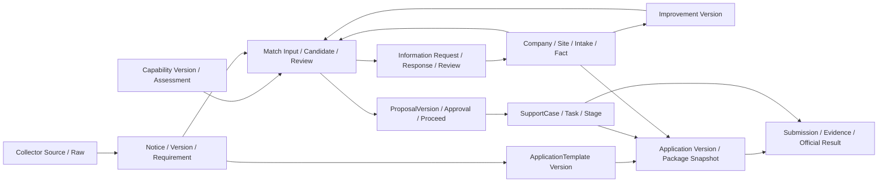
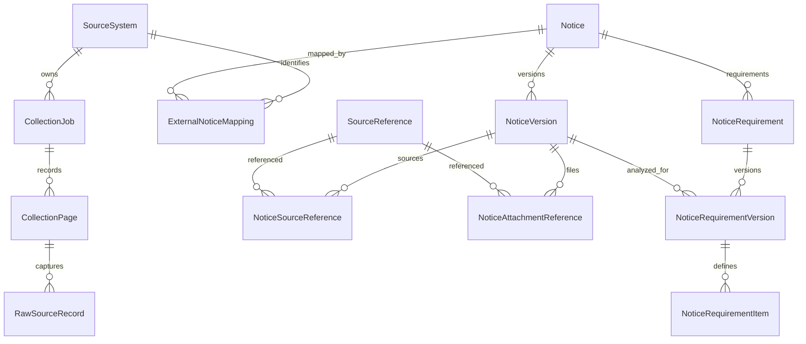
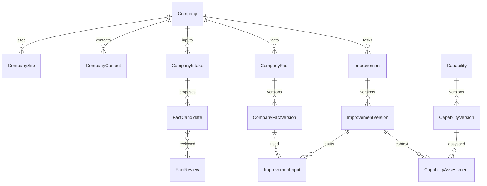
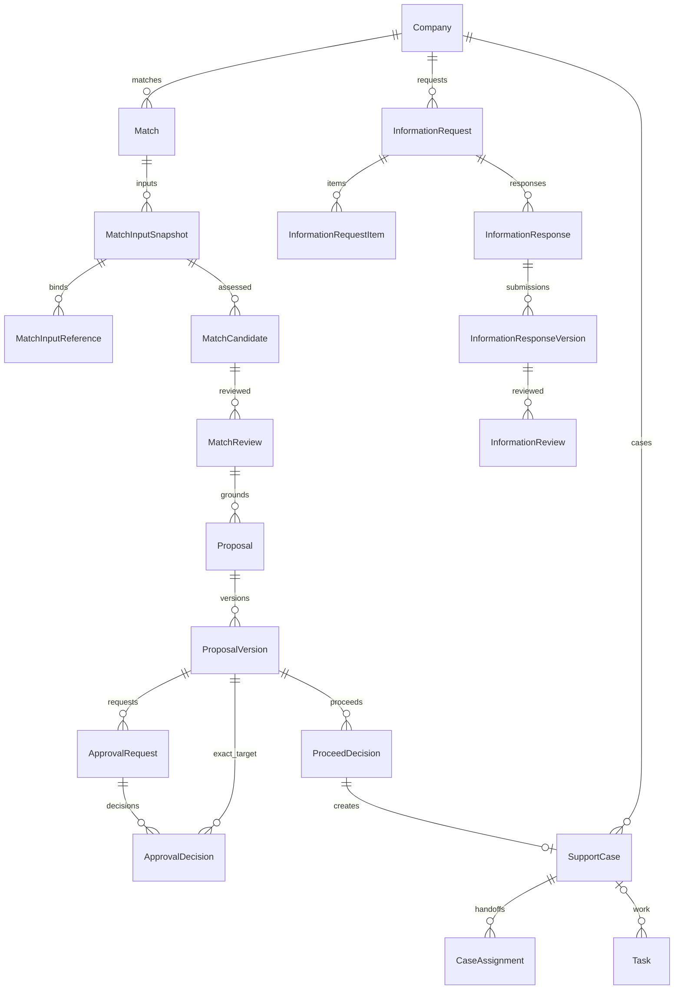
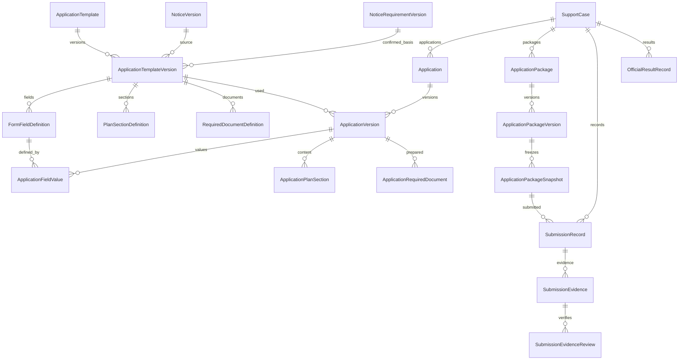
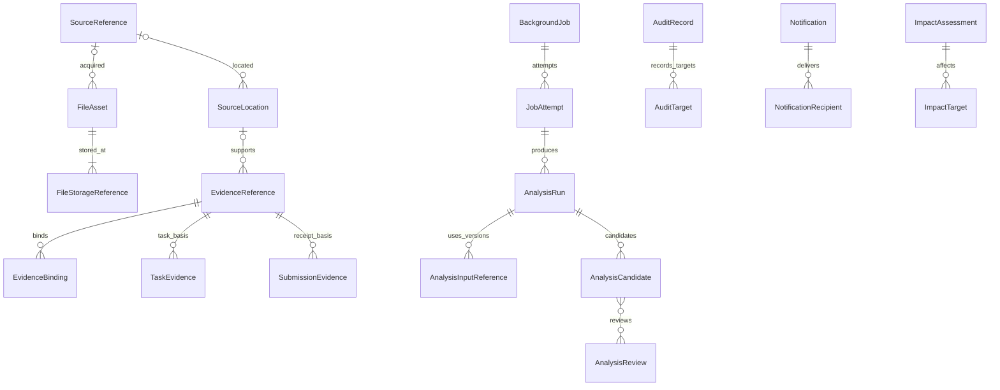

# DATCO 정부지원사업 운영체계 - Logical Data Model

## 1. 문서 역할과 기준

이 문서는 Logical Entity, Relationship/Cardinality, Identity, External/Internal ID, Version/Snapshot, Source/Provenance/Evidence, Company/Site/Case Scope, Integrity Constraint, 중복/idempotency, Lineage를 정의한다. Entity는 논리 Object이며 이 목록의 개수가 실제 Table 개수를 뜻하지 않는다.
우선순위는 [AGENTS](../AGENTS.md) → [Baseline](00_PROJECT_BASELINE.md) → [Architecture](01_SYSTEM_ARCHITECTURE.md) → [E2E Flow](02_E2E_SYSTEM_FLOW.md) → [1차 Probe](../tools/bizinfo-probe/ANALYSIS.md)/[2차 Probe](../tools/bizinfo-probe/PHASE2_ANALYSIS.md) → 이 문서다. 충돌·추가 결정은 Open Decision에 기록하고 상위문서를 임의 수정하지 않는다.
Phase-1 Persistence는 `11_DECISION_LOG.md`의 Decision-001에 따라 PostgreSQL/SQLAlchemy 2.x/Psycopg 3/Sync Session/Alembic으로 선택되었다. 이 문서는 SQL Type/실제 Table·Column 최종 Naming/Index·Partition·Lock·Transaction·Constraint·Junction 구현, 모든 State enum/Permission, API Endpoint/UI Component를 확정하지 않는다. 속성명은 논리 의미이며 Modular Monolith의 데이터 소유권과 참조 경계를 유지한다. Physical Schema는 Slice별 Migration/Integration Test로 구현하고 Logical Entity를 Table과 1:1로 자동 생성하지 않는다.

## 2. 핵심 불변조건

1. 주요 Entity는 Internal ID를 갖고 외부 식별자는 별도 매핑한다. 기업마당 pblancId는 Notice ID가 아니며 Source+External ID로 식별한다.
2. 핵심 업무 Object는 Root 정체성을 유지하고 의미가 바뀌는 내용은 Version으로 보존한다. Root의 현재 참조로 과거 판단을 복원하지 않는다.
3. ApprovalDecision은 승인대상 ProposalVersion을 직접 참조한다. v2가 생겨도 v1 승인 삭제/자동 전용 금지.
4. Candidate, Review, Human Confirmed 결과는 구분한다. Source/Evidence/Source Location/입력 Version을 연결한다.
5. 기업 전용 데이터는 Company Scope를 가지며 필요 Site/Case 관계가 같은 Company에 속해야 한다. Role 확인만으로 참조 정합성을 대체하지 않는다.
6. 동아테크놀로지는 DEMO/SEED Company일 뿐 전용 Field/Schema/ID를 만들지 않는다. 여러 Company, Company별 여러 Site/Contact/Improvement/Notice 후보/Case를 수용한다.
7. 정부포털의 공식 제출 사실과 결과는 외부 공식원천이다. 내부 Submission/OfficialResult는 해당 사실의 Metadata/Evidence와 검토를 보존한다.
8. 과거 Version, Approval, Proceed, Submission Evidence, 공식 Result, Case History, Audit를 정상 업무에서 임의 삭제하지 않는다.
9. URL 참조 ≠ 실제 자료 확보 ≠ 추출 완료 ≠ 근거 검토 완료다. 각 단계가 별도 데이터/검토 결과로 확인돼야 한다.
10. 무제한 target_type+target_id나 단일 JSON Blob으로 핵심 업무관계를 대신하지 않는다. Raw Payload/분석 원시출력의 유연한 저장 가능성과 핵심 구조화 관계를 구분한다.

## 3. Domain / Entity Catalog

기호: R=Root(독립 업무 정체성), V=Version/불변 Snapshot, C=Child/Junction, O=운영/검토 Record. Scope G=Global DATCO/공고, C=Company, K=Case를 통한 Company, D=입력/대상에서 파생, I=Identity/운영 범위다. Source of Truth 열은 논리 소유 Module이다.
Version 필요의 `이력`은 해당 Record/결정의 append 보존이며 별도 Version Entity를 요구하지 않는다. `불변`은 생성 후 참조 의미 보존이다. 관계는 아래 상세절의 조건을 따른다.

| Domain | Entity | 역할 | Root/Version/Child | Scope | Source of Truth | Version 필요 | 주요 관계 |
| --- | --- | --- | --- | --- | --- | --- | --- |
| A Identity/Scope | UserIdentity | 내부 사용자/외부 인증 매핑 | R | I | Identity/Provider | 이력 | Membership, Actor 참조 |
| A Identity/Scope | CompanyMembership | 사용자 기업 소속/역할 참조 | C | C | Authorization | 이력 | UserIdentity, Company |
| B Collector/Source | SourceSystem | 외부 Source 정체성 | R | G | Collector | 변경이력 | Job, Mapping |
| B Collector/Source | CollectionJob | 수집 요청·실행 범위/결과 | O | G | Collector | 이력 | SourceSystem, BackgroundJob |
| B Collector/Source | CollectionPage | 페이지별 결과/실행근거 | O | G | Collector | 이력 | CollectionJob, Raw |
| B Collector/Source | RawSourceRecord | 비밀 제외 원천응답/참조 | O | G | Collector | 불변 | Page, Source, External ID |
| B Collector/Source | ExternalNoticeMapping | 외부 공고와 내부 ID 연결 | C | G | Collector/Notice Port | 이력 | SourceSystem, Notice |
| C Notice | Notice | 내부 공고 정체성 | R | G | Notice | 별도 V | Mapping, NoticeVersion |
| C Notice | NoticeVersion | 정규화 공고 내용/기간 원문 | V | G | Notice | 불변 | Notice, Raw, 분석/Template |
| C Notice | NoticeSourceReference | 공고 Version의 상세 Source 연결 | C | G | Notice | Version 귀속 | NoticeVersion, SourceReference |
| C Notice | NoticeAttachmentReference | 외부 파일 참조·역할 후보 | C | G | Notice | Version 귀속 | NoticeVersion, SourceReference |
| C Notice | NoticeRequirement | 공고 요건 집합 정체성 | R | G | Notice/Operations Review | 별도 V | Notice, RequirementVersion |
| C Notice | NoticeRequirementVersion | 검토된 요건 집합 | V | G | Notice/Operations Review | 불변 | NoticeVersion, AnalysisReview |
| C Notice | NoticeRequirementItem | 조건/서류/서식/평가기준 항목 | C | G | Notice | Version 귀속 | RequirementVersion, Evidence |
| D Company/Intake | Company | 일반 기업 정체성 | R | C | Company/Provider | 변경이력 | Site, Fact, Case |
| D Company/Intake | CompanySite | 기업 Site | C | C | Company | 변경이력 | Company, Fact/Case |
| D Company/Intake | CompanyContact | 기업/Site 연락처 | C | C | Company | 변경이력 | Company, optional Site |
| D Company/Intake | CompanyIntake | Seed/수기/문서 입력 맥락 | O | C | Intake | 이력 | Company/Site, File/Source |
| D Company/Intake | CompanyFact | 기업 사실의 항목·기간별 정체성 | R | C | Company Fact | 별도 V | Company/Site, FactVersion |
| D Company/Intake | CompanyFactVersion | 확인된 값/근거/기간/단위 | V | C | Company Fact | 불변 | Fact, FactReview/Evidence |
| D Company/Intake | FactCandidate | 미확정 기업값 후보 | C | C | Intake/Fact | 입력 고정 | Intake, optional AnalysisCandidate |
| D Company/Intake | FactReview | 후보 비교·확정/보완 결정 | O | C | Company Fact | 이력 | Candidate, old/new FactVersion |
| D Company/Intake | FactConflict | 충돌 Source/값 비교기록 | O | C | Company Fact | 이력 | Candidates, 기존 FactVersion |
| E Improvement | Improvement | 기업 개선과제 정체성 | R | C | Improvement | 별도 V | Company/Site, Version |
| E Improvement | ImprovementVersion | 제출/확정 과제 내용·입력근거 | V | C | Improvement | 불변 | Improvement, AnalysisRun/Review |
| E Improvement | ImprovementInput | 제출자료/FactVersion 연결 | C | C | Improvement | Version 귀속 | ImprovementVersion, Fact/File |
| F Capability | Capability | 서비스 Capability 정체성 | R | G | Capability/Provider | 별도 V | CapabilityVersion |
| F Capability | CapabilityVersion | 기능·조건·범위·근거 | V | G | Capability | 불변 | Capability, Evidence |
| F Capability | CapabilityAssessment | 과제별 적합성 분석/검토 맥락 | O | C | Capability/Operations | 이력 | ImprovementVersion, CapabilityVersion, Run/Review |
| G Matching | Match | 기업·과제·공고·서비스 검토건 | R | C | Matching | 반복 분석 | Candidate/Review/InputSnapshot |
| G Matching | MatchInputSnapshot | 분석 당시 Version 조합 | V | C | Matching | 불변 | Match, InputReference |
| G Matching | MatchInputReference | 입력별 명시적 Version 연결 | C | C | Matching | Snapshot 귀속 | Fact/Improvement/Capability/Requirement |
| G Matching | MatchCandidate | 분석 의미/근거/부족정보 | C | C | Matching/Intelligence | 입력 고정 | Run, MatchInputSnapshot |
| G Matching | MatchReview | 업무판단·후속조치 | O | C | Matching/Operations | 이력 | Candidate, Reviewer |
| H Request | InformationRequest | 재사용 가능한 기업 정보요청 | R | C | Request | 변경이력 | Context, Items, Responses |
| H Request | InformationRequestItem | 항목·이유·필수성 | C | C | Request | 발송본 보존 | Request, 응답항목 |
| H Request | InformationResponse | 기업 응답 정체성/Draft | R | C | Request | 별도 V | Request, ResponseVersion |
| H Request | InformationResponseVersion | 제출/재제출 응답 묶음 | V | C | Request | 불변 제출본 | Response, Items, Review |
| H Request | InformationResponseItem | 값/응답의미/파일 | C | C | Request | Version 귀속 | RequestItem, ResponseVersion |
| H Request | InformationReview | DATCO 검증/보완 결정 | O | C | Request | 이력 | ResponseVersion, Fact/Application |
| H Request | RequestContext | 요청 원 Domain/Version 연결 | C | C | Request | 참조 보존 | Intake/Match/Application/Proposal |
| I Proposal/Approval | Proposal | 제안 정체성 | R | C | Proposal | 별도 V | MatchReview, ProposalVersion |
| I Proposal/Approval | ProposalVersion | 제안 범위/비용/책임 당시 내용 | V | C | Proposal | 불변 | Proposal, MatchInputSnapshot |
| I Proposal/Approval | ApprovalRequest | 특정 제안 Version 판단 요청 | O | C | Approval | 이력 | ProposalVersion, Approver |
| I Proposal/Approval | ApprovalDecision | 승인/거절/보완 판단 | O | C | Approval | 불변 결정 | Request, ProposalVersion, Actor |
| I Proposal/Approval | ProceedDecision | DATCO 추진확정 | O | C | Operations/Case | 불변 결정 | MatchReview, ProposalVersion, Approval |
| J SupportCase | SupportCase | 추진확정 이후 업무건 | R | C/K | Case | 단계이력 | Proceed, Company/Site, 입력 Version |
| J SupportCase | CaseAssignment | 담당 지정/이관이력 | O | K | Case | 이력 | Case, Assignee, ChangedBy |
| J SupportCase | CaseStageRecord | 단계별 업무/사실·증빙 | O | K | Case | 이력 | Case, Task/Evidence/Result |
| K Application | ApplicationTemplate | 공고별 양식 정체성 | R | G | Application | 별도 V | TemplateVersion |
| K Application | ApplicationTemplateVersion | 확인된 양식 구성 | V | G | Application | 불변 | NoticeVersion, RequirementVersion |
| K Application | FormFieldDefinition | 필드 의미/필수·조건 | C | G | Application | TemplateVersion 귀속 | TemplateVersion, FieldValue |
| K Application | PlanSectionDefinition | 계획서 섹션 정의 | C | G | Application | TemplateVersion 귀속 | TemplateVersion, PlanSection |
| K Application | RequiredDocumentDefinition | 요구서류 정의/조건 | C | G | Application | TemplateVersion 귀속 | TemplateVersion, RequiredDocument |
| K Application | EvaluationCriterion | 평가기준 정의 | C | G | Application | TemplateVersion 귀속 | TemplateVersion, RequirementItem |
| K Application | FieldMappingRule | Fact/분석→필드 매핑 규칙 | C | G | Application | TemplateVersion 귀속 | Definition, 원 항목 의미 |
| K Application | Application | Case의 신청입력 정체성 | R | K | Application | 별도 V | Case, ApplicationVersion |
| K Application | ApplicationVersion | 양식별 실제 입력 Revision | V | K | Application | 제출관련 보존 | Application, TemplateVersion |
| K Application | ApplicationFieldValue | 정의에 따른 실제 값 | C | K | Application | Version 귀속 | Definition, ValueReview |
| K Application | ApplicationPlanSection | 실제 계획서 내용 | C | K | Application | Version 귀속 | SectionDefinition, Evidence |
| K Application | ApplicationRequiredDocument | 실제 준비서류/확인결과 | C | K | Application | Version 귀속 | DocumentDefinition, File/Evidence |
| K Application | ApplicationValueCandidate | 자동채움/제공값 후보 | C | K | Application | 입력 고정 | Definition, Fact/분석 Version |
| K Application | ApplicationValueReview | 값/근거 확인 | O | K | Application | 이력 | Candidate, 확정 Value/Section |
| K Application | ApplicationPackage | 신청준비 묶음 정체성 | R | K | Package | 별도 V | Case, PackageVersion |
| K Application | ApplicationPackageVersion | 입력·서류·확인/Readiness 묶음 | V | K | Package | 이력 보존 | ApplicationVersion, Approval |
| K Application | ApplicationPackageSnapshot | READY_TO_SUBMIT 당시 불변 조합 | V | K | Package | 불변 | PackageVersion, 자료/확인, Submission |
| L Submission/Evaluation | SubmissionRecord | 외부 제출사실 내부 기록 | R | K | Operations/외부 Portal | 정정이력 | Case, PackageSnapshot |
| L Submission/Evaluation | SubmissionEvidence | 제출증빙 명시 연결 | C | K | Submission | 보존 | SubmissionRecord, EvidenceReference |
| L Submission/Evaluation | SubmissionEvidenceReview | 증빙 확인/보완결정 | O | K | Submission | 이력 | SubmissionEvidence, Reviewer |
| L Submission/Evaluation | EvaluationRecord | 평가·보완·일정 기록 | O | K | Case/Operations | 이력 | Case, Task/Evidence |
| L Submission/Evaluation | OfficialResultRecord | 공식 선정/미선정 결과/검토 | O | K | Case/외부 공식원천 | 정정이력 | Case, Evidence, Reviewer |
| M Task/Schedule | Task | 업무·담당·증빙요구 | R | K/C | Task | 이력 | Case 또는 명시적 기업업무 |
| M Task/Schedule | TaskAssignment | 담당 지정/변경이력 | O | D | Task | 이력 | Task, Actor |
| M Task/Schedule | TaskDependency | 선행/후행 업무 연결 | C | D | Task | 이력 | predecessor Task, successor Task |
| M Task/Schedule | ScheduleDeadline | 내부기한/공고마감 참조 | C | D | Schedule | 변경이력 | Task/Case, NoticeVersion의 검증기간 |
| M Task/Schedule | TaskEvidence | 완료/보완 근거 연결 | C | D | Task | 보존 | Task, EvidenceReference |
| N File/Evidence | FileAsset | 실제 확보한 불변 내용 정체성 | R | G/C | File | 내용 불변 | Source/Intake, StorageReference |
| N File/Evidence | FileStorageReference | Provider별 저장 위치/외부 ID | C | File Scope | File/Provider | 이관이력 | FileAsset, Provider |
| N File/Evidence | SourceReference | 외부 URL/수기/Seed/문서 원천 | R | G/C | 소유 Domain/File | 변경이력 | SourceSystem/Intake, 확보 File |
| N File/Evidence | SourceLocation | 문서 페이지/섹션/필드 위치 | C | Source Scope | Evidence | 불변 위치 | SourceReference/FileAsset |
| N File/Evidence | EvidenceReference | 어떤 근거인가/검토 맥락 | R | D | Evidence | 보존 | SourceLocation/File/Source, Binding |
| N File/Evidence | EvidenceBinding | 근거와 업무대상의 명시 연결 | C | D | 대상 Domain | Version 귀속 | typed Fact/Requirement/Case/Task 등 |
| O Background/Analysis | BackgroundJob | 비동기 작업 정체성 | R | D | Job | 이력 | typed 입력/결과, Attempts |
| O Background/Analysis | JobAttempt | 실행시도/오류/결과 | O | Job Scope | Job | 이력 | Job, Run/Collection 결과 |
| O Background/Analysis | AnalysisRun | 분석 종류/설정·입력·출력 | O | D | Intelligence/요청 Domain | 불변 결과 | JobAttempt, InputReference |
| O Background/Analysis | AnalysisCandidate | 구조화 후보/Reason/근거 | C | Run Scope | Intelligence | 입력 고정 | AnalysisRun, Evidence/Location |
| O Background/Analysis | AnalysisReview | 분석후보 검토·결과 연결 | O | D | 해당 Operations Domain | 이력 | Candidate, 확인 결과의 typed 연결 |
| O Background/Analysis | AnalysisInputReference | 입력 자료/Version 명시 연결 | C | D | 요청 Domain | Run 귀속 | Notice/Fact/Improvement/Capability/File |
| P Audit/Notification | AuditRecord | Actor/Action/Time/이유 | O | D/I | Audit | 보존 | AuditTarget, Actor |
| P Audit/Notification | AuditTarget | Object/Version 명시 감사대상 | C | D | Audit | 불변 연결 | typed 업무참조 |
| P Audit/Notification | Notification | Domain Event의 전달 Record | O | D | Notification | 전달이력 | 업무 Event/대상 참조 |
| P Audit/Notification | NotificationRecipient | 수신자/전달·읽음 기록 | C | D/I | Notification | 전달이력 | Notification, UserIdentity |
| Q Impact/Lineage | ImpactAssessment | 변경 영향후보/검토 결정 | O | D/G | Operations/Intelligence | 이력 | 변경 Version, Run/Review |
| Q Impact/Lineage | ImpactTarget | 영향 객체와 후속조치 | C | D | Operations | 이력 | typed Match/Proposal/Package/Case/Task |

Catalog는 17개 Domain, 94개 논리 Entity로 구성한다. EvidenceBinding/AuditTarget 등의 연결 Entity는 제한된 명시 관계군이며 Table을 하나의 unchecked polymorphic link로 만들라는 뜻이 아니다.

## 4. 공통 Identity / Version / Attribute 규칙

| Attribute | 의미 | 필수성 | Source/생성주체 | Version/History 주의 |
| --- | --- | --- | --- | --- |
| internalIdentity | Entity 내부 ID | 모든 Entity | 소유 Domain | 외부 ID와 분리, 실제 ID 기술 미확정 |
| rootIdentity / versionOrdinal | Version의 Root/순번 | 일반 Version V | 소유 Domain | Root+순번 유일, 과거 연결 불변 |
| companyIdentity | 기업 소유 범위 | C/K 데이터 | 부모 Company/Case | 다른 기업 참조 금지; 모든 Global에 강제하지 않음 |
| siteIdentity / caseIdentity | 세부 범위 | 해당 업무 시 | Company/Case 관계 | Site/Case Company 일치 |
| createdAt / createdBy | 생성시각/Actor | 업무 생성기록 | Domain/Identity | 삭제된/비활성 Actor도 과거 귀속 보존 |
| source / evidenceReferences | 출처/근거 | 사실/분석/판단 시 | Collector/Intake/검토자 | 버전별 연결, 실제 Secret 제외 |
| reviewIdentity / verificationMeaning | 검토기록/검증 의미 | 확정 사실/결정 | 권한 있는 사람 | Candidate 생성과 확정 구분 |
| lifecycleMeaning / reason | 현재 업무 의미/이유 | 상태 있는 업무 | Domain Action | 정확한 enum/Guard는 04 |
| currentVersionReference | 현재 선택 Version | Version Root 필요 시 | Domain | 편의 포인터; 과거 승인/분석은 직접 V 참조 |

주요 Root R은 독립 ID로 참조하며 Version V/Child C/Record O도 식별 가능해야 한다. 순번은 Root 내 의미 순서이지 외부 수정시각이 아니다. Cardinality 표기의 0..N은 Draft/미처리 단계도 포함하며 완료단계에서는 아래 Guard/필수성이 강화된다.
Snapshot V는 소유 Root와 고정한 Version/행위 맥락을 참조하고 Snapshot Identity로 구분한다. 일반 Version 순번과 Snapshot 식별을 같은 순번 공간으로 강제하지 않는다.
UserIdentity는 Local/DMP 외부 사용자 ID와 Provider를 분리해 매핑하고 CompanyMembership은 Company+User+역할/소속 맥락을 명시한다. Role는 논리 참조이며 상세 Permission/Global DATCO 관리역할 표현은 05에서 결정한다.

## 5. Collector / Source와 Notice

| Entity.Attribute | 의미 | 필수성 | Source/생성주체 | Version/History 주의 |
| --- | --- | --- | --- | --- |
| SourceSystem.sourceCode/providerKind | 원천 정체성/Connector 구분 | 필수 | 운영 기준 | 기관명 문자열만으로 ID 판별 금지 |
| CollectionJob.source/conditions/requestedBy | 수집 범위·Actor·비밀 제외 조건 | 필수 | Collector | crtfcKey 값/인증 URL 저장 금지 |
| CollectionJob.executionReference/outcome | BackgroundJob과 완료·부분·실패 의미 | 요청 이후 | Collector | 실행결과/중단 재시도 추적 |
| CollectionPage.job/pageIndex/pageUnit/totCnt/count | 페이지 응답 근거 | 실행 시 | 실제 API | totCnt 결측 허용, 빈 배열/오류 구분 |
| RawSourceRecord.source/collectedAt/httpFormat/payloadReference | 원천응답 또는 비공개 참조 | 필수 | Collector | API Key/인증 Header/Secret 제외 |
| RawSourceRecord.externalIdentity/page | 항목 외부 ID/페이지 관계 | 항목 시/필요 시 | 실제 응답 | 페이지 payload와 항목 위치 구분 |
| ExternalNoticeMapping.source/externalIdentity/notice | 외부→내부 ID | 필수 | Collector→Notice Port | 같은 Source+ID는 하나 Notice, 정정은 이력 |
| Notice.identity/sourceMappings | 내부 공고 정체성/매핑 | 필수 | Notice | Root 지속 |
| NoticeVersion.notice/ordinal/rawReferences | Root/순번/수집근거 | 필수 | Notice import 정책 | 불변 내용과 Raw Source 연결 |
| NoticeVersion.title/organizations/summary | 정규화 제목/기관/개요 | 수집값에 따름 | pblancNm, jrsdInsttNm/excInsttNm, bsnsSumryCn | 결측·정규화검증 표시, 없는 값 발명 금지 |
| NoticeVersion.periodOriginal/startCandidate/endCandidate/periodVerification | 기간 원문·파싱후보·검증 | 원문 제공 시/파싱 가능 시 | reqstBeginEndDe/내부 파싱·검토 | 원문 보존, 후보와 확인값 구분 |
| NoticeVersion.sourceCreated/sourceUpdated | 원천 등록/수정시각 | 제공 시 | creatPnttm/updtPnttm | 내부 Version 아님, 시간대/보장 미확정 |
| NoticeSourceReference.noticeVersion/sourceReference | 상세 원천 연결 | Source 있을 때 | pblancUrl | URL과 실제 확보 Content 구분 |
| NoticeAttachmentReference.noticeVersion/sourceReference/sourceRole/nameOriginal | 파일 URL/이름/역할 후보 | 제공 참조 시 | flpthNm/fileNm, printFlpthNm/printFileNm | 다수 연결 허용, print 정확한 역할 미확정 |
| NoticeRequirement.notice | 요건 집합 Root | 필수 | Notice Domain | 여러 분석/확정 Revision 수용 |
| NoticeRequirementVersion.root/noticeVersion/review | 특정 공고 Version의 검토 요건 | 필수 | Human Review | 입력/검토 고정, Candidate와 분리 |
| NoticeRequirementItem.kind/content/condition/evidence | 자격·범위·서류·필드·계획·평가·조건부 요건 | 필수/조건 시 | 검토된 분석 | Version 소속, 근거 위치 연결 |

SourceSystem 1→0..N CollectionJob, Job 1→0..N CollectionPage, Page 1→0..N RawSourceRecord, SourceSystem 1→0..N ExternalNoticeMapping. Mapping 한 건은 정확히 하나 Notice를 가리킨다. Notice 1→0..N NoticeVersion(Draft 제외 사용 가능한 Notice에는 최소 1 Version), Version 1→0..N 원문/첨부 참조 및 AnalysisRun을 가진다.
SourceSystem과 Notice 간에 여러 매핑을 허용하되 같은 Source+External ID는 중복 Notice로 갈 수 없다. 서로 다른 Source의 동일 공고 병합은 후속 Collector 정책이지 제목만으로 자동 확정하지 않는다.
실제 API는 GET /uss/rss/bizinfoApi.do, crtfcKey 인증, dataType=json, jsonArray 배열이었다. 필드명은 Source Attribute 근거이며 물리 Column명 확정이 아니다. 2차 당시 totCnt=1423/pageUnit=2에서 712페이지 1건, 713페이지 200/빈 배열이었다. 페이지 기록은 이 의미와 비밀 제외 요청조건을 추적하며 1423을 상수로 고정하지 않는다.
기간 원문 `2026-10-01 ~ 2026-10-23`, `2020.01.01 ~ 2026.12.31`과 파싱결과/검증상태를 동시에 보존한다. 상시접수/예산소진/조건부 형식은 관찰 사실이 아니며 후속 정책 후보다. 파싱불가를 임의 날짜로 바꾸지 않는다.
updtPnttm은 변경신호 후보다. NoticeVersion은 내용/기간/첨부와 수집근거로 내부 생성하며 정책/Hash는 06에서 확정한다. inqireCo/totCnt는 실행 Metadata이며 업무 Version 핵심 내용에 무조건 넣지 않는다. Version은 Requirement, Template, Match 입력과 연결되고 과거 버전은 현재 포인터 변경과 무관하게 유지된다.

## 6. Source / File / Evidence와 확보단계

| Entity.Attribute | 의미 | 필수성 | Source/생성주체 | Version/History 주의 |
| --- | --- | --- | --- | --- |
| SourceReference.origin/provider/externalLocator | 외부 URL/문서/Seed/수기 출처 | 필수 | Collector/Intake | 인증 Query 제거, Source와 Company 범위 구분 |
| FileAsset.contentIdentity/scope/acquiredAt/source | 실제 확보 Content/파일 | 필수/Source 필요 시 | File acquisition/Upload | 바이트 변경은 새 FileAsset, 동일 ID 덮어쓰기 금지 |
| FileAsset.mediaKind/nameMetadata/validation | 형식/이름/확보 검증 | 확보 시 | 실제 응답/검증 | PDF prefix 확인≠내용추출 완료 |
| FileStorageReference.file/provider/storageIdentity | 논리 File와 저장 Provider 위치 | 필수 | FileProvider | Windows Path를 Domain 키로 사용하지 않음 |
| SourceLocation.source/file/locationDescriptor | 페이지/섹션/필드 위치 | 필수 자료/위치 | 추출/검토 | 해당 불변 Content 안의 위치 |
| EvidenceReference.sourceLocation/file/source/reason | 판단 근거와 자료 | 최소 하나 자료 참조 | 검토/Domain | 단순 File 존재와 근거 검토 구분 |
| EvidenceBinding.evidence/explicitTargetVersion | 근거의 업무대상 | 필수 | 해당 Domain | 대상·Scope 무결성 검증 |

외부 URL은 SourceReference, 실제 확보 내용은 FileAsset, 업무판단에 쓰는 근거는 EvidenceReference로 분리한다. HTML/text 확보도 FileAsset의 논리 Content로 취급할 수 있으며 Phase-1은 Local Private FileProvider/DB Metadata를 사용하고 실제 저장 형식·물리 배치는 구현 단계에서 구체화한다. SourceReference 1→0..N 확보 FileAsset, FileAsset 1→1..N StorageReference(보관 완료 시), SourceLocation은 특정 Source/File에 귀속된다.
FileAsset 내용은 불변, Provider 이관은 StorageReference 이력을 바꾸고 논리 File ID를 유지한다. Notice의 Global 자료와 Company Private 파일을 분리한다. URL 참조만 있는 단계에는 확보 File이 없어도 된다. 추출 여부는 AnalysisRun/Job 결과, 검토 여부는 Domain Review로 확인한다.
여러 NoticeAttachmentReference를 모델이 지원하지만 실제 기업마당 다중첨부 방식은 미확정이다. API 제공 URL의 실제 HTML/PDF 접근은 확인됐으나 전체본문/print 역할/HWP/HWPX/파일내용 분석은 부분확인 또는 미확인이다.
EvidenceBinding은 FactVersionEvidence, RequirementItemEvidence, ImprovementVersionEvidence, CapabilityVersionEvidence, MatchCandidateEvidence, ResponseItemEvidence, ApplicationValueEvidence, CaseStageEvidence, ResultEvidence 등의 **허용된 명시 연결군**을 뜻한다. SubmissionEvidence/TaskEvidence는 별도 의미 있는 관계다. 각 관계는 실제 존재하는 대상 ID/Version과 Evidence를 검증하며 무제한 문자열 target_type+target_id를 기본 구조로 삼지 않는다.
Evidence를 여러 판단에 재사용할 수 있으나 Company Private 근거를 다른 기업에 공유하지 않는다. Global 공고 근거를 Company 결과에서 참조해도 Company 비공개 근거가 Global로 승격되지 않는다.

## 7. Notice Analysis / 공통 분석의 단순화

NoticeAnalysisRun/Candidate/Review, ImprovementAnalysisCandidate/Review는 공통 AnalysisRun/AnalysisCandidate/AnalysisReview와 **종류별 명시 입력·결과 관계**로 표현한다. 같은 실행 메타데이터를 종류마다 중복 Entity로 만들지 않되 Domain 결과의 의미/소유권은 통합하지 않는다.
Notice 분석은 정확히 한 NoticeVersion과 0..N 실제 입력 FileAsset/SourceLocation을 AnalysisInputReference로 고정한다. Candidate는 Eligibility/범위/기간/서류/Form Field/Plan Section/평가기준/조건부항목, Reason/Evidence/Location을 가진다. AnalysisReview는 Reviewer/시각/결정과 검토한 Candidate를 연결하며 확인된 NoticeRequirementVersion/Item은 별도로 생성한다.
입력 Run의 NoticeVersion과 확인 RequirementVersion의 NoticeVersion이 일치해야 한다. 부분입력/불명확한 항목은 검토범위와 미확정 항목으로 남는다. 새 분석이 기존 확정 Requirement를 자동 덮어쓰지 않는다. 여러 RequirementVersion을 보존하고 Template/Match는 실제 사용한 Version을 직접 참조한다.
모든 AnalysisRun은 1→0..N Candidate/Review를 갖는다. Review의 확정대상은 종류에 맞는 명시 관계(RequirementVersion/ImprovementVersion/Assessment 등)로 제한한다. FactReview/MatchReview/ApplicationValueReview는 해당 업무확정 의미를 별도 보존하고 일반 분석 품질검토와 혼동하지 않는다.

## 8. Company / Intake / Fact / 재무기간

| Entity.Attribute | 의미 | 필수성 | Source/생성주체 | Version/History 주의 |
| --- | --- | --- | --- | --- |
| Company.identity/masterAttributes/providerMapping/demoMarker | 일반 기업/외부 Master 연결 | 필수/Provider 시 | 입력/CompanyProvider | DEMO/SEED 명시, 실제 DMP 계약 미확정 |
| CompanySite.company/siteMeaning | 기업 사업장 | 필수 | Company | Company 1→0..N Site |
| CompanyContact.company/optionalSite/contactMeaning | 기업/Site 연락처 | 필수/필요 시 | 입력/Provider | Site Company 일치, 개인정보 보호 |
| CompanyIntake.company/site/inputMode/source/files | 입력 맥락 | 필수/입력별 | Seed/수기/Upload | 문서 없는 입력에 가짜 File/추출기록 금지 |
| CompanyFact.company/site/fieldMeaning/period/asOf | 항목/범위/기간별 정체성 | 필수/항목 필요 시 | Fact Domain | 연도 다른 값을 같은 Root에 덮어쓰기 금지 |
| CompanyFactVersion.fact/ordinal/value/dataMeaning/unit | 확인값/형/단위 | 필수/의미별 | Human Confirmation | Root/기간과 일치, 값 Version 불변 |
| CompanyFactVersion.source/evidence/verification/review/validity | 출처/검증/유효성 | 확정 시 필수 | FactReview | 검토자·시각·Source Location 포함 |
| FactCandidate.intake/analysisCandidate/value/period/unit/source | 미확정 추출/제공값 | 필수/분석 시 | 입력 또는 Analysis | 확인 결과와 분리 |
| FactReview.candidates/comparedVersion/decision/reviewer/time/confirmedVersion | 신규/동일/충돌/보완 판단 | 필수/분기별 | DATCO 검토 | 과거 비교 Version/결정 보존 |
| FactConflict.existingVersion/candidateReferences/reason/resolutionReview | Source/값 충돌 | 충돌 시 | 비교/사람 검토 | 자동 덮어쓰기 금지 |

Company 1→0..N Site/Contact/Intake/CompanyFact/Improvement/SupportCase. Fact 1→0..N FactVersion, 사용 가능한 확인 Fact에는 최소 1 확인 Version이 필요하다. Candidate는 확인값을 대신하지 않는다. 하나의 FactVersion에 여러 Evidence/Source 근거를 명시 연결할 수 있다.
Upload→File→Extraction→FactCandidate, 수기/Seed→출처가 있는 FactCandidate로 합류한다. 분석 원시 후보에서 FactCandidate로 매핑할 때 AnalysisCandidate 참조를 보존한다. FactReview는 검토한 후보/기존 Version과 결정, 새 확인 Version 또는 기존 동일값 연결을 보존한다. Conflict는 후보집합과 기존 Version의 비교사실이며 필요할 때만 생성한다.
재무값은 Company, 필요 Site, 항목 의미, 연도/기간/As-of, 값, 단위, Source/Evidence, 검증, Version을 구분한다. 2025 매출과 2026 매출은 서로 다른 기간별 Fact 정체성으로 표현하며 수정 재무자료는 해당 기간 Root의 새 Version으로 보존한다. 기간 누락/상이 단위는 검토 대상이며 Taxonomy를 임의 확정하지 않는다.
기간/항목/Scope 기반 Fact 정체성 유일성은 논리 후보다. 유효기간과 회계기간/기준일의 차이, 단위환산, 반복측정 허용 여부는 Open Decision으로 후속 구체화한다.

## 9. Improvement / Capability

| Entity.Attribute | 의미 | 필수성 | Source/생성주체 | Version/History 주의 |
| --- | --- | --- | --- | --- |
| Improvement.company/site/currentVersion | 기업 개선과제 Root | 필수/필요 Site | Workspace | Company별 여러 과제 허용 |
| ImprovementVersion.root/ordinal/inputMeaning/review | 현황/문제/목표/과제/필요기능 | 제출/확정 시 | 기업 입력·DATCO 검토 | 입력 제출본과 확인된 결과를 구분 |
| ImprovementInput.version/factVersion/file/source | 분석 입력 관계 | 입력 시 | Workspace/Job | 실제 당시 Fact/File Version 참조 |
| Capability.providerMapping/currentVersion | 서비스 Catalog Root | 필수/Provider 시 | DATCO_ADMIN | Global Catalog와 기업별 판단 분리 |
| CapabilityVersion.root/service/functions/problems/conditions/exclusions/prerequisites/scope/evidence | 제공가능성 구조 | Catalog 확인 시 | DATCO Catalog Review | 문자열 Label만으로 판단 금지 |
| CapabilityAssessment.improvementVersion/capabilityVersion/run/review/fitMeaning/reason | 과제별 적합성 | 필수 | Intelligence/DATCO | Catalog 내용변경과 다른 Record |

Improvement 1→0..N ImprovementVersion, 제출 입력 Version은 분석에 고정되고 Confirmed 결과는 입력과 AnalysisReview를 참조하는 새 Version 또는 검토 결과가 연결된 동일 불변 제출본으로 표현할 수 있다. 기본 논리안은 내용 수정 시 새 Version, 내용 동일 시 별도 Review 연결이다. 정확한 상태/작성 잠금은 04에서 정한다.
ImprovementVersion 1→0..N ImprovementInput으로 Fact/File/자료를 명시 연결한다. Capability 1→0..N CapabilityVersion, 한 CapabilityVersion은 여러 기업과제의 Assessment에 재사용 가능하다. Assessment는 기업 Scope를 가지며 ImprovementVersion과 Catalog Version을 정확히 참조한다. Catalog 근거는 자체 Source/Evidence로 관리한다.

## 10. Matching 입력 Snapshot과 Review

| Entity.Attribute | 의미 | 필수성 | Source/생성주체 | Version/History 주의 |
| --- | --- | --- | --- | --- |
| Match.company/site/context | 기업·과제·공고 검토 맥락 | 필수/필요 Site | Matching | 여러 후보/재검토 허용 |
| MatchInputSnapshot.match/runContext/ordinal | 분석 당시 입력조합 | 분석 시 | Application Use Case | 불변, 현재 Root 포인터 금지 |
| MatchInputReference.snapshot/typedVersion | 입력별 명시적 관계 | 입력종류별 | 각 Domain 조회 | FactVersion/ImprovementVersion/CapabilityVersion/RequirementVersion/Assessment |
| MatchCandidate.snapshot/run/fitMeaning/reason/missing/opposingEvidence | 분석 판단 후보 | 필수 | Matching Engine | FIT류 분석의미와 업무결정 분리 |
| MatchReview.candidate/reviewer/time/businessDisposition/reason | 제안가능/Hold/Exclude/추가정보 | 필수 | DATCO | 특정 Candidate/InputSnapshot에 대한 결정 |

Match 1→0..N MatchInputSnapshot/Candidate/Review. 하나 Candidate는 정확히 하나 Snapshot과 AnalysisRun에 귀속한다. 사용 가능한 입력조합에는 필요한 Confirmed FactVersion 집합, Confirmed ImprovementVersion, Reviewed CapabilityVersion/Assessment, Confirmed RequirementVersion이 포함되어야 한다. 정확한 다중 선택수/필수 Fact항목은 후속 판단정책이다.
MatchInputReference는 종류별 명시 관계군으로 각 Record가 하나의 실제 Version을 참조한다. 같은 Company/Site의 Fact/Improvement와 Global 공고/Capability를 연결한다. Review의 분석의미와 업무판단은 별도 Attribute/Record로 보존한다. 재분석은 새 Run/입력조합을 만들고 기존 Review의 의미를 유지한다.

## 11. Information Request / Response

| Entity.Attribute | 의미 | 필수성 | Source/생성주체 | Version/History 주의 |
| --- | --- | --- | --- | --- |
| InformationRequest.company/reason/dueDate/sender/sentReference | 요청기업/이유/기한/발송 | 필수/발송 시 | DATCO | 발송한 항목/이유를 변경 시 이력 보존 |
| RequestContext.request/typedObjectVersion | 요청이 돌아갈 원 업무 | 필수 | Fact/Match/Application/Proposal | 명시 관계, 같은 Company |
| InformationRequestItem.request/meaning/requiredReason | 요청항목/필수성 | 필수 | DATCO | 발송본 보존, 사후 교체로 응답 의미 변경 금지 |
| InformationResponse.request/company/author | 기업 응답 Root/Draft | 필수 | COMPANY_EDITOR | 1 Request→0..N Response, 제출 정책 후속 |
| InformationResponseVersion.response/ordinal/submittedAt | 제출/재제출 본 | 제출 시 | 기업 Submit | 불변 제출본, Draft와 구분 |
| InformationResponseItem.version/requestItem/answerMeaning/value/files | Value/0/없음/모름/추후/해당없음 | 필수 의미/조건별 값 | 기업 | 0은 값, null/빈칸과 구분 |
| InformationReview.responseVersion/reviewer/decision/reason/resultReferences | DATCO 검증/보완 | 검토 시 | DATCO | 검토 제출본 고정; Fact/Application 갱신 참조 |

Request 1→1..N Item(발송 시), ResponseVersion 1→0..N Item(Draft 가능, 제출 시 요청과 규칙 검사). 응답항목은 같은 Request의 항목만 참조한다. InformationReview는 특정 ResponseVersion을 확인하며 Submit 자체는 Verified Fact가 아니다.
RequestContext는 명시적 Intake/Fact/Match Candidate 또는 Review/ApplicationVersion 또는 PackageVersion/ProposalVersion 연결군이다. E2E의 요청 Trigger에 맞춰 관계를 제한하며 임의 문자열 객체 ID로 연결하지 않는다. Template/Definition 기반 Missing Data와 응답 결과는 같은 기업/입력 Version 정책을 검사한다.

## 12. Proposal / Approval / Proceed / Case

| Entity.Attribute | 의미 | 필수성 | Source/생성주체 | Version/History 주의 |
| --- | --- | --- | --- | --- |
| Proposal.company/matchReview/currentVersion | 제안 Root와 원 검토 | 필수 | DATCO | Root 유지 |
| ProposalVersion.root/ordinal/serviceScope/supportTask/cost/contribution/responsibility | 제안내용 | 제안 시 | DATCO | 비용 구조·통화 등 세부 미확정 |
| ProposalVersion.inputSnapshot/review/evidence | 당시 근거/검토 | 요청 시 필수 | DATCO | 입력 Version 연결/불변 제안 본 |
| ApprovalRequest.proposalVersion/intendedApprover/requestedAt | 승인대상/기업 승인자 | 필수 | DATCO | currentVersion 추적 포인터로 대체 금지 |
| ApprovalDecision.request/proposalVersion/actor/time/decision/reason | 승인/거절/보완 판단 | 필수 | COMPANY_APPROVER | 요청의 Version과 일치, 결정 불변 |
| ProceedDecision.matchReview/proposalVersion/approvalReferences/actor/time | DATCO 추진확정 | 필수/필요 승인 | DATCO | 기업 Approval과 별도 Record |
| SupportCase.company/site/proceed/noticeVersion/proposalVersion/approvalReferences | 실제 추진건 입력관계 | 생성 시 필수/필요 Site·승인 | Case | 생성조건 현재성 검사, 과거 참조 유지 |
| CaseAssignment.case/assignee/from/until/changedBy/reason | 현재 담당/이관 이력 | 지정 시 | 권한 있는 운영자 | Case ID/과거 담당·시각 보존 |
| CaseStageRecord.case/stageMeaning/evidence/task/resultReferences | 단계별 진행/사실 | 단계 업무 시 | Case | 전체 Lifecycle 이력 |

Proposal 1→0..N ProposalVersion. ProposalVersion 1→0..N ApprovalRequest, Request 1→0..N Decision(여러 판단/재요청 상황의 이력 수용), 각 Decision은 정확히 하나 Request와 그 동일 Version에 귀속한다. 최종유효 결정/승인자 수/중복 의사결정 규칙은 04/05에서 정하며 과거 이력을 덮어쓰지 않는다.
ProceedDecision은 특정 MatchReview/ProposalVersion과 필요한 ApprovalDecision 집합을 참조한다. 회사 Scope 및 승인 Version 일치가 필수다. SupportCase는 정확히 하나 유효 ProceedDecision을 가진다. 하나 ProceedDecision→0..1 Case를 기술 중복방지 후보로 둔다. Company+Notice만 유일키로 제한하지 않는다. 동일 기업/공고의 정당한 복수 Case는 각각 독립된 유효 추진결정/업무맥락으로 표현하며 자격/중복지원 정책은 후속 판단이다.
ProposalVersion의 입력 Snapshot은 해당 MatchReview가 검토한 Candidate의 Snapshot과 일치해야 한다. Proceed/Case의 MatchReview·ProposalVersion·Approval·NoticeVersion은 같은 추진결정의 입력조합을 가리켜야 한다. 중요변경 후 새 입력을 적용할 때는 명시적 재검토/재승인과 변경기록을 보존하며 현재 포인터만 바꿔 이전 판단을 재해석하지 않는다.
Case의 현재 담당자는 유효 Assignment에서 찾거나 검증된 편의 참조로 둔다. 교체 시 기존 Assignment를 종료하고 새 이력을 추가하며 ID와 Audit를 유지한다. 여러 담당 역할/공동담당 허용 범위는 후속 결정이다.
선정/미선정 공식 결과를 Case에 연결하고 NOT_SELECTED에서 Agreement 자동진행 금지는 04 Guard로 구현한다. 관계만으로 승인 유효성을 보장할 수 없으므로 생성시점/후속 중요변경의 상태 검증이 함께 필요하다.

## 13. Dynamic Application / 실제 값 / Package

| Entity.Attribute | 의미 | 필수성 | Source/생성주체 | Version/History 주의 |
| --- | --- | --- | --- | --- |
| ApplicationTemplate.notice/context/currentVersion | 공고별 양식 Root | 필수 | 검토된 서식 | 모든 공고를 고정양식에 강제하지 않음 |
| ApplicationTemplateVersion.root/ordinal/noticeVersion/requirementVersion/review | 확인된 양식 기준 | 필수 | Notice/Form Review | 입력 공고/요건 Version 일치 |
| FormFieldDefinition.templateVersion/fieldKey/meaning/requiredCondition | 입력 필드 | 필수 | 확인 서식 | Version 내 식별 유일 |
| PlanSectionDefinition.templateVersion/sectionKey/meaning | 계획서 섹션 | 필수 | 확인 서식 | 변경 시 새 TemplateVersion |
| RequiredDocumentDefinition.templateVersion/documentMeaning/condition | 서류/조건 | 필수 | Requirement | 실 제출 File와 구분 |
| EvaluationCriterion.templateVersion/meaning/sourceRequirement | 평가기준 | 제공 시 | 검토된 요건 | 공식 Source 연결 |
| FieldMappingRule.definition/sourceMeaning/ruleContext | 매핑 조건/출처 의미 | 규칙 시 | 검토된 설계 | 알고리즘 미확정 |
| Application.case/currentVersion | Case의 입력 Root | 필수 | Application | Case 1→0..N Application, 양식별 필요 |
| ApplicationVersion.root/ordinal/templateVersion | 실제 입력 Revision | 필수 | 사용자/Domain | 제출 사용본 보존 |
| ApplicationFieldValue.version/definition/value/sourceKind/verification/review | 실제 입력값 | 해당 필드 시 | 기업/DATCO/후보 확인 | Definition 소속 Template와 일치 |
| ApplicationPlanSection.version/definition/content/source/review | 작성 계획 | 해당 섹션 시 | 기업/DATCO | 정의와 실제 작성내용 구분 |
| ApplicationRequiredDocument.version/definition/file/evidence/verification | 서류 준비/확인 | 요구항목 시 | Upload/검토 | URL만으로 준비완료 아님 |
| ApplicationValueCandidate.targetDefinition/inputVersions/proposedValue/sourceKind | 자동채움/제공 후보 | 후보 시 | Fact/분석/기업/DATCO | Confirmed 값과 분리 |
| ApplicationValueReview.candidate/reviewer/time/decision/confirmedValueReference | 매핑/입력 확인 | 확인 시 | 권한 있는 사람 | 후보/출처/당시 Version 추적 |
| ApplicationPackage.case/currentVersion | 준비묶음 Root | 필수 | Package | 복수 준비회차 허용 |
| ApplicationPackageVersion.root/ordinal/applicationVersions/documents/confirmation/approval/readiness | 입력·서류·확인 조합 | 준비/검사 시 | Package Review | 필수조건 검증, 이전 Readiness 전용 금지 |
| ApplicationPackageSnapshot.packageVersion/immutableManifest/createdBy/createdAt | 제출대상 고정 조합 | READY_TO_SUBMIT 시 | Readiness 확인 | 당시 값/문서/승인/Version을 보존 |

Template 1→0..N TemplateVersion, Version 1→0..N Fields/Sections/RequiredDocuments/EvaluationCriteria/MappingRules. 요구 정의는 TemplateVersion 내부에서 식별한다. ApplicationVersion의 모든 Value/Section/Document Definition은 그 TemplateVersion 소속이어야 한다.
ApplicationPackageVersion은 같은 Case의 1..N ApplicationVersion과 필요한 File/Evidence/Company Confirmation/Approval를 명시 연결한다(완료 준비본 기준). 정의의 필수/조건부 충족과 승인/기업확인 유효성은 04 Readiness Guard로 검사한다.
Company Confirmation은 확인 대상 Package/Application Version, 확인 Actor/시각/결정을 가진 검토 Record 의미로 PackageVersion에 귀속한다. 단순 boolean만으로 당시 확인을 대체하지 않는다. 별도 Entity 분리 필요성/정확한 Role는 후속 상태·권한 설계에서 정한다.
자동채움 SourceKind와 검증상태는 별개다. 기업/DATCO가 제공했어도 Human Confirmed를 자동 의미하지 않는다. Candidate→Review→실제 Value로 연결하고 당시 Fact/Improvement/Capability Version을 직접 참조한다. 세부 Value Source 연결은 AnalysisInputReference와 같은 제한된 명시 관계 원칙을 따른다.
PackageVersion 1→0..N PackageSnapshot으로 준비/제출 회차를 보존한다. Snapshot은 값/계획/문서/File ID/Template·Fact·Proposal·Approval 등 **정확한 Version 조합**과 확인 결과를 고정한다. 원 Version이 불변·보존됨을 보장하면 참조 manifest로 충분하며 일부 제출내용 사본이 필요하면 해당 행위 경계에 한정한다. currentFact/currentProposal를 따라가는 동적 참조는 제출 Snapshot에 사용하지 않는다.

## 14. Submission / Evaluation / 공식 결과 / 후속업무

| Entity.Attribute | 의미 | 필수성 | Source/생성주체 | Version/History 주의 |
| --- | --- | --- | --- | --- |
| SubmissionRecord.case/packageSnapshot/portal/submittedAt/submittedBy/receiptNumber | 외부 제출 Metadata | 등록 시 대상/Actor/시각, 접수정보 제공 시 | DATCO/외부 Portal | 같은 Case·Snapshot 일치, 정정이력 |
| SubmissionEvidence.submission/evidence | 공식 제출증빙 | 완료검증 시 | 등록자/File | 필요한 공식근거 연결 |
| SubmissionEvidenceReview.evidence/reviewer/time/decision/reason | 증빙 일치/보완검토 | 완료검증 시 | DATCO | 접수번호 입력과 별개 |
| EvaluationRecord.case/evaluationMeaning/schedule/tasks/evidence | 평가/보완/발표/현장 기록 | 해당 업무 시 | 외부정보/DATCO | 공식근거/이력 연결 |
| OfficialResultRecord.case/outcome/source/evidence/reviewer/time/supersedes | 선정/미선정 공식결과·정정 | 결과확정 시 | 공식원천+사람 검토 | AI 후보와 분리, 이전 결과 보존 |

Case 1→0..N SubmissionRecord/EvaluationRecord/OfficialResultRecord, Submission은 정확히 하나 PackageSnapshot을 대상으로 한다. Submission 1→0..N SubmissionEvidence, Evidence 1→0..N Review를 갖고 완료상태에는 필요한 공식증빙의 유효 Review가 있어야 한다. 접수번호만으로 Verified가 아니다.
재제출/보완제출은 별도 제출행위/대상 Snapshot의 의미를 가진다. 동일 Action 재시도는 새 공식 제출사실로 복제하지 않는다. Portal 사실이 Source of Truth이고 내부 정보는 근거/검토된 표현이다.
Agreement/Execution/Inspection/Settlement/Aftercare는 현재 **CaseStageRecord + Task/Schedule + Evidence/Review**로 우선 표현한다. 계약/정산 금액 등 독립 식별/반복/복잡한 검증이 필요해지면 별도 Domain Record로 분리하는 결정을 기록한다. 현재 모든 단계를 별도 Table/새 Root로 확정하지 않는다. 공식 Result는 선정분기의 근거이므로 별도 Record를 유지한다.

## 15. Task / Schedule / 담당 이력

| Entity.Attribute | 의미 | 필수성 | Source/생성주체 | Version/History 주의 |
| --- | --- | --- | --- | --- |
| Task.case/company/workMeaning/evidenceRequirement | 업무/Scope/완료조건 | 필수 맥락 | Case/기업 업무 | Case 없으면 명시 Company; 교차Scope 금지 |
| TaskAssignment.task/assignee/from/until/changedBy | 담당 변경 | 지정 시 | 운영자 | 과거 기록 유지 |
| TaskDependency.predecessor/successor/condition | 선행업무 | 의존 시 | 업무 설계 | 자기참조/순환 방지, 같은 허용 Scope |
| ScheduleDeadline.taskOrCase/dueAt/kind/sourceNoticeVersion/verification | 내부기한/공식마감 | 기한 시 | 운영자/검증된 기간 | 공식마감과 내부기한 구분 |
| TaskEvidence.task/evidence/reviewDecision | 완료근거/보완 | 요구 시 | 수행자/검토 | 파일 존재만으로 Task 완료 아님 |

Case 1→0..N Task, Task 1→0..N Assignments/Dependencies/Deadline/Evidence. Task 간 의존은 자기참조와 순환을 금지하는 논리 후보다. Cross Case 의존을 허용할지는 후속 정책으로 두고 Company Scope가 깨지지 않아야 한다.
Waiting/Blocked/Overdue/Resume/Evidence Reject와 기한 변경 의미는 04에서 정한다. Overdue/마감임박은 기한과 실제 상태로 파생되며 별도 Dashboard 진실값을 만들지 않는다.

## 16. Background Job / Analysis / Audit / Notification / Impact

| Entity.Attribute | 의미 | 필수성 | Source/생성주체 | Version/History 주의 |
| --- | --- | --- | --- | --- |
| BackgroundJob.kind/requestIdentity/scope/typedInputReferences | 수집/추출/공고/개선/Capability/Matching/Impact 요청 | 필수 | Domain 요청 | 기술 중복과 의도적 재분석 구분 |
| JobAttempt.job/attemptOrdinal/startedAt/endedAt/outcome/error/resultReference | 실행시도 | 시도 시 | 실행기 | Job+시도순번 유일, Secret 오류 제외 |
| AnalysisRun.attempt/kind/configurationReference/inputReferences/rawOutputReference | 분석 실행근거 | 분석 시 | Intelligence | 입력 Version·분석 설정 고정, 원시출력 비공개 가능 |
| AnalysisCandidate.run/structuredMeaning/reason/evidence/location | 후보 | 결과 시 | 분석 | 확인결과로 자동승격 금지 |
| AnalysisReview.candidates/reviewer/time/decision/typedConfirmedResult | 검토결과 | 검토 시 | Operations | 검토한 입력/후보와 확정결과 일치 |
| AnalysisInputReference.run/typedVersionOrFile | 종류별 입력 연결 | 입력 시 | Domain | 명시적 관계/Scope, 오래된 결과 검사 |
| ImpactAssessment.triggerVersion/run/review/decision | 변경 영향평가 | 변경 시 | Analyzer/DATCO | No Action도 근거/행위 기록 |
| ImpactTarget.assessment/explicitTarget/actionReference | 영향객체/재검토·재승인·Task | 대상 시 | Operations | 과거 객체 삭제 아닌 후속조치 |
| AuditRecord.actor/action/time/reason/targets | Create/Update/Review/Confirm/Approve/Reject/Revision/Proceed/증빙/이관 | 중요 행위 | Audit | Secret/민감 원문 무조건 복제 금지 |
| Notification.domainEventReference/targetContext/provider | 알림 전달 | Event 시 | Domain Event/Provider | 업무 State Source of Truth 아님 |
| NotificationRecipient.notification/user/delivery/readMeaning | 수신/전달/읽음 | 수신자 시 | Notification | 읽음/삭제가 업무 State 변경하지 않음 |

BackgroundJob 1→0..N JobAttempt, 시도는 실제 결과 Run/CollectionPage와 연결한다. 공통 Job을 Collector/분석 종류별 상태 하나로 강제하지 않는다. CollectionJob은 수집 맥락, BackgroundJob은 실행 기반이므로 0..1 연결로 작업을 조정할 수 있고 시도는 여러 번 보존한다. Queue/복구/재시도 실제 방식은 후속 결정이다.
AnalysisInputReference, MatchInputReference, RequestContext, EvidenceBinding, AuditTarget, ImpactTarget는 **허용된 종류별 실제 관계**를 명시하는 논리 연결군이다. 물리 구현은 개별 Junction/검증되는 제한된 관계로 결정하며 target 문자열만 저장하는 unchecked generic graph를 기본으로 채택하지 않는다. Cardinality와 동일 Company 검사도 대상관계마다 적용한다.
Impact는 NoticeVersion/FactVersion/금융 Fact/CapabilityVersion/ProposalVersion 변경을 Trigger로 삼고 저장된 입력관계를 따라 Match/Proposal/Approval/Package/Case/Task를 찾는다. 핵심 Lineage는 각 Domain의 명시 Version 참조로 성립하므로 별도의 무제한 Dependency Graph를 중복 Source of Truth로 만들지 않는다.
Notification의 Revision Request 등 Event는 저장된 업무행위를 가리키며 알림 전달/읽음 자체가 승인/완료가 아니다. Audit/Notification Target의 최소 허용집합과 운영전용 전역 Target은 후속 명세에서 확정한다.

## 17. Scope / 관계 무결성

| 대상 | Scope 전달경로 | 필수 무결성 |
| --- | --- | --- |
| Site/Contact/Intake/Fact/Improvement | Company 또는 명시 Company + optional Site | Site가 같은 Company, Candidate/Source도 해당 Scope |
| Match/Assessment/Proposal/Approval/Proceed | Company 및 명시 입력/대상 Version | 기업 Fact/Improvement는 같은 Company; 공고/Capability는 허용 Global |
| Request/Response/Review | Request.company → 하위 항목/응답 | RequestItem/ResponseVersion Company와 맥락 일치 |
| Case/Application/Package/Submission/Result/Task | Case → Company 또는 기업업무의 명시 Company | Proposal/Approval/Proceed/Case/Snapshot Company와 Version 일치 |
| Private File/Evidence | File.company → Source/Binding/대상 | 타기업 Fact/Request/Package에 잘못 연결 금지 |
| Global Notice/Capability/Configuration | Global DATCO 범위 | company_id 강제 안 함; 참조가 기업 비공개 근거를 공개하지 않음 |
| Job/Audit/Notification/Impact | 입력/대상 Scope 또는 운영전역 | 혼합 Scope이면 대상별 확인, 수신자/Actor 권한 별도 검증 |

Company Scope를 직접 보관하거나 부모관계로 역추적할 수 있어야 한다. 둘 다 보관하는 경우 반드시 같은 값이어야 한다. Case→Company 역추적은 항상 가능해야 한다. 임의 전달 company_id만 믿지 않고 실제 참조 대상을 검증한다. 상세 Permission은 05에서 정하며 이 모델의 관계 무결성은 권한과 함께 검사한다.

## 18. Versioning Matrix / Snapshot 정책

| Object | Root 유지 | Version 필요/이유 | 과거 보존 | Approval 영향 | Change Impact |
| --- | --- | --- | --- | --- | --- |
| Notice | 예 | 내용/기간/첨부 변경근거 | 예 | 간접 제안/신청 재검토 | 대상 |
| Company Fact | 예, 기간별 | 값/Source/검증 변화 | 예 | 사업비/자격 등 간접 영향 | 대상 |
| Improvement | 예 | 제출내용/확정 과제 변경 | 예 | 제안범위 영향 | 대상 |
| Capability | 예 | 조건/제공범위/근거 | 예 | 서비스범위 영향 | 대상 |
| Match Input | Match 유지 | 입력조합 Snapshot | 예 | Proposal 판단 근거 | 대상 |
| Proposal | 예 | 합의 내용/비용/책임 | 예 | 직접 승인대상/재승인 | 대상 |
| Application Template | 예 | 공고별 양식/요건 변화 | 예 | Package 준비 재확인 | 대상 |
| Application Package | 예 | 입력/서류/확인 조합 | 예 | 현재 확인/승인 일치 | 대상 |
| Submission Snapshot | Submission/Package 관계 유지 | 당시 제출내용 재현 | 예 | 제출 당시 승인의미 보존 | 과거증빙 유지/후속 영향 |

Reference는 Root의 현재 Object를 따라갈 수 있으나 판단/승인/제출의 근거는 특정 불변 Version 직접 참조로 고정한다. Snapshot은 행위 당시 사용한 불변 Version 조합과 필요 내용을 재현하는 묶음이다. 불변 Version 참조 자체는 유효한 Snapshot 구성요소다.
MatchInput, Proposal 승인대상, READY_TO_SUBMIT, Government Submission, 중요한 공식결과에 당시 근거를 보존한다. Proposal 승인대상은 ProposalVersion과 그 입력 Snapshot으로 표현하고, Submission은 PackageSnapshot을 참조해 별도 내용복제 Entity를 중복 생성하지 않는다. 공식결과는 OfficialResultRecord와 당시 불변 Evidence/Review로 보존한다. 모든 Entity를 통째로 Snapshot 복제하지 않는다.
Draft 수정은 가능하나 제출/승인/분석 입력으로 사용한 본은 변경 의미를 잃지 않도록 불변 Revision/Version으로 보존한다. 잠금/유효한 현재 Version 선택 정책은 04에서 확정한다.

## 19. Source of Truth Matrix

| 업무정보 | Source of Truth | 경계/향후 전환 |
| --- | --- | --- |
| 기업마당 Raw | Collector Provenance/원천응답 | Secret 제외, 비공개 Raw/공유 Sanitized 구분 |
| 정규화 Notice/Version | Notice Domain | 외부 수정시각이 내부 Version 아님 |
| Confirmed Requirement | NoticeRequirementVersion/Review | AI 후보와 분리 |
| Company Master/Auth | 초기 Company/Identity Provider | DMP 실제 계약 후 매핑/소유권 전환 검증 |
| Confirmed Company Fact | CompanyFactVersion/FactReview | Source/기간/검증 추적, Master와 구분 |
| Capability Catalog | DATCO CapabilityVersion | DMP Capability 전환 가능; Assessment는 기업업무 |
| Match Review | Matching/Operations | 당시 입력 Snapshot/판단 근거 |
| Proposal Approval | ApprovalDecision+ProposalVersion | 현재 Proposal를 따라가지 않음 |
| Application/Package 준비 | 해당 Version/검토/Readiness Snapshot | 외부 제출사실과 구분 |
| Official Submission Fact | 정부 공식 Portal + 내부 Evidence/검토 | 내부 Metadata만으로 공식 사실 확정 금지 |
| Case Result | 공식 결과 Evidence + 내부 검토 Record | AI Match와 선정결과 구분 |
| File | 논리 FileAsset + Provider 저장참조 | Local→DMP 파일 ID/이관/복구 검증 |
| Task/Case History | 해당 Domain/Assignment/Stage/Audit | Dashboard/알림은 파생/전달 |

## 20. Duplicate / Idempotency / 보존

| 대상 | 논리 Constraint 후보 | 정당한 반복과 구분 |
| --- | --- | --- |
| Source+External Notice ID | 하나 Internal Notice 매핑 | 수집이력/내용 Version은 여러 개 가능 |
| Root+Version ordinal | Root 내 유일 | 새 의미변경은 새 Version |
| NoticeVersion 재분석 | 요청 Identity+입력조합+분석 맥락으로 기술 반복 판별 | 같은 입력도 새 분석 설정/의도적 재검토는 새 Run |
| ProceedDecision→Case | 하나 Decision에 최대 하나 Case | Company/Notice가 같아도 다른 유효 Decision은 별도 검토건 |
| Submission Action 재시도 | 내부 Action Identity로 같은 기록 재사용 | 보완/재제출은 별도 외부행위/대상 Snapshot. 접수번호만 단독 유일성 가정 금지 |
| Request Submit 재시도 | Response Action Identity+제출본으로 동일 Version 재사용 | 보완 재제출은 새 ResponseVersion |
| Assignment/JobAttempt | 대상/순번·행위 Identity 검증 | 유효시점/시도 이력 보존 |

실제 Unique Constraint 문법, 동시 잠금/transaction, ID 기술, idempotency 보존기간은 물리설계/04/06에서 정한다. 서로 다른 Root를 한 전역 유일키로 불필요하게 제한하지 않는다.
과거 Version/Approval/Proceed/Submission Evidence/공식 Result/Audit/Case History는 정상 업무 Hard Delete 대상으로 삼지 않는다. Catalog/Draft/Temporary Candidate는 별도 보존정책이 가능하나 참조된 자료를 먼저 제거해 Lineage를 깨뜨리지 않는다.
Delete(실제 제거), Void(업무행위 무효화), Inactive(이후 사용 중지), Superseded(새 본으로 대체)는 구분할 필요가 있다. 법적 Retention/개인정보 삭제와 보존 충돌은 승인된 정책으로 후속 결정하며 기간을 임의 확정하지 않는다.
Dashboard Count/KPI/Pending/Deadline/Overdue는 원 Domain에서 파생한다. Materialized View/Cache는 미확정이며 Dashboard 전용 상태를 원 업무 State처럼 생성하지 않는다.

## 21. Logical Relationship Diagram

### 21.1 Overall Domain Relationship

화살표는 의존/참조 방향이며 물리 FK/소유권을 뒤집는 지시가 아니다. Company/Notice/Capability가 Version 참조로 합류하고 승인/추진확정 이후 Case와 제출 Snapshot으로 연결된다.

### 21.2 Collector / Notice / Source

Notice와 Requirement의 Version을 구분한다. 수집 Raw 근거는 NoticeVersion에 명시 참조하며 해당 상세 Source/첨부와 연결한다. 완료본의 최소항목 조건은 본문에서 강화한다.

### 21.3 Company / Fact / Improvement / Capability

Company의 여러 Site/Fact/과제를 수용한다. Capability Catalog는 Global이고 Assessment만 기업과제 맥락을 갖는다. FactConflict와 Review의 Source/비교 Version은 별도 명시 관계로 보존한다.

### 21.4 Matching / Request / Proposal / Approval / Case

하나의 ProceedDecision은 최대 한 Case, Company는 여러 Case를 허용한다. Request는 별도 재사용 Domain이며 Match/Package 등으로의 원점 관계는 RequestContext가 명시한다. ApprovalDecision은 Request와 동일 ProposalVersion을 직접 가리킨다.

### 21.5 Application / Package / Submission

Definition와 실제 Value가 다르며 PackageSnapshot에 정확한 ApplicationVersion/File/Approval 조합을 고정한다. 제출 Record는 하나 Snapshot을 참조하되 재제출 등 여러 외부행위를 지원한다.

### 21.6 File / Evidence / Lineage / Job / Audit

도식은 주요 관계 부분집합이다. 수기/Upload FileAsset은 SourceReference를 해당 입력출처로 연결하며 Evidence의 File/Source 직접참조 대안도 본문처럼 허용한다. Review가 여러 Candidate를 함께 검토하는 경우 도식의 다대다 관계를 명시 검토-후보 연결로 구현한다. 선택적 SourceReference/FactVersion 관계는 File/수기자료 등 다른 허용 입력과 함께 본문 조건으로 검증한다. 입력/대상의 typed Version 관계가 Lineage와 Scope를 보장한다.

## 22. FLOW-01~32 Entity 교차검증

| E2E Flow | 생성/변경/참조 Entity | 데이터 책임 |
| --- | --- | --- |
| FLOW-01 수집 | SourceSystem, CollectionJob, BackgroundJob, RawSourceRecord | 비밀 제외 수집근거 |
| FLOW-02 Pagination | CollectionPage, JobAttempt | 건수/빈 결과/부분실행 |
| FLOW-03 Notice | Mapping, Notice, NoticeVersion | Source+ID 중복방지 |
| FLOW-04 변경 | NoticeVersion, Raw, ImpactAssessment | 실제 신호와 내부 Version 구분 |
| FLOW-05 확보 | SourceReference, FileAsset, StorageReference, NoticeAttachmentReference | URL/확보/추출 단계 구분 |
| FLOW-06 공고분석 | AnalysisRun/Candidate/Review, RequirementVersion/Item | 후보/확정·근거 연결 |
| FLOW-07 기업 | Company, Site, Contact, Membership, Intake | 범용 기업/Scope |
| FLOW-08 Fact | FactCandidate, FactReview, FactConflict, FactVersion, Evidence | 기간/단위/충돌 보존 |
| FLOW-09 Workspace | ImprovementVersion, ImprovementInput | Draft/제출 입력 구분 |
| FLOW-10 개선분석 | AnalysisRun/Candidate/Review, ImprovementVersion | 입력 Fact/File Version |
| FLOW-11 Capability | CapabilityVersion, CapabilityAssessment, AnalysisReview | Catalog와 기업 적합성 분리 |
| FLOW-12 Matching | Match, InputSnapshot/Reference, Candidate, Review | 분석 의미/업무판단 분리 |
| FLOW-13 정보요청 | Request/Item/Context, Response/Version/Item, Review | 기업응답/검증/복귀 대상 |
| FLOW-14 Proposal | Proposal/Version, MatchReview, ApprovalRequest | 당시 제안내용 |
| FLOW-15 Approval | ApprovalDecision, Request, ProposalVersion | 승인대상 고정 |
| FLOW-16 Reapproval | 새 ProposalVersion/Request/Decision, Audit | 기존 승인 유지 |
| FLOW-17 Proceed | ProceedDecision, MatchReview, Approval | DATCO 결정 별도 |
| FLOW-18 Case | SupportCase, CaseAssignment | 유효 Proceed/복수 Case |
| FLOW-19 양식/입력 | TemplateVersion/Definitions, ApplicationVersion/Values/Candidates/Review | 정의와 값/출처 구분 |
| FLOW-20 Package | PackageVersion/Snapshot, ApplicationVersion, Approval/Evidence | Readiness 당시 조합 |
| FLOW-21 제출 | SubmissionRecord/Evidence/Review, PackageSnapshot | 공식증빙과 Version |
| FLOW-22 결과 | EvaluationRecord, OfficialResultRecord, CaseStageRecord | 공식 결과/단계/Aftercare |
| FLOW-23 Task | Task/Assignment/Dependency, Deadline, TaskEvidence | 일정·담당·완료근거 |
| FLOW-24 알림 | Notification/Recipient, AuditTarget | 업무 Event의 전달 |
| FLOW-25 Impact | ImpactAssessment/Target, 입력 Version 참조 | 명시 Lineage로 영향 추적 |
| FLOW-26 실패/Retry | BackgroundJob/Attempt, AnalysisRun/Review | 입력/결과/시도 보존 |
| FLOW-27 Scope 거부 | UserIdentity/Membership, Company/Case/File Scope, Audit | 보호 Object 변경 없음 |
| FLOW-28 복구 | 모든 보존 Entity와 FileStorageReference | 별도 Backup 제품 Entity 불필요; 정합성 검증 후속 |
| FLOW-29 Import/Export | Job/Attempt, Raw/Source, 각 Domain, Audit | Use Case 종류 분리; 포맷 후속 |
| FLOW-30 Dashboard | Domain 상태/기한/Review/Case/Task 조회 | 파생 Data, 새 Source of Truth 아님 |
| FLOW-31 DMP | Provider 매핑/StorageReference/Identity/Membership | 내부 ID/History 유지 |
| FLOW-32 Lineage | typed Input/Evidence/Version/Approval/Submission/Result | 원천까지 역추적 |

표의 Mapping/FactVersion/RequirementVersion/Package 등 약칭은 위 Catalog의 ExternalNoticeMapping/CompanyFactVersion/NoticeRequirementVersion/ApplicationPackage를 뜻한다. Backup/Export/Dashboard만을 이유로 별도 대규모 업무 Entity를 추가하지 않았다.

## 23. Validation A~T

문서상 모델 정합성 검토이며 실제 Schema/DB/Test 통과가 아니다.

| 검증 | 모델/조건 | 결과 |
| --- | --- | --- |
| A Source+pblancId 중복 | ExternalNoticeMapping 유일 후보 | 연결 가능 |
| B 여러 NoticeVersion | Notice 1→N Version | 수용 |
| C 기간 원문/파싱 | periodOriginal + 후보/검증 | 동시 보존 |
| D Reference/확보 | SourceReference vs FileAsset vs Run | 구분 |
| E Candidate/Requirement | AnalysisCandidate/Review vs RequirementVersion | 분리 |
| F 여러 Site | Company 1→N Site | 수용 |
| G Fact Source/Version/Conflict | Intake/Candidate/Review/Conflict/Evidence/FactVersion | 보존 |
| H 재무기간/단위 | 기간별 Fact Root/값 Version/단위 | 구분 |
| I Improvement 입력 | ImprovementInput→FactVersion/File/제출본 | 추적 |
| J Capability와 Assessment | Global CatalogVersion vs Company Assessment | 분리 |
| K Match 당시 Version | MatchInputSnapshot/typed Reference | 추적 |
| L Request 재사용 | RequestContext→Match/Application/Fact/Proposal | 수용 |
| M Approval 대상 | Decision→ProposalVersion 및 Request 일치 | 고정 |
| N v2와 v1 승인 | 불변 Version/Decision 이력 | 보존 |
| O Proceed 전 Case | 필수 Proceed 관계+생성 Guard | 표현 가능, 04 상세 |
| P 복수 Case/기술중복 | Company 1→N Case, Proceed→0..1 Case | 구분 |
| Q Readiness Snapshot | PackageSnapshot의 불변 manifest | 보존 |
| R 제출 Version/Evidence | Submission→PackageSnapshot→EvidenceReview | 연결 |
| S 타기업 참조 | 대상별 Company/Case/File 일치 제약 | 식별·차단 요구 |
| T 최종결과→원천 | Result/Evidence/Submission/Snapshot/Approval/MatchInput/확정값/Source | 역추적 가능 |

## 24. Open Decision / 영향과 후속 경계

상위 핵심목표/Architecture/E2E와 충돌을 발견하지 않았다. 공통 분석 Entity 재사용, Requirement 별도 Version, 기간별 Fact Root, 불변 FileAsset, typed 관계군, CaseStageRecord 중심 후속업무는 상위 흐름을 구체화한 논리 권고안이다. 실제 물리 개수/작성·확정 상태/업무권한을 선결정하지 않는다.

| Open Decision | 영향/확정 위치 |
| --- | --- |
| UUID·ULID 등 ID 기술/물리 Naming/Index·Partition·Lock·transaction/Constraint·Junction | PostgreSQL/SQLAlchemy/Psycopg/Alembic은 Decision-001로 선택됨. 남은 Physical Schema는 Slice별 구현 결정 |
| 정확한 State/Guard/Version 잠금·승인 유효성/Readiness/Case 전이 | 04_STATE_ACTION_MODEL |
| 상세 Permission/기업확인·증빙검토 Role/담당 이관·공동담당 | 05_PERMISSION_UI_MATRIX |
| Fact 항목·기간/기준일·유효기간 identity/단위/금융 Taxonomy | 후속 03 구체화·Domain 정책 |
| Source ID 안정성, Pagination/searchCnt/Retry/Rate Limit/실행상한/동시 import | 06_BIZINFO_COLLECTOR |
| NoticeVersion 의미변경/Hash Algorithm/첨부 변경검사 | 06 Collector, 04 영향 Guard |
| 전체본문 Extraction/HWP·HWPX/실 API 다중첨부/print 역할 | 06/07_INTELLIGENCE_DESIGN |
| Template 생성 알고리즘/조건부서류/자동매핑/Confidence | 07 Intelligence, 04/05 확인정책 |
| typed 관계군의 실제 Junction/Review-후보 집합/감사대상 명세 | 물리설계/해당 Domain, 무결성 검증 유지 |
| Background Queue 실행 세부/중단 복구·Retry 운영수치 | PostgreSQL Job/Python Worker는 Decision-001로 선택됨. 기존 04 Job/Attempt 기준을 유지하며 실행 세부는 구현 단계 |
| Backup/Retention/개인정보 삭제·보존 충돌/복구목표 | 승인된 운영정책/10 검증 |
| 실제 DMP Contract/외부 ID 매핑/데이터 소유권/이관 | Integration 검증 후 결정 |
| 협약/정산 등 독립 Record 필요성·복잡한 비용 구조 | 실제 업무 요구 확인 후 분리 결정 |

현재 04는 State/Transition/Guard/Action, 05는 Role/Permission/Scope, 06은 실제 API Mapping/Pagination/Retry/Duplicate/Change/Attachment, 07은 Extraction/OCR/LLM/Analyzer/Candidate/Confidence의 Phase-1 기준을 담당한다. 08은 Screen/Action과 조회·변경 Object, 09는 Demo Scenario/Fixture·시연 Data, 10은 Test/Acceptance와 Constraint/Version/Scope/Evidence/Recovery 실행 검증 기준을 담당한다.
**현재 03 Logical Data Model은 Phase-1 구현 기준으로 사용 가능하다.** Physical Schema는 Decision-001의 PostgreSQL/SQLAlchemy/Alembic 기준 아래 각 Vertical Slice에서 필요한 범위만 구현하고, State Guard와 데이터 무결성을 함께 검증한다.

## 승인된 Capability Slice 확장 — 2026-10-14 / Decision-003

사용자는 Feature Inventory Root/Revision/Import, Feature–CapabilityVersion 관계, 기업별 Composition/Version·복수 구성·Coverage 및 Matching의 정확한 조합 Version 참조를 명시 승인했다. 기존 Capability/Assessment/Match/Proposal 의미, 01/02/04/05/07 계약과 역할·State·Approval 정책은 유지한다.

- Feature Root는 원천 Feature ID와 내부 ID를 분리한다. 원천 ID는 UTF-8(system + U+001F + feature_group + U+001F + name)의 SHA-256 앞 16 hex 문자 대문자에 DMP-를 붙인다. 설명·출처·원천 행·제공 전제는 불변 Revision으로 보존한다.
- Import는 원본 digest/metadata 및 정확한 Feature Revision membership을 가진다. 같은 원본 재Import는 동일 Snapshot, 변경 내용은 새 Revision이며 과거 참조를 삭제하지 않는다.
- CapabilityVersion.functions는 Feature Revision N:M typed 관계로 구현한다. 발행 근거는 연결된 원천 Revision과 관리자의 검토 설명이며 원천 기능 제공 가능성과 기업 도입조건을 구분한다. 작성본과 불변 발행본을 분리한다.
- Composition Root는 권위 있는 입력 제공자가 검증한 Company 범위에 속한다. Version은 정확한 ImprovementVersion, CapabilityVersion 집합, 선택·제외 Feature 및 요구사항별 역할/해결·미해결/부족정보 Coverage를 보존한다. Case 생성 전 존재하며 ApplicationPackage가 아니다.
- Composition 수정은 새 Version이다. expected_version, 재송 fingerprint, Transaction/Audit를 적용한다. 기능 중복은 Revision으로 제거하고 같은 Root의 다른 Revision 충돌은 자동 덮어쓰지 않는다.
- MatchInputSnapshot은 검증한 CompositionVersion과 Confirmed RequirementVersion 및 당시 입력/Evidence를 고정한다. Snapshot/후보/Review는 별도 기록이며 기존 Fit/Review 의미를 유지한다.

현재 물리안은 feature_imports/dmp_features/dmp_feature_revisions/feature_import_members, capabilities/capability_versions/capability_version_features/capability_assessments, service_compositions/service_composition_versions/composition_capabilities, capability_match_snapshots/capability_match_candidates/capability_match_reviews 및 slice 재송/Audit 기록이다. Coverage는 CompositionVersion의 검증된 구조화 값으로 저장하여 별도 중복 Root를 만들지 않는다.

다른 연구원의 Company/Site/Intake/Fact/Improvement 테이블·API는 생성/변경하지 않는다. 해당 제공자가 없는 정상 실행은 기업별 Action을 서버에서 차단한다. 테스트 Fixture는 rollback-only 별도 PostgreSQL schema이며 업무 기업/회원으로 위장하지 않는다. 미확정 자격·점수·부분적합 집계 정책은 구현하지 않고 NEED_MORE_INFO 후보와 검토 근거를 보존한다. 별도 공식 승인 정책 추가는 이번 확장에 포함되지 않는다.

## 승인된 공통 분석 계보 확장 — Decision-004

공통 Run은 NOTICE_REQUIREMENT_ANALYSIS/CAPABILITY_ASSESSMENT/SUPPORT_MATCHING을 구분한다. Notice의 NoticeVersion/JobAttempt는 계속 필수이며 동기 Capability/Matching은 해당 FK를 NULL로 두고 실제 typed context를 필수로 연결한다. Assessment context는 고정 ImprovementVersion/Company Scope/CapabilityVersion/Assessment와 선택적 CompositionVersion을 가진다. 외부 ImprovementVersion은 Provider 검증 대상이며 없는 물리 FK나 대상 행을 생성하지 않는다. Matching context는 실제 Snapshot/Candidate를 연결하고 CompositionVersion/RequirementVersion은 Snapshot의 기존 FK에서 추적한다.

공통 Candidate는 Notice SourceLocation 또는 실제 CapabilityAssessment 또는 MatchCandidate 중 정확히 한 종류를 참조하며 Run/context와 일치한다. 공통 Review의 기술적 유형과 도메인 업무 outcome을 구분한다. Notice는 기존 단일 공식 Review를 보존하고, 도메인 검토는 실제 Assessment 검토/Audit 또는 MatchReview와 typed 관계로 연결한다. HOLD를 Notice CONFIRM으로 바꾸지 않는다. 이들은 새 업무 State가 아니다.

Run/context/common Candidate/Review는 불변이다. 재평가는 동일한 입력 Version 대상의 새 Assessment 후보/Run을 생성하며 재실행·새 Version 분석과 멱등 재요청을 구분한다. Context 관계에 assessment_id/match_candidate_id 전역 UNIQUE를 두어 실제 이력 다중성을 차단하지 않는다. 기존 도메인 미연결 행은 legacy로 남기고 새 결과부터 실제 Run FK를 요구한다. 새 typed 데이터가 있으면 자동 Migration Down을 거부한다.

R-07 운영용 ReviewedConditionVersion/기업 자동 추출 구조는 이 문서의 확정 물리 모델에 추가하지 않는다. 상세 제안은 reviews/R07_REVIEWED_CONDITION_DESIGN.md이며 구현 승인 전이다.

## Proposal P01-P05 승인된 구현 증분 — 2026-10-16

P01-P05 물리 구현: Proposal Root의 Company/현재 ordinal, 불변 ProposalVersion(정확한 MatchReview/Snapshot·Manifest·11개 내용항목·작성자·digest), 별도 불변 내용 Review, 특정 Version/지정 APPROVER의 ApprovalRequest/Decision, Version별 Private DOCX/PDF File을 추가한다. 외부 Company/Fact 참조는 신뢰된 소비 Provider 검증 대상이며 가짜 Company FK를 만들지 않는다. Match 검토완료 근거는 Candidate/Review에 연결된 불변 별도 Record로 저장한다.

## W1 승인된 구현 증분 — 2026-10-19 / Decision-006

Company 입력·Site·파일·파싱 위치·Fact 후보/기업 사실확인/운영자 Review·FactVersion·ImprovementVersion을 실제 PostgreSQL에 저장한다. 입력·Site·Fact·개선과제 Root는 현재 ordinal만 전진시키며 Version·Evidence·Review·Audit는 불변이다. 재무 Fact 의미키는 Company/Site/항목/기간/단위/통화다. 새 근거의 동일값 재확인은 이전 FactVersion을 수정하지 않고 별도 Review로 연결한다.

새 Migration f974c0012026은 e863p0012026 다음이다. 실제 Company 물리 객체만 FK를 연결하며 기존 외부 소비 계약을 유지한다. 승인된 공통 계보 증분은 analysis_company_contexts와 기존 Candidate/Review의 typed Company FK 2개다. RULE_BASED 후보만 공통 Run/Candidate/Review에 연결하고 직접입력·수동 후보를 AI 실행으로 위장하지 않는다. Company/file/parse/actor/값/Review 관계는 deferred 제약으로 검사한다. 데이터가 있는 Down은 COMPANY_HISTORY_EXISTS로 거절한다. 공용 DB에는 적용하지 않는다.

## PR14 v1.4 승인된 물리 증분 (2026-10-22)

승인 원문과 구체 범위: [PR14_V14_CONTRACT_APPROVAL](reviews/PR14_V14_CONTRACT_APPROVAL.md) A~D. 기존 CompanyInputVersion JSON에 상세 재무 후보/기업 입력과 출처 선택을 호환 증분으로 저장한다. 금액은 정확한 원 단위 정수 문자열, 누락은 미확인으로 구분한다. File/Parse/Evidence 및 불변 입력 Version/행을 typed 관계로 연결해 원문 값과 사용자 수정값을 구분한다. 원본 교체·현재 자료 등록 취소는 append-only 관계/이벤트로 남기며 과거 File/Evidence/제출본을 삭제·재연결하지 않는다. InformationRequest의 기존 논리 State를 물리 요청·불변 응답 Version·첨부·Review로 구현한다.

ApprovalRequest는 기존 DIRECT_APPROVER 모드와, 명시적으로 지정된 같은 기업 Editor가 내부 승인 근거를 기록하는 COMPANY_RECORDED_AUTHORIZATION 모드를 구분한다. 실제 승인권자 성명·직책·승인 시각/방식·구두 경위 또는 결재 파일과 시스템 기록자·전송 시각은 별도 불변 기록이다. 시스템 Actor를 실제 승인권자 본인으로 조작하거나 전자서명으로 해석하지 않는다. 정확한 ProposalVersion/요청/지정 행위자/Scope 관계 및 과거 직접 승인 호환을 유지한다.
