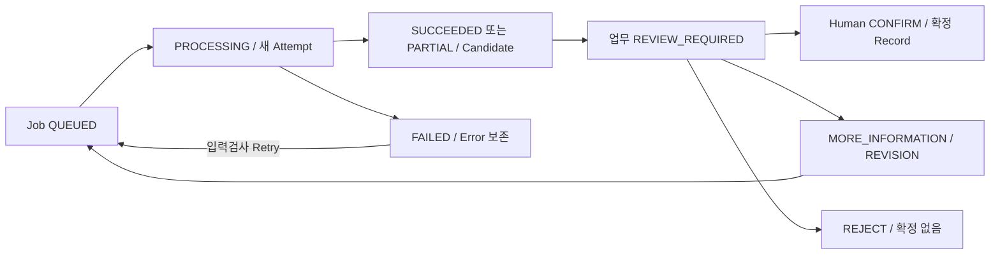
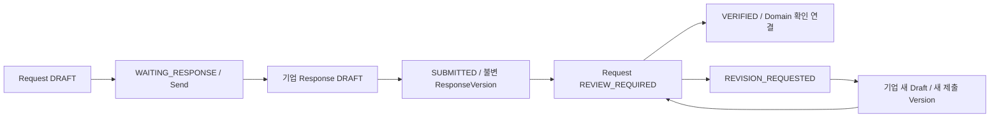
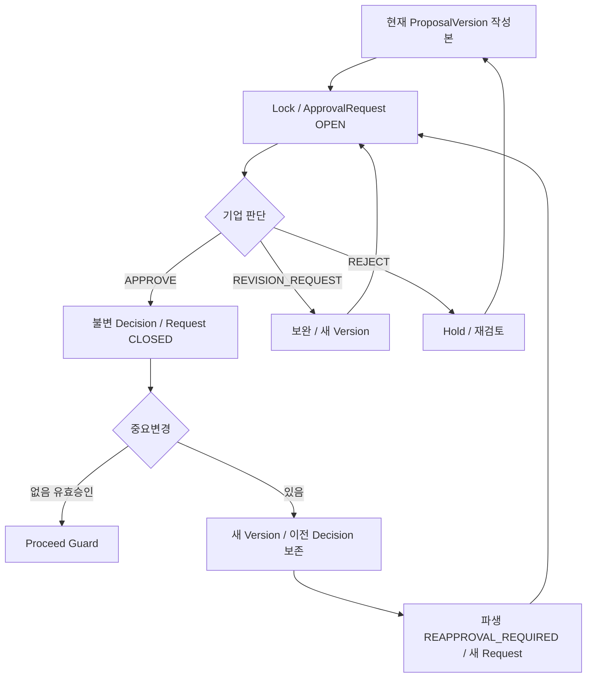
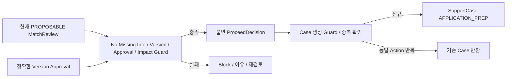
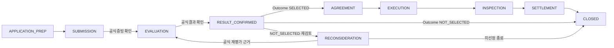
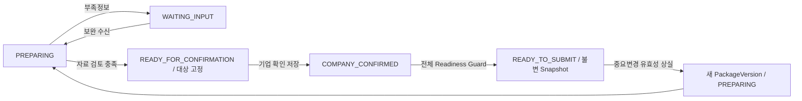
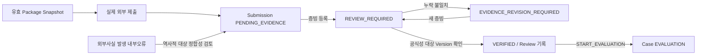
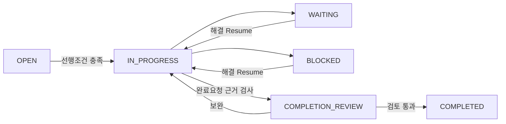
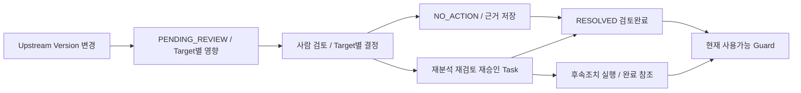

# DATCO 정부지원사업 운영체계 - State / Action Model

## 1. 역할과 적용 기준

이 문서는 현재 State, Action, From/To, Guard, Blocking Reason, Version Lock, Current Usability, Human Review, Side Effect, Audit/Notification, Retry/Failure 및 Change Impact를 함께 정의하는 Workflow 기준이다. 단순 enum 목록이나 UI Button 목록이 아니다.
우선순위는 [AGENTS](../AGENTS.md) → [Baseline](00_PROJECT_BASELINE.md) → [Architecture](01_SYSTEM_ARCHITECTURE.md) → [E2E](02_E2E_SYSTEM_FLOW.md) → [Data Model](03_DATA_MODEL.md) → [Probe 1차](../tools/bizinfo-probe/ANALYSIS.md)/[2차](../tools/bizinfo-probe/PHASE2_ANALYSIS.md) → 이 문서다.
DB/ORM/SQL/ID 기술, 실제 API Route/HTTP Status, UI 디자인, 상세 Permission Matrix, Queue/AI/OCR/DMP 계약, Collector Retry 횟수/Backoff/Rate Limit 값, Transaction 구현코드는 확정하지 않는다. 책임 Actor는 authorized DATCO actor, authorized company editor/approver, authorized worker/operator 수준으로 정의하고 세부 Role/버튼 공개는 05에 넘긴다.
상태/결과명은 UPPER_SNAKE_CASE로 통일한다. 새로운 Entity를 추가하지 않고 03의 Entity/Review/Version 관계를 사용한다. State는 해당 Domain의 업무 상태 소유자가 관리하고 파생 View가 독립 진실값을 만들지 않는다.

## 2. 모델링 종류와 State Category

| 종류 | 의미 | 적용 원칙 |
| --- | --- | --- |
| A Stateful workflow holder | 저장된 Lifecycle/Execution/Review 진행상태가 필요한 Root 또는 운영 Record | 전이 Action을 통해 변경. 모두 별도 DDD Aggregate Root라는 뜻은 아님 |
| B Immutable Decision Record | 사람의 특정 대상/Version에 대한 결정 | 생성 후 Outcome/대상을 Update하지 않음. 새 판단은 새 Record |
| C Immutable Version/Snapshot | 당시 내용/입력조합 | 고정 후 내용 수정 금지, 새 Version/행위 Snapshot |
| D Review Record | 후보/근거에 대한 확인·보완·거절 판단 | 결정 기록 보존. 대상 Object의 진행상태와 별개 |
| E Derived Indicator | 현재 관계/시간/기록으로 계산되는 의미 | 독립 State Source of Truth로 중복 저장하지 않음 |
| F No Independent Lifecycle | 관계/정의/원천 식별/근거 Record | 별도 State enum 강제 안 함 |

Lifecycle State, Review State, Decision Outcome, Execution State, Derived Indicator, Validity/Freshness, Version Lock Condition을 구분한다. Job SUCCEEDED ≠ Human Confirmed, API 수집 성공 ≠ Requirement 확정, 분석 Candidate 생성 ≠ 검토 완료다.
FIT/PARTIAL_FIT/NEED_MORE_INFO/MISMATCH는 분석 의미, PROPOSABLE/REQUEST_MORE_INFO/HOLD/EXCLUDE는 MatchReview의 업무판단이다. SELECTED/NOT_SELECTED는 OfficialResultRecord.outcome이며 Case Stage와 중복 저장하지 않는다.
Portal 열기 ≠ 제출, 접수번호 입력 ≠ Evidence Verified, 결과 입력 ≠ 공식결과 확인이다. 화면 표시/버튼 클릭이 아닌 저장된 상태·Version·Decision·Evidence를 완료조건으로 사용한다.

## 3. State Coverage Matrix

아래 A는 저장 Workflow를 가진 Object 17종이며, 그중 03 Catalog의 Root는 10종이다. Job/운영 Record도 포함하며 03의 R/O 분류를 다시 정의하지 않는다. D의 결과는 Review 결정이고 Candidate의 Review 필요 여부는 해당 Record와 현재 입력관계에서 계산한다.

| Entity | Modeling Type | State Machine 필요 | 핵심 State/Decision | Source of Truth |
| --- | --- | --- | --- | --- |
| CollectionJob | A 실행 | 예 | QUEUED/PROCESSING/SUCCEEDED/PARTIAL/FAILED | Collector |
| BackgroundJob | A 실행 | 예 | QUEUED/PROCESSING/SUCCEEDED/PARTIAL/FAILED | Job |
| JobAttempt | A 실행 Record | 예 | PROCESSING/SUCCEEDED/PARTIAL/FAILED | 해당 Attempt |
| AnalysisRun | C 실행결과 | 아니오 | 입력/결과 고정, 업무 검토 별도 | Run/Attempt |
| Notice | F Root 정체성 | 아니오 | currentVersion과 사용가능성 파생 | Notice/Version |
| NoticeVersion | C | 아니오 | 불변 내용, 변경은 새 Version | NoticeVersion |
| NoticeRequirementVersion | C | 아니오 | 확인된 요건, 현재성 파생 | Version/AnalysisReview |
| FactCandidate | F 후보 | 아니오 | REVIEW_REQUIRED 및 미확정은 Review에서 파생 | Candidate/FactReview |
| FactReview | D | 아니오 | CONFIRM_NEW_VALUE/CONFIRM_EXISTING_VALUE/CONFLICT/REQUEST_MORE_INFORMATION/REJECT_CANDIDATE | FactReview |
| CompanyFactVersion | C | 아니오 | 확인값/근거 불변 | Version/FactReview |
| Improvement | A 업무 | 예 | DRAFT/SUBMITTED/REVIEW_REQUIRED/CONFIRMED/REVISION_REQUIRED | Improvement |
| ImprovementVersion | C | 아니오 | 제출본/확인내용 고정 | Version/Review |
| CapabilityVersion | C | 아니오 | 검토된 Catalog, 활성/현재성은 Root 선택관계 | Capability/Version |
| CapabilityAssessment | A 검토 | 예 | REVIEW_REQUIRED/CONFIRMED/REVISION_REQUIRED | Assessment/AnalysisReview |
| Match | A 검토 | 예 | DRAFT/REVIEW_REQUIRED/REVIEWED | Match |
| MatchCandidate | C 후보 | 아니오 | FIT/PARTIAL_FIT/NEED_MORE_INFO/MISMATCH | Candidate/Run/Snapshot |
| MatchInputSnapshot | C | 아니오 | 당시 입력 Version 조합 불변 | Snapshot |
| MatchReview | D | 아니오 | PROPOSABLE/REQUEST_MORE_INFO/HOLD/EXCLUDE | MatchReview |
| InformationRequest | A 요청 | 예 | DRAFT/WAITING_RESPONSE/REVIEW_REQUIRED/REVISION_REQUESTED/VERIFIED | Request |
| InformationResponse | A 응답 | 예 | DRAFT/SUBMITTED | Response |
| InformationResponseVersion | C | 아니오 | 제출 시 고정 | ResponseVersion |
| Proposal | F Root | 아니오 | 작성/승인/재승인 의미는 Version/Request/Decision에서 파생 | Proposal/관계 |
| ProposalVersion | C | 아니오 | Draft 작성본만 편집, 요청 이후 불변 | Version/Lock |
| ApprovalRequest | A 요청 | 예 | OPEN/CLOSED | Request, closureReason |
| ApprovalDecision | B | 아니오 | APPROVE/REVISION_REQUEST/REJECT | Decision |
| ProceedDecision | B | 아니오 | 추진확정 기록, 현재사용 가능은 파생 | Decision/입력 Version |
| SupportCase | A 단계 | 예 | APPLICATION_PREP/SUBMISSION/EVALUATION/RESULT_CONFIRMED/AGREEMENT/EXECUTION/INSPECTION/SETTLEMENT/RECONSIDERATION/CLOSED | Case/CaseStageRecord |
| Application | A 입력 | 예 | DRAFT/REVIEW_REQUIRED/CONFIRMED | Application/입력검토 |
| ApplicationTemplateVersion | C | 아니오 | 검토된 정의/공고 Version 불변 | TemplateVersion |
| ApplicationVersion | C | 아니오 | 확인/준비/제출 사용본 고정 | Version |
| ApplicationValueCandidate | F 후보 | 아니오 | 후보·검토 상태는 Review 관계 | Candidate/ValueReview |
| ApplicationValueReview | D | 아니오 | CONFIRM/REQUEST_MORE_INFORMATION/REJECT | Review |
| ApplicationPackage | A 준비 | 예 | PREPARING/WAITING_INPUT/READY_FOR_CONFIRMATION/COMPANY_CONFIRMED/READY_TO_SUBMIT | Package |
| ApplicationPackageVersion | C | 아니오 | 확인/Readiness 사용본 고정 | Version/검토 |
| ApplicationPackageSnapshot | C | 아니오 | 당시 조합 불변, 현재 유효성 파생 | Snapshot |
| SubmissionRecord | A 증빙진행 | 예 | PENDING_EVIDENCE/REVIEW_REQUIRED/EVIDENCE_REVISION_REQUIRED/VERIFIED | Submission/EvidenceReview |
| SubmissionEvidenceReview | D | 아니오 | VERIFY/REQUEST_REVISION | Review |
| EvaluationRecord | A 평가업무 | 예 | OPEN/CLOSED | 평가 업무 Record, 결과와 구분 |
| OfficialResultRecord | B/D | 아니오 | SELECTED/NOT_SELECTED + 공식근거/검토 | 공식원천/ResultRecord |
| Task | A 업무 | 예 | OPEN/IN_PROGRESS/WAITING/BLOCKED/COMPLETION_REVIEW/COMPLETED | Task |
| ImpactAssessment | A 검토 | 예 | PENDING_REVIEW/RESOLVED | Assessment/Target 결정 |
| Notification | A 전달 | 예 | PENDING/DELIVERED/FAILED | 전달결과/Recipient |

나머지 Entity는 03의 Definition/Child/Junction/Source/Evidence/Audit/Assignment 이력으로 관리하며 별도 State를 강제하지 않는다. 승인/선정/Readiness 요약표시는 아래 단일 Source of Truth에 종속된다.

## 4. Guard Catalog / Blocking Reason

모든 Action은 아래 Guard의 논리 의미를 적용한다. From 검사는 G-STATE, 권한은 G-AUTH, 관계는 G-COMPANY/G-CASE/G-FILE을 기본으로 한다. Global/worker Action도 해당 운영권한과 허용 Source/대상 범위를 검사한다. 적용되지 않는 Company/Case Guard만 생략한다.

| Guard ID | 종류/논리 의미 | Blocking Reason |
| --- | --- | --- |
| G-AUTH | 요청 Actor/worker가 해당 Action을 실행할 권한 | ACTION_NOT_AUTHORIZED |
| G-COMPANY | 연결된 기업 Object/Actor Scope 일치, Global 참조의 허용범위 | CROSS_COMPANY_SCOPE |
| G-CASE | Case/Package/Application/Task가 해당 Company·업무맥락과 일치 | CASE_SCOPE_MISMATCH |
| G-FILE | File/Evidence 소유/공개범위 및 대상 정합성 | FILE_SCOPE_MISMATCH |
| G-STATE | 현재 저장 상태가 Action From 집합에 포함 | TRANSITION_NOT_ALLOWED |
| G-VERSION | 요청 expected 대상 Version/Revision과 실행시 대상 정확히 일치 | TARGET_VERSION_MISMATCH |
| G-FRESH | 대상 입력이 현재 적용 Version이고 변경 검토가 해결됨 | STALE_INPUT_VERSION 또는 STALE_MATCH_REVIEW |
| G-IMPACT | 해당 Action을 막는 미해결/후속조치 미완료 Impact 없음 | UNRESOLVED_CHANGE_IMPACT |
| G-NO-INFO | 해당 Gate의 필수 정보/검증 부족 및 Blocking Request 없음 | MISSING_REQUIRED_INFORMATION |
| G-COMPLETE | Action별 필수 값/단위/기간/조건 충족 | REQUIRED_DATA_MISSING |
| G-EVIDENCE | 필요한 실제 File/Source/Evidence·위치 연결과 검토 충족 | REQUIRED_EVIDENCE_MISSING |
| G-OFFICIAL | 공식 공고/제출/결과 근거와 대상 연결이 사람 검토로 확인 | OFFICIAL_SOURCE_NOT_VERIFIED |
| G-APPROVAL | 8절의 정확한 Version/권한/수량/Impact 조건을 만족한 승인 | PROPOSAL_NOT_APPROVED / APPROVAL_VERSION_MISMATCH / REAPPROVAL_REQUIRED |
| G-PROPOSABLE | 현재 MatchReview의 disposition=PROPOSABLE, 분석 FIT만으로 대체 불가 | MATCH_NOT_PROPOSABLE |
| G-PROCEED | 정확한 입력/승인에 대한 현재 사용가능 ProceedDecision | PROCEED_NOT_CONFIRMED 또는 STALE_PROCEED_DECISION |
| G-NO-CASE | 같은 ProceedDecision으로 이미 생성된 Case 없음, 동일 Action은 기존결과 | CASE_ALREADY_EXISTS |
| G-TEMPLATE | Application/Definition/Requirement/NoticeVersion 조합 일치 | TEMPLATE_VERSION_MISMATCH |
| G-READINESS | 10절의 자료·확인·승인·Scope·Impact 전부 충족 | PACKAGE_NOT_READY / REQUIRED_DOCUMENT_MISSING |
| G-SUBMISSION | 공식 Receipt/Evidence Review 충족, 해당 제출 Snapshot 일치 | SUBMISSION_EVIDENCE_NOT_VERIFIED |
| G-PREREQUISITE | 필요한 선행 Task 완료, 해당 Case 단계 선행조건 충족 | PREREQUISITE_NOT_COMPLETED |
| G-DEPENDENCY | 자기/순환 Dependency 없음, 허용 Company/Case 관계 | INVALID_TASK_DEPENDENCY |
| G-IDEMPOTENCY | Business Action Identity의 요청/대상 일치, 반복이면 기존결과 | IDEMPOTENCY_TARGET_MISMATCH |
| G-INPUT | 수집/분석 입력 형식·검증·실제 확보범위가 Action 목적에 충분 | INPUT_NOT_READY / SOURCE_ACQUISITION_INCOMPLETE |

Guard 실패는 저장된 업무 Object를 성공상태로 변경하지 않는다. 검증 당시 이유를 반환하되 타기업 자료/Secret/인증 URL을 노출하지 않는다. 논리 Blocking Reason이며 실제 API Error Code/HTTP Status는 후속 구현에서 정한다.
정당한 Action이라도 실행시 최신 상태/Version을 다시 검사한다. UI의 disabled/visibility는 Backend Guard 대체가 아니다. 수정/확인/승인/제출에 쓰는 File/Source 참조도 검사한다.
G-OFFICIAL/G-EVIDENCE는 검증 Action에서는 실제 확인할 자료·대상·검토권한을 검사하고, 후속진행 Action에서는 이미 저장된 유효 Review를 검사한다. 검증을 수행하려고 기존 검증완료를 요구하는 순환 Guard를 만들지 않는다.

G-FRESH/G-IMPACT는 Action 목적별로 판별한다. 재분석·재검토·재승인처럼 Impact를 해결하는 Action은 **지정된 후속조치 대상과 현재 입력**이 일치하고 다른 해결되지 않은 선행 제약이 없으면 실행 가능하다. 해결하려는 바로 그 Target의 완료를 사전에 요구하지 않는다. Proceed/Case/Readiness 등 후속업무 사용 Action은 해당 Blocking Impact의 검토와 필요한 후속조치 완료를 모두 요구한다.

## 5. Version Lock Matrix

Lock는 불변조건이며 모든 Version에 별도 LOCKED enum을 복제하지 않는다. Draft 작성본은 사용 전 편집 가능하지만 분석/검토/승인/준비/제출에 참조한 본은 고정한다. 내용은 불변이고 후속 Review/유효성은 별도 Record/관계로 관리한다.

| Object | Draft 수정 가능 | Lock Trigger | Lock 이후 변경방법 | 기존 Version 보존 | Change Impact |
| --- | --- | --- | --- | --- | --- |
| NoticeVersion | 아니오 | import 결과 생성 | 새 NoticeVersion/변경검토 | 예 | Requirement/Match/Template/Package |
| CompanyFactVersion | 아니오 | Human Confirm으로 생성 | 새 Candidate/Review/FactVersion | 예 | Match/매핑/Proposal |
| ImprovementVersion | 제출 전 작성본만 | Submit 또는 분석 입력 고정 | 새 Draft/Version→재분석/검토 | 예 | Assessment/Match/Proposal |
| CapabilityVersion | 공개/참조 전 작성본만 | Catalog 확정/Assessment 입력 | 새 CatalogVersion | 예 | Assessment/Match/Proposal |
| MatchInputSnapshot | 아니오 | 분석 입력조합 생성 | 새 Snapshot/Run | 예 | MatchReview/Proposal |
| ProposalVersion | 승인요청/근거 사용 전만 | REQUEST_APPROVAL 또는 결정/업무 참조 | 새 ProposalVersion+새 Request | 예 | Reapproval/Proceed/Package |
| InformationResponseVersion | 아니오 | Submit으로 제출본 생성 | 새 Response Draft/제출 Version | 예 | Fact/Application 검토 |
| ApplicationTemplateVersion | 확정/참조 전 작성본만 | Template 검토확정/입력에 사용 | 새 TemplateVersion | 예 | Application/Package |
| ApplicationVersion | 확인/근거 사용 전 Draft만 | 사람확인/Company Confirmation/Package Readiness/Submission 사용 중 가장 먼저 | 새 ApplicationVersion | 예 | Package Readiness |
| ApplicationPackageVersion | 확인/사용 전 작성본만 | Company Confirmation/Readiness/Snapshot 참조 | 새 PackageVersion | 예 | 현재 Readiness/후속제출 |
| ApplicationPackageSnapshot | 아니오 | MARK_PACKAGE_READY로 생성 | 새 준비조합/새 Snapshot | 예 | 현재 사용가능성만 재검토 |
| Submission 대상 Snapshot | 아니오 | 제출대상으로 고정/참조 | 별도 보완/재제출 Snapshot·Record | 예 | 외부 제출사실 보존 |

Root.currentVersion은 선택 중인 본을 가리키는 편의관계다. 새 작업본 생성 시 기존 확인/승인을 현재 새 본에 전용하지 않는다. 과거 불변 본의 의미는 유지하고 Current Usability를 별도로 판별한다. 사용된 Version에 대한 감사/결정 참조를 in-place 수정하지 않는다.

## 6. 실행과 분석 / Notice / Fact / Improvement

### 6.1 Job Execution와 분석 Review의 분리

CollectionJob/BackgroundJob은 QUEUED→PROCESSING→SUCCEEDED/PARTIAL/FAILED다. JobAttempt는 실행을 시작할 때 PROCESSING으로 생성되고 하나의 terminal 결과 SUCCEEDED/PARTIAL/FAILED를 보존한다. FAILED/PARTIAL 재시도는 오류를 지우지 않고 새 JobAttempt를 생성하며 Job은 QUEUED로 돌아갈 수 있다.
AnalysisRun은 성공/부분 실행 결과와 입력 Version을 고정한다. Candidate가 생성되면 업무 Review는 REVIEW_REQUIRED가 된다. AnalysisReview 결과는 CONFIRM, REQUEST_MORE_INFORMATION, REQUEST_REVISION, REJECT로 통일한다. 부분확정은 해당 후보항목의 확인범위를 기록하며 나머지를 확정으로 취급하지 않는다.
Architecture/E2E의 분석 요청→실행→REVIEW_REQUIRED→CONFIRMED 표현은 **Execution State와 업무 Review 진행을 합쳐 설명한 Flow**다. 구현에는 Job.CONFIRMED를 만들지 않고 Job.SUCCEEDED와 해당 업무 확인/Review를 분리한다. 분석 Review CONFIRM이 어떤 Fact/Requirement/Improvement를 확정했는지 실제 대상 Record가 있어야 한다.
Retry는 현재 입력 Version/실제 자료와 재실행 필요를 검사한다. 오래된 성공결과는 역사적으로 보존하되 현재 확인으로 자동 승격하지 않는다. 재시작 중 PROCESSING Attempt는 성공으로 간주하지 않고 실행 소유/완료근거를 확인한 후 중단 실패처리 또는 재개한다. 중단판정/재시도 횟수·대기값은 후속 실행정책이다.

Job 실행 성공과 사람 확인은 서로 다른 Object/결정이다. 실패한 계산으로 확정 결과를 만들지 않는다.

### 6.2 Notice Action과 Requirement Review

IMPORT_NEW_NOTICE는 검증 Raw/Source+External ID로 Notice/최초 Version을 생성한다. COMPARE_EXISTING_NOTICE는 기존 매핑을 재사용하고 source signal+핵심 Content+기간+첨부 metadata를 비교한다. KEEP_EXISTING_VERSION은 변경없음 근거/수집이력을 남기며 CREATE_NOTICE_VERSION은 정책으로 확인한 의미변경에 새 Version을 만든다.
updtPnttm만으로 Version을 생성한다고 확정하지 않으며 inqireCo/totCnt를 업무변경으로 취급하지 않는다. Hash/변경판정 상세는 06에 위임한다. 실제 JSON wrapper/ID/기간/첨부 URL과 관찰조건의 마지막/빈 페이지는 Probe를 따른다. Rate Limit/오류/Retry-After 값을 새로 추정하지 않는다.
REQUEST_NOTICE_REVIEW는 해당 NoticeVersion/확보 Source로 Run을 요청하고 Candidate의 미검토 의미는 REVIEW_REQUIRED다. CONFIRM_NOTICE_REQUIREMENT는 권한 있는 DATCO 검토와 공식 Source/Evidence/입력 Version 일치에 근거해 NoticeRequirementVersion/Item과 AnalysisReview를 생성한다. REQUEST_MORE_SOURCE_REVIEW는 REQUEST_MORE_INFORMATION Review를 남기고 부족 자료/검토를 다시 요청한다. 기업응답만으로 공식 공고조건을 변경할 수 없다.
전체본문/print 역할/HWP/HWPX/다중첨부/자료 충분성은 아직 미확정이므로 확보한 범위와 Partial Input을 명시한다. 지원되지 않거나 부족한 원천을 확보/확정완료로 표시하지 않는다.

### 6.3 Company Fact Review

FactCandidate→FactReview Outcome은 CONFIRM_NEW_VALUE, CONFIRM_EXISTING_VALUE, CONFLICT, REQUEST_MORE_INFORMATION, REJECT_CANDIDATE다. 확인한 Source/Location/기업·기간·단위·값과 기존 FactVersion 비교가 필수다.
CONFIRM_NEW_VALUE는 새 CompanyFactVersion+FactReview+Evidence 연결, CONFIRM_EXISTING_VALUE는 기존 확인값을 직접 참조하는 Review/근거 연결을 만든다. CONFLICT는 기존 확인값을 유지하고 FactConflict/비교근거를 보존한다. 부족정보는 Request로 복귀, 거절은 확정 Version을 생성하지 않는다. 값/기간/단위/Source 의미가 바뀌면 기존 Version 내용을 수정하지 않고 새 후보/확인 본을 검토한다.
companyFact.confirmed 같은 별도 truth를 추가하지 않는다. 현재 확인값은 유효하게 선택된 Version과 검토 근거로 판단한다.

### 6.4 Improvement / Capability Assessment

Improvement는 DRAFT→SUBMITTED→REVIEW_REQUIRED→CONFIRMED, 검토보완은 REVISION_REQUIRED→새 작업본 DRAFT다. SUBMITTED 동안 분석 Job은 따로 실행되며 Improvement.PROCESSING을 복제하지 않는다. 결과 생성/입력 일치 후 REVIEW_REQUIRED, 사람확인으로 CONFIRMED와 정확한 Version/Review를 연결한다.
확인된 과제 수정은 새 ImprovementVersion 작업본을 만들고 DRAFT로 시작한다. 기존 Confirmed Version/Review는 보존하고 새로운 판단은 새 입력으로 검토한다.
CapabilityVersion은 Catalog 확정 후 불변이고 별도 복잡한 Lifecycle을 만들지 않는다. 과제별 CapabilityAssessment는 REVIEW_REQUIRED→CONFIRMED 또는 REVISION_REQUIRED, 새 분석 결과 재검토는 REVIEW_REQUIRED로 돌아간다. FIT류 Candidate 의미, 사람 검토 여부, Catalog/입력 현재성은 별개다.

## 7. Match / Information Request / Application 값

### 7.1 Match와 Review

Match는 DRAFT(입력 선택)→REVIEW_REQUIRED(분석 Candidate 생성)→REVIEWED(사람 업무판단 기록)다. Review Outcome은 PROPOSABLE, REQUEST_MORE_INFO, HOLD, EXCLUDE다. FIT라도 자동 PROPOSABLE이 아니며 PROPOSABLE이라도 Proceed Guard를 생략하지 않는다.
재분석은 새 MatchInputSnapshot/Run/Candidate를 만들고 REVIEW_REQUIRED로 돌아간다. 이전 Review는 보존한다. 현재 InputSnapshot과 다른 Review는 STALE_MATCH_REVIEW로 판단한다. Blocking Missing Info가 있으면 PROPOSABLE 확정 및 Proposal 승인요청 진행을 차단한다.

### 7.2 Request / Response 독립 상태

InformationRequest는 DRAFT→WAITING_RESPONSE(발송 저장)→REVIEW_REQUIRED(기업 제출)→VERIFIED 또는 REVISION_REQUESTED→REVIEW_REQUIRED(재제출)다. SENT/RESPONSE_SUBMITTED는 Action Event이며 별도 Lifecycle을 중복 저장하지 않는다.
InformationResponse는 DRAFT→SUBMITTED다. Submit은 불변 InformationResponseVersion을 생성한다. 보완 시 새 Draft/제출 Revision을 만들고 기존 제출본은 수정하지 않는다. 기존 Response Root를 다시 DRAFT로 열 수 있으나 대상 제출본 Identity는 유지한다.
DATCO InformationReview가 특정 제출본/요청항목을 확인해야 VERIFIED다. 값/0/없음/모름/추후제출/해당없음은 answerMeaning으로 구분하며 빈값을 0/해당없음으로 자동 처리하지 않는다. Request VERIFIED는 모든 해당 Blocking 항목 검토충족을 의미한다. Fact/Application의 실제 확인/갱신 결과도 같은 검토 Action에서 연결돼야 다음 Gate의 부족정보가 해소된다.
Due Date 초과는 REQUEST_OVERDUE 파생지표이며 WAITING_RESPONSE를 별도 OVERDUE Lifecycle로 바꾸지 않는다. 공식 Requirement는 기업응답이 아닌 공식 Source 검토가 추가로 필요하다.

요청/응답/검증 Record를 분리한다. 기업 제출이 DATCO 검증이나 Fact 확정을 대신하지 않는다.

### 7.3 Application과 값 확인

Application은 DRAFT→REVIEW_REQUIRED→CONFIRMED다. 값의 SourceKind(자동후보/기업/DATCO)와 Verification은 별개다. ApplicationValueCandidate 생성만으로 ApplicationFieldValue를 확인하지 않는다.
CONFIRM_APPLICATION_VALUE는 해당 TemplateVersion/Definition/입력근거/Scope를 검사해 ApplicationValueReview와 확인값/Section을 저장한다. REQUEST_MORE_INFORMATION/REJECT는 미확인 항목으로 남기고 Request/새 입력으로 돌아간다.
ApplicationVersion은 사람확인/Company Confirmation/Package 사용/제출 근거 중 가장 이른 참조시점에 고정한다. 이후 수정은 새 ApplicationVersion/DRAFT다. Notice/Fact/Template의 중요변경은 Impact를 만들어 관련 확인값/준비조건을 재검토한다. TemplateVersion은 확인 Requirement/NoticeVersion과 일치해야 한다.
Lock 이후에도 고정한 입력값에 대한 Review/확인결과 연결은 추가할 수 있으나 입력값·Definition·Source Version을 바꾸지 않는다. 확인 중 새 값/문서를 넣어야 한다면 새 ApplicationVersion을 만들고 영향받는 확인을 다시 수행한다. CONFIRM_APPLICATION_VALUE는 미확인/새 후보만 대상으로 하며 이미 고정한 값을 수정하는 Action이 아니다.

## 8. Approval / Reapproval / 현재 유효성

Proposal Root에 approval_status를 독립 저장하지 않는다. 작성본 수정가능 여부는 Lock, 승인요청/결정/재승인은 특정 ProposalVersion 관계로 계산한다.
ApprovalRequest는 OPEN→CLOSED다. closureReason은 DECIDED 또는 SUPERSEDED다. OPEN Request는 한 ProposalVersion에 고정된다. 허용 Outcome은 APPROVE, REVISION_REQUEST, REJECT이며 terminal Decision 후 동일 Request에 다른 Outcome을 추가하여 의미를 바꾸지 않는다. 단순 기본정책은 Request당 terminal Decision 최대 1개로 한다. 03의 0..N Decision 관계는 이 제한을 포함할 수 있는 넓은 모델이므로 충돌하지 않는다.
승인자 수/정확한 권한은 05의 required approver set으로 결정한다. 복수 승인자가 필요하면 각 지정 승인자에 대해 별도 Request/Decision을 만들고 필요한 집합 충족으로 계산한다. 승인요건이 미설정이면 승인완료를 추정하지 않고 차단한다.
새 ProposalVersion은 새로운 현재 추진대상이다. 이전 OPEN Request는 SUPERSEDED로 닫고 Decision은 보존한다. 수정/보완 후 새 ProposalVersion+새 ApprovalRequest를 생성한다. REVISION_REQUEST 이후 같은 Request를 재활용하지 않는다. REJECT 이후에는 DATCO Match/Proposal 재검토 후 새 내용/Version/Request로 진행하며 Reject 결정을 Approve로 Update하지 않는다.
동일 APPROVAL Action Identity/대상/Outcome 재시도는 기존 Decision을 반환한다. 다른 Outcome/대상의 재전송이나 닫힌 Request의 새 판단은 차단한다.

### 8.1 현재 유효한 Approval

다음 조건을 **모두** 만족한 집합만 현재 추진/Readiness에 사용한다.

1. Outcome=APPROVE이며 Decision과 Request가 정확히 동일 ProposalVersion을 참조한다.
2. 해당 ProposalVersion이 현재 선택된 추진/준비 대상 Version이며 Company Scope와 입력조합이 일치한다.
3. 결정 당시 승인권한과 현재 적용되는 승인요건의 지정 승인자/필요 수를 충족한다. 상세 조직/퇴사/역할변경 의미는 05에서 명시하되 모든 과거 승인을 무조건 삭제하지 않는다.
4. 새 ProposalVersion으로 대상이 바뀌지 않았고, 해당 사용을 무효화하는 확정 Change Impact나 미해결 Blocking Impact가 없다.
5. 해당 승인 Cycle의 유효 Request/Decision이며 SUPERSEDED된 현재 요청으로 결과를 위장하지 않는다. 과거 DECIDED Request의 승인 사실은 역사적으로 유지한다.

정확한 대상불일치는 APPROVAL_VERSION_MISMATCH, 승인부족은 PROPOSAL_NOT_APPROVED, 중요변경 후 미승인은 REAPPROVAL_REQUIRED, 영향미해결은 UNRESOLVED_CHANGE_IMPACT다.
Reapproval Required는 별도 저장 Lifecycle가 아니라 **이전에 승인된 내용의 중요변경/Impact 처리요구 + 현재 대상 Version에 필요한 승인 없음**에서 파생한다. 사업비/기업부담/서비스·수행·책임범위 변경은 재승인 요구를 발생시킨다. 단순 최초 무승인은 APPROVAL_REQUIRED 의미이며 재승인과 구분한다. v1 APPROVE는 v2 APPROVE가 아니다.

Request 종료·Decision 생성·Version 선택이 승인 판단의 기준이다. 그림의 보완/재검토는 이전 Request 재사용을 의미하지 않는다.

## 9. Proceed / SupportCase / CaseStage

CONFIRM_PROCEED는 G-AUTH, Company Scope, 현재 PROPOSABLE MatchReview, Blocking Missing Info 없음, 현재 ProposalVersion/그 입력 Snapshot 일치, 필요한 정확한 Version Approval, 재승인 미해결 없음, stale 입력/Blocking Impact 없음을 검사한다. 성공은 불변 ProceedDecision 생성이며 Company Approval과 다른 기록이다.
CREATE_SUPPORT_CASE는 현재 사용가능 Proceed, Company/Site/NoticeVersion/ProposalVersion/Approval 입력조합 일치, 미해결 영향 없음, 같은 Proceed에 기존 Case 없음이 Guard다. 성공 시 SupportCase/CaseStageRecord를 APPLICATION_PREP로 생성한다. 같은 Proceed Action 반복은 기존 Case, 다른 새로운 유효 Proceed는 Company/Notice가 같아도 정당한 별도 Case가 될 수 있다.
Proceed를 나중에 Update해 다른 Proposal을 가리키지 않는다. 생성 전 stale면 새 검토/승인/추진결정으로 돌아간다. 이미 생성된 Case가 stale한 경우 과거 생성사실은 보존하고 현재 업무 Gate를 재검토한다.

회사 승인과 DATCO 추진확정, Case 생성은 별도 Gate다. 권한 없는 자동생성이나 같은 Proceed의 중복 Case를 허용하지 않는다.

### 9.1 Case Stage Transition Matrix

Case는 현재 Stage를 관리하고 CaseStageRecord가 단계행위/Evidence/Audit를 보존한다. Outcome은 OfficialResultRecord만이 진실값이며 SELECTED/NOT_SELECTED를 Case Stage로 중복 저장하지 않는다.

| From Stage | Action | Guard | To Stage | Required Evidence | Side Effect |
| --- | --- | --- | --- | --- | --- |
| 생성 전 | CREATE_SUPPORT_CASE | 유효 Proceed/관계/중복검사 | APPLICATION_PREP | Match/Proposal/Approval 근거 | Case/Assignment/초기 Stage |
| APPLICATION_PREP | RECORD_EXTERNAL_SUBMISSION | 유효 Readiness Snapshot/외부행위 Metadata | SUBMISSION | 증빙 등록대기 가능 | SubmissionRecord 생성, 완료 아님 |
| SUBMISSION | START_EVALUATION | 필요한 Submission Evidence Verified | EVALUATION | 접수증 또는 승인된 공식증빙/Review | 신청완료 의미, 평가 Record/Task |
| EVALUATION | CONFIRM_OFFICIAL_RESULT | 공식 Source/Evidence/Human Review | RESULT_CONFIRMED | 공식 결과자료 | OfficialResultRecord/Stage 기록 |
| RESULT_CONFIRMED | START_AGREEMENT | 현재 공식 Outcome=SELECTED, 영향/선행조건 충족 | AGREEMENT | 선정결과 검토 | 협약 준비 Task |
| RESULT_CONFIRMED | CLOSE_NOT_SELECTED | 공식 Outcome=NOT_SELECTED, 종료조건 충족 | CLOSED | 미선정결과/종료검토 | 이력 보존/사후관리 |
| RESULT_CONFIRMED | RECONSIDER_NOT_SELECTED | 공식 Outcome=NOT_SELECTED, 권한/재검토 사유 | RECONSIDERATION | 미선정결과/재검토 사유 | 재검토 Task, 자동선정 아님 |
| RECONSIDERATION | RETURN_TO_EVALUATION | 공식 재평가 경로/근거와 필수 증빙 확인 | EVALUATION | 공식 재평가/재접수 근거 | 새 평가회차, 기존 결과 보존 |
| RECONSIDERATION | CLOSE_NOT_SELECTED | 현재 NOT_SELECTED 유지, 재검토 종료 | CLOSED | 종료검토 | 이력 보존 |
| AGREEMENT | START_EXECUTION | 필수 협약조건/선행 Task/근거 확인 | EXECUTION | 확인된 협약근거 | 수행 Task |
| EXECUTION | START_INSPECTION | 수행단계 필수 Task/근거 충족 | INSPECTION | 수행/산출근거 | 검수 Task |
| INSPECTION | START_SETTLEMENT | 필요한 검수 완료/증빙 확인 | SETTLEMENT | 검수 확인 | 정산 Task |
| SETTLEMENT | CLOSE_CASE | 필수 정산/종료 Task/근거 충족 | CLOSED | 정산/종료검토 | 사후관리 연결 |
| CLOSED | 조회/사후관리 Task | 권한/Scope | CLOSED 유지 | 기존 이력 | 자동 재개 없음 |

단계별 필수 Task/Evidence는 해당 사업 요구/확인된 조건을 따르며 내용이 정의되지 않으면 준비충족을 추정하지 않는다. 사업별 선택단계/스킵은 현재 허용하지 않고 후속 승인된 정책으로 남긴다. NOT_SELECTED에서 AGREEMENT는 금지한다.

결과 입력만으로 공식 Outcome/Stage를 확정하지 않는다. 선정/미선정은 외부 Evidence와 검토 Record에 따른다.

## 10. ApplicationPackage / Readiness / 무효화

Package Lifecycle은 PREPARING, WAITING_INPUT, READY_FOR_CONFIRMATION, COMPANY_CONFIRMED, READY_TO_SUBMIT의 5개다. REVIEW_REQUIRED를 별도 Package 상태로 늘리지 않고 중요한 변경은 **새 PackageVersion + PREPARING**으로 처리한다. 과거 Snapshot/확인본은 보존한다.
PREPARING→WAITING_INPUT은 Blocking 자료부족/정보요청, 보완자료 수신은 PREPARING으로 복귀하여 검토한다. 자료가 준비되면 READY_FOR_CONFIRMATION, 필요한 기업 확인 Record가 대상 Version/Actor/시간/결정으로 저장되면 COMPANY_CONFIRMED, 최종 Guard 충족 후 MARK_PACKAGE_READY로 READY_TO_SUBMIT/Snapshot 생성이다.
Company Confirmation은 boolean만이 아니라 03에 정의한 PackageVersion 귀속 검토 Record 의미를 사용한다. 그 정확한 권한/복수확인 대상은 05에서 정한다. READY_FOR_CONFIRMATION 시 검토대상 Package/ApplicationVersion을 고정하여 이후 변경이 확인대상을 바꾸지 않게 한다.

### 10.1 MARK_PACKAGE_READY 필수 Guard

현재 Case/Package/ApplicationVersion 존재, 적용 TemplateVersion/Definition 일치, 필수 Field 및 Plan Section의 Human Confirmation, Required Document의 실제 File/Evidence·검토 충족, Conditional Requirement 처리(해당없음도 근거 포함), Blocking Request 없음, 필요한 Company Confirmation, 현재 ProposalVersion에 필요한 유효 Approval, Reapproval Required 없음, 미해결 Blocking Impact 없음, Company/Case/File/승인 Scope 일치가 모두 필요하다.
성공 Action은 ApplicationPackageVersion과 정확한 입력/문서/확인/승인 조합을 고정한 ApplicationPackageSnapshot을 만들고 현재 READY_TO_SUBMIT을 저장한다. 같은 Action 반복은 기존 Snapshot을 반환한다. Snapshot 존재만으로 현재 항상 준비완료라고 판단하지 않는다.
현재 적용 Notice/Fact/Proposal/Approval/Template/Required Document가 중요한 변경 또는 유효성 상실을 겪으면 이전 Snapshot을 보존하고 해당 사용을 즉시 보류한다. INVALIDATE_PACKAGE_READY는 새 PackageVersion/PREPARING과 Impact/사유를 남긴다. 원래 Snapshot에 이미 발생한 외부 제출사실은 지우지 않는다. 모든 무관한 최신 Global Version 생성이 모든 Case를 자동 변경하는 것은 아니며 적용관계/영향 판별이 필요하다.

과거 Snapshot은 변경하지 않고 새로운 준비조합을 검토한다. 준비완료와 외부 제출은 별개다.

## 11. Submission / 공식증빙 / Evaluation Result

RECORD_EXTERNAL_SUBMISSION은 authorized DATCO actor, 현재 유효 READY_TO_SUBMIT Snapshot, 해당 Case/Version 일치, 외부 제출 Metadata를 검사해 SubmissionRecord=PENDING_EVIDENCE와 Case SUBMISSION Stage를 저장한다. 접수번호 입력만으로 VERIFIED가 아니다.
REGISTER_SUBMISSION_EVIDENCE는 실제 File/Source와 대상 Snapshot/기업·Case 관계를 검사하여 SubmissionEvidence를 연결하고 REVIEW_REQUIRED로 전이한다. VERIFY_SUBMISSION_EVIDENCE는 공식성·접수/대상/Version 일치를 사람이 확인해 SubmissionEvidenceReview=VERIFY를 저장하며 필요한 모든 공식증빙 충족 시 SubmissionRecord=VERIFIED다. 부족/불일치는 REQUEST_REVISION Review와 EVIDENCE_REVISION_REQUIRED, 보완은 새 Evidence/Review를 추가한다.
VERIFIED 이후 START_EVALUATION은 별도 Action이며 Case를 EVALUATION으로 옮긴다. 그 전에는 최종 신청완료/평가진행 Gate를 충족했다고 표시하지 않는다. 검토결과에 문제를 발견하면 기존 Review를 덮어쓰지 않고 새 보완검토와 Current Usability 보류/Impact를 남긴다. 이미 발생한 공식 제출/평가 사실을 DB rollback처럼 지우지 않는다.
외부 제출은 성공했는데 Snapshot이 나중에 stale이거나 내부 기록이 실패한 경우 **RECONCILE_EXTERNAL_SUBMISSION**으로 실제 사용한 역사적 Snapshot/사유/확보 사실을 기록할 수 있다. 일반 제출준비 Guard의 예외 기록경로지만 승인/Readiness를 소급 성공시키지 않고 PENDING_EVIDENCE/Impact 검토로 둔다. 알려진 제출대상을 연결할 수 없으면 정합성 문제를 보완하며 다른 Snapshot으로 위장하지 않는다.
EvaluationRecord는 OPEN/CLOSED로 평가회차/보완업무를 관리한다. OfficialResult 확정은 해당 Case, 공식 Source/Evidence, Human Review, Outcome SELECTED/NOT_SELECTED를 고정하는 Record 생성과 Case RESULT_CONFIRMED Stage를 함께 처리한다. 잘못된 결과 정정은 새 OfficialResultRecord/supersedes/검토와 영향기록을 만들며 과거 결과를 삭제하지 않는다. Case Stage 재조정은 확인된 공식정정·검토로만 가능하고 자동 SELECTED 승격은 금지한다.

등록·검증·평가진행을 분리한다. 외부사실을 취소한 것처럼 표시하거나 내부 예외조치로 증빙 Gate를 우회하지 않는다.

## 12. Task / Dependency

Task Lifecycle은 OPEN, IN_PROGRESS, WAITING, BLOCKED, COMPLETION_REVIEW, COMPLETED다. 업무착수는 필요한 선행조건을 충족해야 하며 예외로 자료대기는 WAITING, 알려진 제약은 BLOCKED로 사유를 저장한다. 해결 후 RESUME으로 IN_PROGRESS에 복귀한다.
REQUEST_TASK_COMPLETION은 선행조건/필수산출물·근거를 검사해 COMPLETION_REVIEW로 이동한다. COMPLETE_TASK는 권한 있는 검토자가 필요한 Evidence/완료조건을 확인하고 COMPLETED를 저장한다. REJECT_TASK_COMPLETION은 보완사유를 남기고 IN_PROGRESS로 돌아간다. 증빙 불필요 Task도 정의된 완료조건을 확인한다.
자기 Dependency/순환 금지, 선행 Task 미완료 시 필요한 시작/완료 Action 차단, Company/Case 관계 위반 금지다. Cross Case Dependency는 승인된 상세 정책 전에는 만들지 않는 보수적 기본안으로 둔다. 담당자/기한 변경은 별도 Assignment/Deadline/Audit 이력이고 기존 Case/Task ID를 유지한다.
TASK_OVERDUE는 dueAt<now이며 Task가 COMPLETED가 아닐 때 파생한다. DEADLINE_APPROACHING은 적용 기한과 미완료 상태·설정된 임박 기준으로 계산하며 정확한 시간대/임박 폭은 후속 정책이다.

OVERDUE는 위 Lifecycle의 추가 State가 아니며 기한·시간에 따라 표시한다.

## 13. Change Impact / Freshness

NoticeVersion, Company/Financial FactVersion, CapabilityVersion, ProposalVersion 변경은 연결 Lineage를 따라 ImpactAssessment=PENDING_REVIEW와 대상 ImpactTarget를 만들 수 있다. Assessment는 모든 대상의 검토결정을 기록하면 RESOLVED로 종료된다. Target별 결정은 NO_ACTION, REANALYSIS_REQUIRED, RE_REVIEW_REQUIRED, REAPPROVAL_REQUIRED, TASK_REQUIRED이며 한 Assessment의 여러 대상은 다른 조치를 가질 수 있다.
**검토 RESOLVED ≠ 후속조치 완료**다. Target에 필요한 새 Run/Review/Approval/Task의 완료 참조가 있어야 해당 업무 G-IMPACT/G-FRESH가 통과한다. NO_ACTION도 현재 사용 가능한 이유와 확인자가 필요하다. 영향 확인 전에는 관련된 사용대상을 보류하고 다른 무관한 Object까지 일괄 무효화하지 않는다.
과거 판단은 Historical Record로 유지한다. 현재 적용 Version이 바뀌면 별도의 Current Usability를 검사한다. Freshness는 최종 생성시각 비교 하나가 아니라 입력조합의 적용/유효성·영향처리 관계다.

검토결정과 후속조치 완료를 함께 검사한다. 과거 승인/Version을 삭제하는 방식으로 영향문제를 해결하지 않는다.

### 13.1 Current Validity Matrix

| Object | Historical Record 유지 | 현재 사용가능 조건 | 무효/재검토 Trigger |
| --- | --- | --- | --- |
| NoticeRequirementVersion | 예 | 적용 NoticeVersion/공식 근거/검토 범위 일치 | 공고/서식/기간/첨부 중요변경 |
| CompanyFactVersion | 예 | 해당 기업/기간/단위의 선택된 확인값·근거/유효성 | 충돌/정정/기간·Source 의미변경 |
| ImprovementVersion | 예 | 제출/확인 본과 선택 입력/Review 일치 | 과제/Fact/현장자료 변경 |
| CapabilityAssessment | 예 | 적용 Catalog/Improvement 입력과 검토 일치 | 서비스조건/과제 중요변경 |
| MatchReview | 예 | 현재 Candidate/InputSnapshot에 대한 검토, 필요정보·Impact 해소 | 입력 Version 변경/미해결 부족정보 |
| ProposalVersion | 예 | 현재 추진대상, 원 MatchReview/입력 검토 유효 | 중요내용/근거 변경 |
| ApprovalDecision | 예, v1 승인 의미 유지 | 정확한 현재 v1 대상/권한·수량/영향 조건 만족 | v2 선택/승인무효 영향/요건 미충족 |
| ProceedDecision | 예 | 정확한 Match/Proposal/Approval/Company 조합 현재 사용가능 | 승인/입력 stale, 새 Case 대상 변경 |
| ApplicationPackageSnapshot | 예, 제출본 보존 | 현재 Package의 READY_TO_SUBMIT 대상과 모든 Guard 유효 | 자료/Template/Proposal/Approval 중요변경 |
| SubmissionRecord | 예, 외부사실 보존 | 특정 실제 제출대상/공식증빙/검토 의미에 한정 | 증빙 오류/정정은 새 검토, 과거 제출사실 삭제 아님 |

## 14. State / Decision / Derived 구분과 단일 진실값

| 업무 의미 | 저장 State | Decision Record | Derived 여부 |
| --- | --- | --- | --- |
| Proposal Approved | Proposal에 독립 승인 State 없음 | 정확한 ProposalVersion ApprovalDecision | 현재 승인충족 요약은 파생 |
| Reapproval Required | Proposal에 별도 Lifecycle 없음 | 이전 승인/중요변경/Impact | 예 |
| Task Overdue | Task 기본 Lifecycle 유지 | 없음 | 예 |
| Deadline Approaching | 원 업무 State 유지 | 없음 | 예 |
| Notice Changed | NoticeVersion 고정 | 변경판정/수집근거 | Version/내용 비교로 판단, 별도 지속 enum 없음 |
| Submission Verified | SubmissionRecord.VERIFIED는 검증진행 요약 | SubmissionEvidenceReview | 필요한 Review 충족에서만 State 전이 |
| Official Result | Case.RESULT_CONFIRMED는 결과확정 단계 | OfficialResultRecord.SELECTED/NOT_SELECTED | 선정결과를 Case에 독립 중복 저장 안 함 |
| Current Approval Validity | 없음 | ApprovalDecision/Request | 예 |
| Package Ready | Package.READY_TO_SUBMIT | 확인/Readiness Snapshot | 현재 사용할 수 있는 READY 여부는 Guard 재검사 |
| Match Proposable | Match.REVIEWED | MatchReview.PROPOSABLE | 현재 유효한 제안가능 요약은 파생 |

주요 Derived View/Indicator 8종: TASK_OVERDUE, REQUEST_OVERDUE, DEADLINE_APPROACHING, NOTICE_CHANGED, CURRENT_APPROVAL_VALID, REAPPROVAL_REQUIRED, CURRENT_USABLE, CURRENT_PACKAGE_READY. 대상별 View를 새로운 Entity/State truth로 만들지 않는다.
저장 Summary State는 원 결정을 자동복제해 독립 변경하지 않는다. Submission 검증완료/Case 결과단계와 Review/Outcome의 일치도 해당 전이에서 함께 검사하고 재검토는 이력으로 보존한다.

## 15. 핵심 Action Matrix

모든 행에 적용되는 기본 Guard는 G-AUTH/G-STATE/G-IDEMPOTENCY 및 대상 Scope에 맞는 G-COMPANY/G-CASE/G-FILE이다. Guard 열은 추가/강조 검사다. From의 `RECORD`는 불변/관계 Record 생성·조회 대상이며 State enum이 아니다. `NEW`는 미생성 대상이고 `ANY`는 명시한 대상의 합법적인 상태에서만 해당 비파괴 Action을 뜻한다. Side Effect는 Result/New Record 열에 정의한다.
Audit 열의 Y는 Actor/Action/대상 Version/시간/이유를 감사로 연결한다. Notification은 별도 전달 Trigger이고 원 업무 전이의 성공 여부와 분리한다.

| Action ID | Domain | Object | Action | From | Required Guard | Result | New Record/Version / Side Effect | Audit | Notify |
| --- | --- | --- | --- | --- | --- | --- | --- | --- | --- |
| ACT-COL-01 | Collector | CollectionJob | REQUEST_COLLECTION | NEW | G-INPUT | QUEUED | CollectionJob/BackgroundJob | Y | 없음 |
| ACT-JOB-01 | Job | BackgroundJob / JobAttempt | START_JOB | QUEUED | G-INPUT/G-VERSION | PROCESSING | 새 JobAttempt | Y | 없음 |
| ACT-JOB-02 | Job | BackgroundJob / JobAttempt | COMPLETE_JOB | PROCESSING | G-INPUT | SUCCEEDED 또는 PARTIAL | Attempt 결과/Run/Raw 참조 | Y | Review 대기 |
| ACT-JOB-03 | Job | BackgroundJob / JobAttempt | FAIL_JOB | PROCESSING | 실행 실패근거 | FAILED | Attempt 오류 보존 | Y | 실행 실패 |
| ACT-JOB-04 | Job | BackgroundJob / JobAttempt | RETRY_JOB | FAILED/PARTIAL | G-VERSION/G-INPUT | QUEUED | 재시도 요청, 실행 시 새 Attempt | Y | 없음 |
| ACT-JOB-05 | Job | BackgroundJob / JobAttempt | RECOVER_INTERRUPTED_JOB | PROCESSING | 실행소유/완료근거 확인 | PROCESSING 유지 또는 FAILED | Attempt 복구기록/후속 Retry | Y | 운영검토 |
| ACT-NOTICE-01 | Notice | Notice / NoticeVersion / Requirement Review | IMPORT_NEW_NOTICE | NEW | G-INPUT/Source+ID 미매핑 | RECORD | Notice/Mapping/최초 NoticeVersion | Y | 신규공고 |
| ACT-NOTICE-02 | Notice | Notice / NoticeVersion / Requirement Review | COMPARE_EXISTING_NOTICE | RECORD | G-INPUT/G-VERSION | 비교결과 | Raw/기존 Version 변경근거 | Y | 없음 |
| ACT-NOTICE-03 | Notice | Notice / NoticeVersion / Requirement Review | CREATE_NOTICE_VERSION | RECORD | 의미변경판정/입력검증 | RECORD | 새 NoticeVersion/Impact | Y | Notice Changed |
| ACT-NOTICE-04 | Notice | Notice / NoticeVersion / Requirement Review | KEEP_EXISTING_VERSION | RECORD | 변경없음 근거 | Version 유지 | 수집/비교이력 | Y | 없음 |
| ACT-NOTICE-05 | Notice | Notice / NoticeVersion / Requirement Review | REQUEST_NOTICE_REVIEW | RECORD | G-VERSION/G-INPUT | QUEUED 실행요청 | Job/Analysis 입력연결 | Y | 없음 |
| ACT-NOTICE-06 | Notice | Notice / NoticeVersion / Requirement Review | CONFIRM_NOTICE_REQUIREMENT | 미검토 Candidate | G-VERSION/G-FRESH/G-EVIDENCE/G-OFFICIAL | CONFIRM Review | RequirementVersion/Items/Review | Y | Review 완료 |
| ACT-NOTICE-07 | Notice | Notice / NoticeVersion / Requirement Review | REQUEST_MORE_SOURCE_REVIEW | 미검토 Candidate | G-VERSION | REQUEST_MORE_INFORMATION | Review/원천확보 요청 | Y | 보완 필요 |
| ACT-FACT-01 | Fact | FactCandidate / FactReview / CompanyFactVersion | CONFIRM_NEW_FACT_VALUE | 미검토 Candidate | G-VERSION/G-EVIDENCE/G-COMPLETE/충돌 해결 | CONFIRM_NEW_VALUE | FactVersion/FactReview/Evidence | Y | Fact 변경영향 |
| ACT-FACT-02 | Fact | FactCandidate / FactReview / CompanyFactVersion | CONFIRM_EXISTING_FACT_VALUE | 미검토 Candidate | 기존값/기간/단위 동일/G-EVIDENCE | CONFIRM_EXISTING_VALUE | FactReview/기존 Version 참조 | Y | 없음 |
| ACT-FACT-03 | Fact | FactCandidate / FactReview / CompanyFactVersion | RECORD_FACT_CONFLICT | Candidate 비교 | G-VERSION | CONFLICT | FactConflict/FactReview | Y | 충돌검토 |
| ACT-FACT-04 | Fact | FactCandidate / FactReview / CompanyFactVersion | REQUEST_FACT_INFORMATION | Candidate | 근거/정보부족 | REQUEST_MORE_INFORMATION | FactReview/Request Draft | Y | 발송 시 Request |
| ACT-FACT-05 | Fact | FactCandidate / FactReview / CompanyFactVersion | REJECT_FACT_CANDIDATE | Candidate | 검토사유 | REJECT_CANDIDATE | FactReview, 확정 없음 | Y | 없음 |
| ACT-IMPROVE-01 | Improvement | Improvement | SUBMIT_IMPROVEMENT | DRAFT | G-COMPLETE/G-INPUT | SUBMITTED | 입력 Version Lock/Job | Y | 분석요청 |
| ACT-IMPROVE-02 | Improvement | Improvement | REGISTER_IMPROVEMENT_CANDIDATE | SUBMITTED | G-VERSION/Run 결과 | REVIEW_REQUIRED | Candidate 연결 | Y | Review 대기 |
| ACT-IMPROVE-03 | Improvement | Improvement | CONFIRM_IMPROVEMENT | REVIEW_REQUIRED | G-FRESH/G-EVIDENCE/G-NO-INFO | CONFIRMED | Version/AnalysisReview | Y | 확인완료 |
| ACT-IMPROVE-04 | Improvement | Improvement | REQUEST_IMPROVEMENT_REVISION | REVIEW_REQUIRED | 검토사유 | REVISION_REQUIRED | Review/보완요청 | Y | Revision Requested |
| ACT-IMPROVE-05 | Improvement | Improvement | REVISE_IMPROVEMENT | CONFIRMED/REVISION_REQUIRED/SUBMITTED/REVIEW_REQUIRED | G-VERSION | DRAFT | 새 작업 Version/기존 이력 유지 | Y | 중요변경 Impact |
| ACT-CAP-01 | Capability | CapabilityVersion / CapabilityAssessment | PUBLISH_CAPABILITY_VERSION | 작성본 | G-COMPLETE/G-EVIDENCE | RECORD | 불변 CapabilityVersion/Review | Y | Catalog 영향 |
| ACT-CAP-02 | Capability | CapabilityVersion / CapabilityAssessment | REVIEW_CAPABILITY_ASSESSMENT | REVIEW_REQUIRED | G-FRESH/G-EVIDENCE | CONFIRMED 또는 REVISION_REQUIRED | AnalysisReview/분석의미 유지 | Y | 보완/확인 |
| ACT-CAP-03 | Capability | CapabilityVersion / CapabilityAssessment | REASSESS_CAPABILITY | REVISION_REQUIRED/CONFIRMED | G-VERSION/G-INPUT | 새 결과 시 REVIEW_REQUIRED | 새 Run/후보, 과거 Review 보존 | Y | Review 대기 |
| ACT-MATCH-01 | Matching | Match / MatchReview | REQUEST_MATCH_ANALYSIS | DRAFT/REVIEWED/REVIEW_REQUIRED | G-INPUT/G-VERSION | 결과 시 REVIEW_REQUIRED | InputSnapshot/Job/새 Candidate | Y | Review 대기 |
| ACT-MATCH-02 | Matching | Match / MatchReview | REVIEW_MATCH | REVIEW_REQUIRED | G-FRESH/G-EVIDENCE, PROPOSABLE면 G-NO-INFO | REVIEWED | MatchReview disposition/근거 | Y | 추가정보/검토완료 |
| ACT-REQUEST-01 | Request | InformationRequest | SEND_INFORMATION_REQUEST | DRAFT | 항목/이유/기한/대상 완전성 | WAITING_RESPONSE | 발송 항목/맥락 고정 | Y | Request Sent |
| ACT-RESPONSE-01 | Response | InformationResponse | SUBMIT_INFORMATION_RESPONSE | DRAFT | 요청 WAITING_RESPONSE/REVISION_REQUESTED, 항목/값/File 검증 | SUBMITTED, Request REVIEW_REQUIRED | 불변 ResponseVersion/Items | Y | Response Submitted |
| ACT-REQUEST-02 | Request | InformationRequest | VERIFY_INFORMATION_RESPONSE | REVIEW_REQUIRED | G-VERSION/G-EVIDENCE/G-COMPLETE/공식요건이면 G-OFFICIAL | VERIFIED | InformationReview/Domain 확인 결과 | Y | 검증완료 |
| ACT-REQUEST-03 | Request | InformationRequest | REQUEST_RESPONSE_REVISION | REVIEW_REQUIRED | 보완사유 | REVISION_REQUESTED | InformationReview, 제출본 보존 | Y | Revision Requested |
| ACT-RESPONSE-02 | Response | InformationResponse | OPEN_RESPONSE_REVISION | SUBMITTED | 요청 REVISION_REQUESTED/G-VERSION | DRAFT | 새 작업응답, 과거 Version 유지 | Y | 없음 |
| ACT-PROPOSAL-01 | Proposal | Proposal / ProposalVersion | CREATE_PROPOSAL_VERSION | NEW/RECORD | G-PROPOSABLE/G-FRESH/G-NO-INFO | 새 작성본 | Proposal/새 Version/이전 Request supersede·Impact | Y | 필요 시 Reapproval |
| ACT-APPROVAL-01 | Approval | ApprovalRequest / ApprovalDecision | REQUEST_APPROVAL | 현재 작성본/RECORD | G-PROPOSABLE/G-NO-INFO/G-FRESH/G-IMPACT/G-COMPLETE | OPEN | Version Lock/새 ApprovalRequest | Y | Approval Requested |
| ACT-APPROVAL-02 | Approval | ApprovalRequest / ApprovalDecision | APPROVE_PROPOSAL | Request OPEN | G-VERSION/G-FRESH/G-IMPACT/지정 승인권한 | CLOSED/APPROVE | 불변 ApprovalDecision | Y | Decision Recorded |
| ACT-APPROVAL-03 | Approval | ApprovalRequest / ApprovalDecision | REQUEST_PROPOSAL_REVISION | Request OPEN | G-VERSION/판단사유 | CLOSED/REVISION_REQUEST | Decision, 새 Version 필요 | Y | Revision Requested |
| ACT-APPROVAL-04 | Approval | ApprovalRequest / ApprovalDecision | REJECT_PROPOSAL | Request OPEN | G-VERSION/판단사유 | CLOSED/REJECT | Decision/Hold 검토 | Y | Decision Recorded |
| ACT-APPROVAL-05 | Approval | ApprovalRequest / ApprovalDecision | SUPERSEDE_APPROVAL_REQUEST | Request OPEN | 새 현재 대상 Version 생성 | CLOSED/SUPERSEDED | 종료사유/과거결정 유지 | Y | 새 요청 시 알림 |
| ACT-PROCEED-01 | Proceed | ProceedDecision | CONFIRM_PROCEED | RECORD | G-PROPOSABLE/G-NO-INFO/G-VERSION/G-FRESH/G-APPROVAL/G-IMPACT | RECORD | 불변 ProceedDecision | Y | Proceed Confirmed |
| ACT-CASE-01 | Case | SupportCase | CREATE_SUPPORT_CASE | NEW | G-PROCEED/G-NO-CASE/G-VERSION/G-IMPACT | APPLICATION_PREP | Case/Stage/Assignment | Y | Case 생성 |
| ACT-CASE-02 | Case | SupportCase | CHANGE_CASE_ASSIGNEE | ANY Case | 새 담당 허용범위 | Stage 유지 | CaseAssignment 이력 | Y | 담당 이관 |
| ACT-TEMPLATE-01 | Application | ApplicationTemplateVersion | CONFIRM_APPLICATION_TEMPLATE | 작성본 | 확인된 Requirement/NoticeVersion/G-EVIDENCE/G-FRESH | RECORD | 불변 ApplicationTemplateVersion/Definitions/검토 참조 | Y | Template 영향 |
| ACT-APPLICATION-01 | Application | Application / ApplicationValueReview | CREATE_APPLICATION_VERSION | NEW/RECORD | 적용 Template/Notice/Case 관계 | DRAFT | 새 ApplicationVersion | Y | 필요 시 Impact |
| ACT-APPLICATION-02 | Application | Application / ApplicationValueReview | REQUEST_APPLICATION_REVIEW | DRAFT | G-TEMPLATE/G-COMPLETE | REVIEW_REQUIRED | 입력 대상 고정/Review 요청 | Y | Review 대기 |
| ACT-APPLICATION-03 | Application | Application / ApplicationValueReview | CONFIRM_APPLICATION_VALUE | DRAFT/REVIEW_REQUIRED | G-TEMPLATE/G-VERSION/G-EVIDENCE/G-FRESH | 확인값 저장 | ApplicationValueReview/Value | Y | 없음 |
| ACT-APPLICATION-04 | Application | Application / ApplicationValueReview | CONFIRM_APPLICATION | REVIEW_REQUIRED | 필수 확인값/계획/문서/G-TEMPLATE/G-FRESH | CONFIRMED | 검토 결과/Version Lock | Y | 확인완료 |
| ACT-APPLICATION-05 | Application | Application / ApplicationValueReview | REVISE_APPLICATION | CONFIRMED/REVIEW_REQUIRED | G-VERSION | DRAFT | 새 ApplicationVersion/Impact | Y | 보완/재검토 |
| ACT-PACKAGE-01 | Package | ApplicationPackage | REQUEST_PACKAGE_INFORMATION | PREPARING | 부족항목/원점 검증 | WAITING_INPUT | Request/필수항목 연결 | Y | Request 발송 시 |
| ACT-PACKAGE-02 | Package | ApplicationPackage | RESUME_PACKAGE_PREPARATION | WAITING_INPUT | 보완 응답/자료 수신 | PREPARING | 검토입력 연결 | Y | 없음 |
| ACT-PACKAGE-03 | Package | ApplicationPackage | REQUEST_COMPANY_CONFIRMATION | PREPARING | G-TEMPLATE/자료검토/대상 완전성 | READY_FOR_CONFIRMATION | Package/ApplicationVersion 고정/확인요청 | Y | 확인요청 |
| ACT-PACKAGE-04 | Package | ApplicationPackage | CONFIRM_COMPANY_PACKAGE | READY_FOR_CONFIRMATION | 지정 기업 확인권한/G-VERSION/G-COMPLETE | COMPANY_CONFIRMED | 대상 Version/Actor/시각/결정 Record 의미 | Y | 기업확인 |
| ACT-PACKAGE-05 | Package | ApplicationPackage | MARK_PACKAGE_READY | COMPANY_CONFIRMED | G-READINESS/G-APPROVAL/G-IMPACT/G-NO-INFO/G-TEMPLATE | READY_TO_SUBMIT | PackageSnapshot/Readiness 기록 | Y | 준비완료 |
| ACT-PACKAGE-06 | Package | ApplicationPackage | INVALIDATE_PACKAGE_READY | ANY 사용된 Package 본 | 관련 중요변경/현재사용 상실 | 새 본 PREPARING | 새 PackageVersion/이전 Snapshot 유지 | Y | Re-review Required |
| ACT-SUBMISSION-01 | Submission | SubmissionRecord / SubmissionEvidenceReview | RECORD_EXTERNAL_SUBMISSION | Case APPLICATION_PREP | G-READINESS/G-VERSION/실제 제출 Metadata | PENDING_EVIDENCE, Case SUBMISSION | SubmissionRecord/Stage | Y | Evidence Missing |
| ACT-SUBMISSION-02 | Submission | SubmissionRecord / SubmissionEvidenceReview | REGISTER_SUBMISSION_EVIDENCE | PENDING_EVIDENCE/EVIDENCE_REVISION_REQUIRED/REVIEW_REQUIRED | G-EVIDENCE/G-VERSION | REVIEW_REQUIRED | 새 Evidence 연결 | Y | 검토요청 |
| ACT-SUBMISSION-03 | Submission | SubmissionRecord / SubmissionEvidenceReview | VERIFY_SUBMISSION_EVIDENCE | REVIEW_REQUIRED | G-OFFICIAL/G-EVIDENCE/G-VERSION | VERIFIED(필수 전체 충족 시) | EvidenceReview=VERIFY | Y | 증빙확인 |
| ACT-SUBMISSION-04 | Submission | SubmissionRecord / SubmissionEvidenceReview | REQUEST_SUBMISSION_EVIDENCE_REVISION | REVIEW_REQUIRED/VERIFIED | 누락/오류/새 검토사유 | EVIDENCE_REVISION_REQUIRED | Review=REQUEST_REVISION/필요 Impact | Y | 보완요청 |
| ACT-SUBMISSION-05 | Submission | SubmissionRecord / SubmissionEvidenceReview | RECONCILE_EXTERNAL_SUBMISSION | 미기록 실제 외부행위 | 역사적 대상/Snapshot/Scope/사유 검증 | PENDING_EVIDENCE | 실제사실 Record/Impact, 소급준비성공 아님 | Y | 정합성검토 |
| ACT-CASE-03 | Case | SupportCase | START_EVALUATION | SUBMISSION | G-SUBMISSION/G-PREREQUISITE | EVALUATION | Stage/EvaluationRecord OPEN | Y | 평가업무 |
| ACT-RESULT-01 | Result | OfficialResultRecord | CONFIRM_OFFICIAL_RESULT | EVALUATION | G-OFFICIAL/G-EVIDENCE/G-VERSION | RESULT_CONFIRMED | 불변 OfficialResultRecord/Review, 평가회차 CLOSED | Y | 공식결과 |
| ACT-RESULT-02 | Result | OfficialResultRecord | CORRECT_OFFICIAL_RESULT | 공식 결과 존재 | 공식 정정근거/검토/Scope | 새 공식 Outcome | 새 ResultRecord supersedes/Impact, Stage 자동변경 금지 | Y | 결과정정 검토 |
| ACT-CASE-04 | Case | SupportCase | START_AGREEMENT | RESULT_CONFIRMED | 현재 Outcome SELECTED/G-IMPACT/G-PREREQUISITE | AGREEMENT | Stage/협약 Task | Y | 단계진행 |
| ACT-CASE-05 | Case | SupportCase | CLOSE_NOT_SELECTED | RESULT_CONFIRMED/RECONSIDERATION | Outcome NOT_SELECTED/종료검토 | CLOSED | Stage/사후관리 | Y | 종료 |
| ACT-CASE-06 | Case | SupportCase | RECONSIDER_NOT_SELECTED | RESULT_CONFIRMED | Outcome NOT_SELECTED/사유 | RECONSIDERATION | Stage/재검토 Task | Y | 재검토 |
| ACT-CASE-07 | Case | SupportCase | RETURN_TO_EVALUATION | RECONSIDERATION | 공식 재평가 경로/G-EVIDENCE | EVALUATION | 새 EvaluationRecord/Stage | Y | 평가업무 |
| ACT-CASE-08 | Case | SupportCase | START_EXECUTION | AGREEMENT | 협약근거/G-PREREQUISITE/G-IMPACT | EXECUTION | Stage/수행 Task | Y | 단계진행 |
| ACT-CASE-09 | Case | SupportCase | START_INSPECTION | EXECUTION | 수행완료근거/G-PREREQUISITE | INSPECTION | Stage/검수 Task | Y | 단계진행 |
| ACT-CASE-10 | Case | SupportCase | START_SETTLEMENT | INSPECTION | 검수확인/G-PREREQUISITE | SETTLEMENT | Stage/정산 Task | Y | 단계진행 |
| ACT-CASE-11 | Case | SupportCase | CLOSE_CASE | SETTLEMENT | 정산/종료근거/G-PREREQUISITE | CLOSED | Stage/사후관리 연결 | Y | 종료 |
| ACT-TASK-01 | Task | Task | CREATE_TASK | NEW | 업무/Scope/완료조건 | OPEN | Task/Deadline | Y | 업무지정 |
| ACT-TASK-02 | Task | Task | ASSIGN_TASK | 미완료 Task | 담당자 허용/G-VERSION | State 유지 | TaskAssignment 이력 | Y | 담당변경 |
| ACT-TASK-03 | Task | Task | START_TASK | OPEN | G-PREREQUISITE | IN_PROGRESS | 진행기록 | Y | 없음 |
| ACT-TASK-04 | Task | Task | WAIT_TASK | OPEN/IN_PROGRESS | 대기사유 | WAITING | 이유/의존 참조 | Y | 필요 시 대기 |
| ACT-TASK-05 | Task | Task | BLOCK_TASK | OPEN/IN_PROGRESS/WAITING | 제약사유 | BLOCKED | 제약근거 | Y | 차단업무 |
| ACT-TASK-06 | Task | Task | RESUME_TASK | WAITING/BLOCKED | 제약해소/G-PREREQUISITE | IN_PROGRESS | 해결기록 | Y | 없음 |
| ACT-TASK-07 | Task | Task | REQUEST_TASK_COMPLETION | IN_PROGRESS | G-COMPLETE/G-EVIDENCE/G-PREREQUISITE | COMPLETION_REVIEW | 완료근거/검토요청 | Y | 완료검토 |
| ACT-TASK-08 | Task | Task | COMPLETE_TASK | COMPLETION_REVIEW | G-EVIDENCE/G-COMPLETE/G-PREREQUISITE | COMPLETED | TaskEvidence 검토/완료기록 | Y | 완료 |
| ACT-TASK-09 | Task | Task | REJECT_TASK_COMPLETION | COMPLETION_REVIEW | 보완사유 | IN_PROGRESS | 검토/보완기록 | Y | 재작업 |
| ACT-TASK-10 | Task | Task | SET_TASK_DEPENDENCY | 미완료 Task | G-DEPENDENCY | State 유지 | TaskDependency | Y | 필요 시 제약 |
| ACT-TASK-11 | Task | Task | CHANGE_TASK_DUE_DATE | 미완료 Task | 기한종류/변경권한/사유 | State 유지 | ScheduleDeadline 변경이력 | Y | 일정변경 |
| ACT-IMPACT-01 | Impact | ImpactAssessment / ImpactTarget | CREATE_IMPACT_ASSESSMENT | 변경 Record | 입력/명시 Lineage/Scope | PENDING_REVIEW | Assessment/Targets | Y | Re-review Required |
| ACT-IMPACT-02 | Impact | ImpactAssessment / ImpactTarget | RESOLVE_IMPACT_REVIEW | PENDING_REVIEW | 대상별 근거/결정 완전성 | RESOLVED | Target별 조치/Review, 완료 참조는 후속 | Y | 재분석/재승인/Task |
| ACT-IMPACT-03 | Impact | ImpactAssessment / ImpactTarget | REGISTER_IMPACT_FOLLOWUP | RESOLVED | 요구조치의 실제 완료/대상 Version | State 유지/Current Guard 재판별 | Target 후속 Record 연결 | Y | 해결 알림 |
| ACT-NOTIFY-01 | Notification | Notification / NotificationRecipient | DELIVER_NOTIFICATION | PENDING/FAILED | 수신권한/범위/전달정책 | DELIVERED 또는 FAILED | Recipient 전달이력 | 필요 전달감사 | 전달 자체 |
| ACT-NOTIFY-02 | Notification | Notification / NotificationRecipient | ACKNOWLEDGE_NOTIFICATION | ANY Notification | 수신자 일치 | 원 업무 State 유지 | Recipient 읽음기록 | 필요 전달감사 | 없음 |
| ACT-OPS-01 | Operations | Existing Domain Objects / FileStorageReference / AuditRecord | VERIFY_OPERATIONAL_RECOVERY | 복구실행 후 | Domain/Version/File/Evidence/Audit 정합성 | 검증 결과 | 운영 Audit, 업무기록 보존 | Y | 운영검토 |
| ACT-OPS-02 | Operations | Existing Domain Objects / BackgroundJob / AuditRecord | IMPORT_OR_EXPORT_DOMAIN_DATA | 승인된 요청 | 검증/Scope/해당 Domain Guard | 해당 Use Case 결과 | Job/Domain/Audit, Gate 우회 금지 | Y | 처리결과 |

## 16. Audit / Notification / Transaction 의미

확정 Fact/Requirement, MatchReview, 정보요청 발송/응답검토, ProposalVersion 생성/승인요청/Decision, Proceed/Case, Readiness, 제출사실/증빙검토/공식결과, Assignment 변경, Impact 해결은 Audit 필수 의미다. Actor/Action/Object/Version/Time/이유를 보존하고 Secret/민감 원문을 무조건 Payload에 복제하지 않는다.
논리적으로 중요한 상태/결정 저장과 해당 감사기록은 한 일관성 경계로 보장해야 한다. 실제 Transaction/Audit 저장실패 처리구현은 물리설계에서 정하되 영속 감사근거가 없는 성공을 사용자에게 확인된 완료로 선언하지 않는다.
알림은 원 Domain Action과 분리한 전달기록으로 관리한다. 전달 실패가 이미 확정한 업무결정을 삭제/rollback시키지 않으며 재전송은 Notification/Recipient 이력에 남긴다. 원 Action/알림 Trigger 연결의 내구성과 전달중복 정책은 구현 상세다.
정보요청/응답제출/보완/승인요청·결정/재승인 필요/추진확정/기한임박·초과/공고변경/재검토/증빙미등록을 Trigger로 수용한다. 읽음/삭제는 원 업무 State를 바꾸지 않는다.

## 17. Idempotency / 금지전이 / 외부사실 보존

Business Action Identity에는 대상 Object/Version/Actor 맥락과 요청의미를 연결한다. 같은 Identity/동일 의미 재전송은 기존 결과를 반환하고 다른 대상/Outcome을 덮어쓰지 않는다.
처리순서는 현재 요청자의 권한/Scope 검사 → Action Identity/대상/의미 일치와 기존 성공결과 조회 → 동일 성공이 있으면 역사적 결과 반환 → 없으면 현재 From/Version/Guard 재검사 → 신규 실행이다. 이미 성공한 Action은 현재 상태가 전이 후 상태라는 이유로 중복 실패/새 실행을 만들지 않는다. 과거 성공결과 반환은 그 결과가 지금도 사용가능하다는 선언이 아니며 Current Usability를 별도로 표시한다.

| 반복 Action | 규칙 |
| --- | --- |
| Approval 제출 | 같은 Request/Version/Outcome이면 기존 Decision, 다른 Outcome은 차단 |
| Proceed Confirm | 같은 요청/입력조합이면 기존 ProceedDecision |
| Case Create | 같은 Proceed에 최대 한 Case, 이미 있으면 기존결과 |
| Response Submit | 동일 제출 Action은 같은 ResponseVersion, 보완 제출은 새 Action/Version |
| Mark Ready | 동일 준비 Action/조합은 기존 Snapshot, 새 조합은 새 PackageVersion/검사 |
| Submission Metadata | 같은 외부행위 등록 Action은 기존 Record, 실제 재제출은 별도행위 |
| Job Retry | 같은 재시도 요청 중복은 한 실행요청, 의도적 새 시도는 새 Attempt; 오류 보존 |

금지: NOT_SELECTED 결과→AGREEMENT, 미승인/승인Version 불일치→Proceed, Proceed 없음/중복→새 Case, 필수서류 부족→READY_TO_SUBMIT, 공식증빙 미확인→신청완료/EVALUATION Gate 통과, 타기업 Object/File 연결, Failed Job→자동 Confirmed, 오래된 Approval→새 ProposalVersion 자동전용이다.
Business 재검토/보완은 DB Transaction rollback과 다르다. 외부 Portal 제출 성공/내부 Evidence 미등록은 Submission Fact+PENDING_EVIDENCE로 표현하고 외부 제출을 없었던 일로 기록하지 않는다. 실제 외부행위와 내부 저장의 재조정은 RECONCILE_EXTERNAL_SUBMISSION으로 수행한다.
Stage/상태 직접 Update로 Guard를 우회하거나 승인/증빙 없이 Dashboard 표시만 바꾸는 Action은 없다.

## 18. E2E FLOW-01~32 / Entity 교차검증

| Flow | 04 대응 | 03 Entity / 완료·복귀 검증 |
| --- | --- | --- |
| FLOW-01 | ACT-COL-01/ACT-JOB-01~03 | CollectionJob/Raw/Attempt, 수집성공≠Requirement |
| FLOW-02 | 6.2 수집결과/부분실행 | CollectionPage/Job, 빈배열≠오류 |
| FLOW-03 | ACT-NOTICE-01~02 | Mapping/Notice, 반복 새 Root 금지 |
| FLOW-04 | ACT-NOTICE-03~04 | NoticeVersion/Impact, 과거보존 |
| FLOW-05 | G-INPUT/G-EVIDENCE, 6.2 | Source/File 확보범위, 실패/Partial 검토 |
| FLOW-06 | ACT-NOTICE-05~07 | Run/Candidate/Review/RequirementVersion |
| FLOW-07 | 기본 Scope/현재성 | Company/Site/Intake, 별도 승인 truth 없음 |
| FLOW-08 | ACT-FACT-01~05 | FactReview/Conflict/Version, 덮어쓰기 금지 |
| FLOW-09 | ACT-IMPROVE-01 | Improvement/제출본 Lock |
| FLOW-10 | ACT-IMPROVE-02~05 | 분석/검토/확정 분리 |
| FLOW-11 | ACT-CAP-01~03 | CatalogVersion vs Assessment Review |
| FLOW-12 | ACT-MATCH-01~02 | Snapshot/Candidate/Review, FIT≠PROPOSABLE |
| FLOW-13 | ACT-REQUEST/RESPONSE | Request/ResponseVersion/Review, 검증후 원 Domain |
| FLOW-14 | ACT-PROPOSAL-01/ACT-APPROVAL-01 | 정확한 제안 Version/새 Request |
| FLOW-15 | ACT-APPROVAL-02~04 | terminal Decision/대상 고정 |
| FLOW-16 | 8절/ACT-APPROVAL-05 | 새 Version/과거승인 유지/파생 재승인 |
| FLOW-17 | ACT-PROCEED-01 | 별도 불변 ProceedDecision |
| FLOW-18 | ACT-CASE-01~02 | Case/Assignment, 하나 Proceed 최대 한 Case |
| FLOW-19 | ACT-APPLICATION-01~05 | Template/ValueCandidate/Review/Version |
| FLOW-20 | ACT-PACKAGE-01~06 | Package/Version/Snapshot/현재 Guard |
| FLOW-21 | ACT-SUBMISSION-01~05/ACT-CASE-03 | 실제 제출/증빙등록/검증/평가 별개 |
| FLOW-22 | ACT-RESULT/ACT-CASE-04~11 | 공식 Outcome/CaseStageRecord 분리 |
| FLOW-23 | ACT-TASK-01~11 | Dependency/Evidence/Assignment/기한 파생 |
| FLOW-24 | ACT-NOTIFY-01~02 | Notification 전달≠업무진행 |
| FLOW-25 | ACT-IMPACT-01~03 | 검토해결≠후속조치완료 |
| FLOW-26 | ACT-JOB-03~05 | 실패/중단/재시도, 확정자료 유지 |
| FLOW-27 | G-AUTH/G-COMPANY/G-CASE/G-FILE | 타기업 접근/연결 DENY |
| FLOW-28 | ACT-OPS-01 | 복구 후 Version/File/Audit 정합성 |
| FLOW-29 | ACT-OPS-02/Collector 경로 | Import/Export/확인 Gate 구분 |
| FLOW-30 | Derived/원 Domain Action | Dashboard 상태 truth 없음 |
| FLOW-31 | 현재성/Scope/Provider 참조 | DMP 교체 후 Guard/History 유지 |
| FLOW-32 | Version Lock/Current Matrix/Audit | 당시 입력→결정→제출→원천 연결 |

Action은 03의 기존 Entity와 Attribute/검토 Record 의미를 사용한다. Company Confirmation은 03 PackageVersion의 대상/Actor/시각/결정 귀속 검토 의미를 재사용한다. Data Model Change Candidate는 없음. Action Identity/closureReason/현재 상태의 물리 Attribute 표현은 후속 물리설계이지 새로운 업무 Entity 추가가 아니다.

## 19. Validation A~X

문서상 State/Action/Guard 정합성 검토이며 실제 실행 테스트/외부 API 검증이 아니다.

| 검증 | 근거 | 검토결과 |
| --- | --- | --- |
| A 분석성공≠확정 | Job SUCCEEDED/업무 Review 분리 | 충족 |
| B Notice 과거보존 | 불변 Version/CREATE_NOTICE_VERSION | 충족 |
| C Fact 충돌 | CONFLICT Review/기존값 유지 | 충족 |
| D Improvement 수정 | 새 작업본/기존 Confirmed Version 보존 | 충족 |
| E FIT≠PROPOSABLE | Candidate 의미/MatchReview Outcome 분리 | 충족 |
| F Response≠Verified | Request/Response 독립/Review Gate | 충족 |
| G 정확한 승인Version | Request/Decision/G-VERSION | 충족 |
| H 승인 자동승계금지 | 새 Version/Request/현재 승인판별 | 충족 |
| I 재승인조건 | 중요변경+현재 승인없음 Derived | 정의 |
| J Proceed≠Approval | 별도 불변 Decision | 충족 |
| K Proceed 전 Case 차단 | G-PROCEED | 충족 |
| L 동일 Proceed 중복 | G-NO-CASE/G-IDEMPOTENCY | 차단 |
| M 정당한 복수 Case | 새로운 유효 Decision, Company+Notice 단독차단 안 함 | 허용 |
| N 매핑후보≠확인값 | ApplicationValueReview/G-TEMPLATE | 충족 |
| O 필수자료 Readiness | G-READINESS/G-EVIDENCE/G-COMPLETE | 차단 |
| P Snapshot 변경금지 | 새 PackageVersion/PREPARING | 충족 |
| Q 제출≠증빙확인 | PENDING_EVIDENCE/REGISTER/VERIFY 분리 | 충족 |
| R 증빙없는 신청완료 | G-SUBMISSION/START_EVALUATION | 차단 |
| S 공식 Outcome | OfficialResultRecord/공식근거/Human Review | 충족 |
| T 미선정 협약 | RESULT_CONFIRMED→AGREEMENT의 SELECTED Guard | 차단 |
| U Overdue 파생 | Task Lifecycle와 시간계산 분리 | 충족 |
| V Failed 자동확정금지 | Attempt 오류/Retry/현재입력검사 | 충족 |
| W Impact 과거보존 | Current Usability/후속기록 | 충족 |
| X 타기업 Action | Company/Case/File 관계 Guard | 차단 |

## 20. Open Decision / Conflict / Impact

상위 핵심목표·Entity 관계와 충돌을 발견하지 않았다. 상위 분석 Flow의 CONFIRMED는 Job 실행 enum이 아닌 업무 Review 확인으로 분리했다. 03의 ApprovalRequest→0..N Decision은 허용 가능한 관계 상한이며 여기서 terminal Decision 1개 기본정책으로 좁혀 핵심 Workflow를 확정했다. Case Outcome은 공식 Record, Case Stage는 단계로 분리한다.
새 Package 상태를 추가하는 대신 중요변경에 새 Version/PREPARING으로 복귀하는 정책을 선택했다. Reapproval/현재승인/Overdue는 Derived이며 과거 내용을 지우지 않는다. 이 결정들은 기존 E2E의 Gate/History를 구체화한다.

| Open Decision | 후속 책임 |
| --- | --- |
| 승인자 수/집합·복수 승인, DATCO ADMIN/OPERATOR Action, 기업 Editor/Approver 및 Package 확인·Evidence 검토 권한 | 05 Permission. 미설정 승인요건으로 완료 추정 금지 |
| 승인자 조직/역할변경의 기존결정 사용정책/DMP Role Mapping | 05/실제 Integration 계약 |
| Collector Retry 횟수/Backoff/Rate Limit/searchCnt/변동 Pagination/Hash 정책 | 06 Collector |
| Queue Retry/실행소유/중단 판정·복구/Audit 원자성·실제 Transaction | 구현 상세/10 검증 |
| 지원사업별 optional Case Stage/공식 결과정정 후 Stage 재조정 세부 | 후속 사업정책. 기본단계 자동 Skip 불허 |
| Cross Case Task Dependency/임박 시간 기준 | 05/업무정책/구현 상세 |
| Notification 재전송/중복/실패복구 | 구현 상세/DMP Notification 확인 |
| 전체본문/첨부역할/HWP/HWPX/부분확정 범위·정확도 | 06/07 Intelligence |
| DB/ORM/ID/API Route/HTTP Error/물리 enum 저장·제약 | 물리구현/08/10 |

**05_PERMISSION_UI_MATRIX 설계 착수 가능: YES.** 핵심 Business Transition과 현재유효성/Version/증빙 Gate가 정의돼 있다. 남은 승인자·역할·공개범위는 05의 설계 대상이며 핵심 Workflow 전체를 미확정으로 넘기지 않는다.

## Proposal P01-P05 승인된 구현 증분 — 2026-10-16

승인된 Proposal 생성 선행 검토: docs/reviews/PROPOSAL_MATCH_REVIEW_POLICY.md의 항목별 근거·확인완료 Gate를 적용한다. 분석 NEED_MORE_INFO는 보존하되, 현재 모든 Blocking 정보를 실제 Evidence로 사람 검토해 해소한 정확한 PROPOSABLE Review가 있어야 생성한다. MISMATCH/확인된 충돌·stale·legacy는 차단한다. 새 State/Action은 추가하지 않는다. 저장은 항상 새 불변 Version이며 과거 내용 Review/Approval은 승계하지 않는다.
